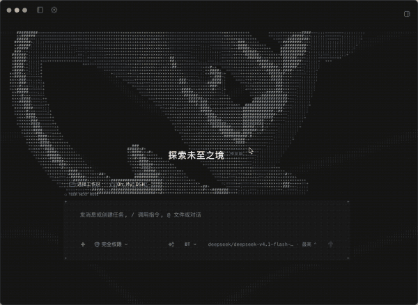
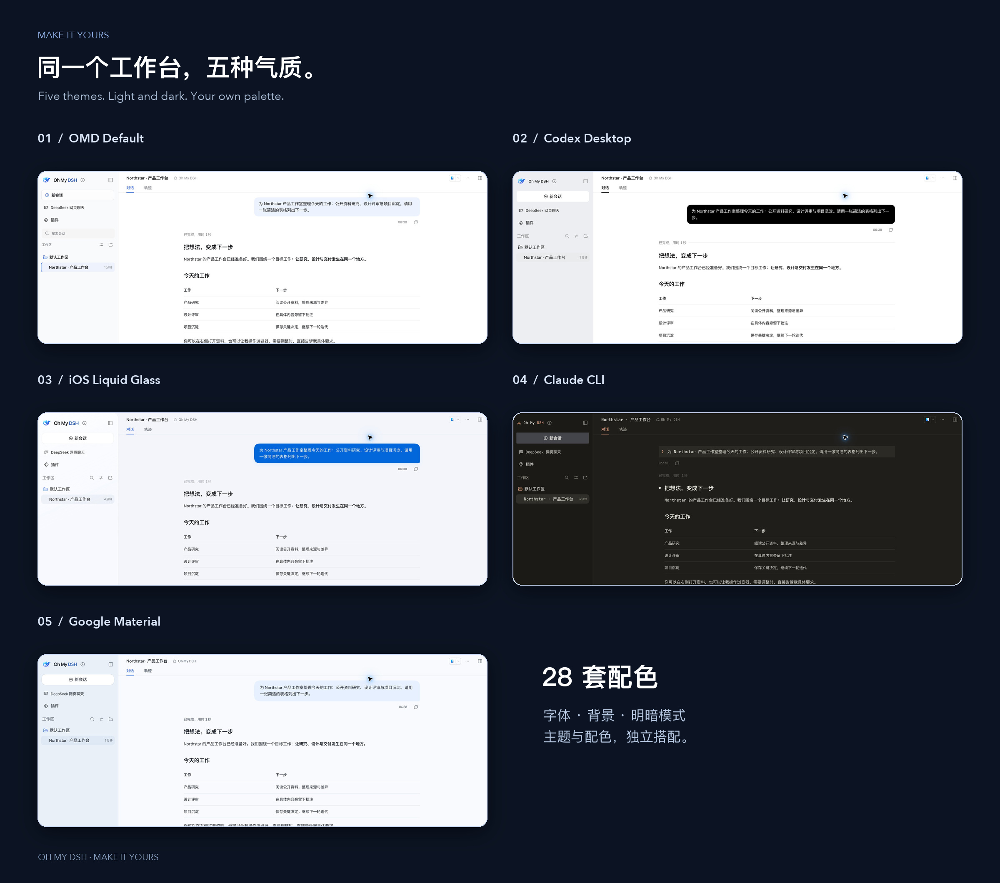

<a id="readme-top"></a>

<h1 align="center">Oh My DSH</h1>

<p align="center"><strong>更顺手的 DSH 工作台，更连贯的长任务。</strong><br>DeepSeek Harness 插件</p>

<p align="center"><strong>简体中文</strong> · <a href="README_EN.md">English</a></p>

<p align="center">
  <a href="docs/release-0.100.0.md"></a>
  <a href="https://github.com/gulagala001/oh-my-dsh/releases"></a>
  <a href="#readme-install"></a>
  <a href="https://github.com/gulagala001/oh-my-dsh/stargazers"></a>
</p>

<p align="center"><a href="#readme-install"><strong>开始使用</strong></a> · <a href="docs/README.md">完整文档</a> · <a href="https://github.com/gulagala001/oh-my-dsh/issues">反馈</a></p>

<p align="center"><a href="docs/images/omd-hero-zh.png"></a></p>

<p align="center"><a href="docs/images/glyph-animation.gif"></a></p>

<a id="quickstart"></a>
<a id="desktop"></a>
<a id="features"></a>
<a id="prompts"></a>
<a id="themes"></a>
<a id="computer-use"></a>
<a id="memory"></a>
<a id="tools"></a>
<a id="support"></a>
<a id="plugins"></a>
<a id="docs"></a>
<a id="readme-install"></a>

## 快速开始

**适用环境：** DSH **0.2.1-rc.2**, Node.js **22.19+**.

模型沿用 DSH 配置。默认安装配置包含完整文件／命令访问并关闭执行审批；已有 profile 的显式设置优先。OpenCU 已内置，完整内置浏览器与原生监看另需匹配的宿主适配及系统权限。

### 1. 安装


打开实际使用的 DSH 实例，在 **插件 → ＋ 添加插件** 中粘贴：

```text
https://github.com/gulagala001/oh-my-dsh/releases/download/v0.2.1-rc.2.omd.0.100.0/oh-my-dsh-0.2.1-rc.2.omd.0.100.0.tgz
```

等当前任务结束后，按宿主提示启用或完整重启该实例，沿用原 profile 与数据。其他宿主、升级和卸载见[安装指南](docs/install.md) · [SHA256SUMS](https://github.com/gulagala001/oh-my-dsh/releases/download/v0.2.1-rc.2.omd.0.100.0/SHA256SUMS).

### 2. 先试这一件事

新建会话，选择 **Oh My DSH**，使用已配置的模型，在一个可分享的项目中输入：

```text
读取这个项目的 README，说明用途与启动步骤；只引用实际读到的信息，不修改文件。
```

**成功标志：** 回复包含真实读取结果；右侧 OMD 控制台可查看上下文与调用记录。

## 组合工作台，也有独立插件

OMD 组合 **Workflow、Rewind、Persona、Extensions 和 DeepSeek Workbench**，配合 OpenCU，以及主题插件及其 Glyph 外观。你可以使用 OMD 组合好的完整工作台，也可以按需求选择已发布的独立产品。

工作流负责执行与续跑，Rewind 负责对话和文件恢复，Persona 管人格，Extensions 管技能与工具接入，Workbench 管网页聊天和迁移。匹配的独立与内置入口协调服务和界面归属；可选组件启动失败时保留基础对话。独立插件的数据、版本和宿主要求分别管理。

[插件架构、独立发行与共装说明](docs/architecture.md) · [升级与数据迁移](docs/upgrade.md)

## 从对话到交付

### 把工作过程放在同一处

会话总览集中展示产出、来源、后台进程、Workflow 和子智能体，点开成员即可继续侧栏对话。**Ultra** 提供 Workflow、Agent Team、自由三种协作方式；**Better Todo** 将原始需求、任务与验证结果关联，保留已完成检查和真实执行回执。

没有项目也能开始：首次发送时创建独立文件目录，后续对话继续复用。输入框的 **✨** 提供轻润色、结构化和步骤规划，可保存要求预设、比较版本、撤销或重做。

[日常使用](docs/usage.md) · [Ultra 与 Workflow](docs/workflow.md)

### 长对话保留背景，精简结果仍能回查

**上下文优化**默认开启：精简可识别的只读结果，对已有完整基线的重复读取提供引用或差异，保留工具真实执行与获准原文。工具卡片的**查看原文**支持行号、搜索、翻页和导出；原文档案可随会话迁移。

按需工具发现、文件与网页视图、AST 代码搜索和 CodeGraph 帮助定位材料。历史整理、Auto Compact 与 **Dream** 分别管理上下文和会话／项目／全局记忆；也可选用 Billion Context 管理压缩，Dream、回查、任务、侧问与分支继续协作。

[上下文优化与原文](docs/context-optimization.md) · [压缩与 BC](docs/context-workflow.md) · [Dream](docs/dream-memory.md)

### 让界面和表达方式适合自己

**Glyph 动态字符**用立体字符鲸鱼、局部波纹和字符控件组织工作空间。还可选择 DSH 原生、Codex Desktop、iOS Liquid Glass、Claude CLI、Google Material，搭配 **29 套配色**、背景、字体和分区颜色；已有外观选择继续保留。

**人格管理**分为身份与人格、语言风格、沟通方式、回答呈现四个模块，支持多个预设、复制修改、JSON 导入导出和 AI 创作提示词。启用会话人设后，可为不同主会话单独选择、继承全局或关闭人格。



[外观设置](docs/skins.md) · [人格与设置](docs/usage.md#人格预设与自定义身份)

### 用好浏览器、电脑和扩展

内置 **OpenCU 2.0.8**，提供浏览器与应用发现、观察、后台优先操作、批注和浮动监看。停止与取消跟踪真实键鼠释放；读取挂起、授权超时和目标替换都有明确的处理结果。完整内嵌界面需匹配宿主适配及系统权限。

**扩展管理**在插件页集中管理 Skill、MCP、指令文件、命令和 Hooks。可选 **dsh-ops** 提供文件、文档、命令与按需工具能力，在第三方功能中安装匹配宿主的固定兼容包。

[电脑与浏览器](docs/computer-use.md) · [扩展管理](docs/extensions.md) · [dsh-ops](docs/dsh-ops.md)

### 临时讨论与实际用量，各有入口

`/侧栏` 打开使用当前模型的临时文字聊天，关闭时停止并清空；`/侧栏（网页版）` 使用 DeepSeek 网页临时会话。普通网页聊天支持将可读取的历史和附件迁移到 DSH。`/btw` 可围绕主任务侧问，回合撤回支持恢复对话及已有检查点的文件改动。

**OMD 控制台**汇总上下文、记忆、调用日志和后台工作，可按日期、模型、组件和会话筛选费用与用量。未知用量保留未知，`≥` 表示已知下界；优化估算与提供方实际账单分别展示。

[临时聊天、侧问与撤回](docs/usage.md#侧问与回合回滚) · [DeepSeek Workbench](docs/deepseek-workbench.md) · [监控统计](docs/monitoring.md)

## 使用范围

| 场景 | 条件 |
| --- | --- |
| 对话、外观、任务和记忆 | 匹配版本的 DSH 与可用模型。 |
| 浏览器／电脑操作 | OpenCU 后端与系统权限；完整内嵌 UI 另需匹配宿主适配。 |
| 网页聊天与历史导入 | DeepSeek Workbench 对应桌面能力与官网登录；只迁移可读取的消息和附件。 |
| 其他 DSH 版本 | 仅使用对应独立构建；rc.1 与 rc.2 不能混装。 |

源码主干可能包含尚未进入固定 Release 的改进。公共下载地址不会随着 `main` 改动而更新；当前安装包、校验值与升级说明见[发行包说明](docs/releases.md)。

## 常见问题

<details>
<summary>安装后没看到 Oh My DSH 或新设置？</summary>

确认安装的是当前实例对应的 profile，完整重启后检查插件启用状态。新会话选择 Oh My DSH；已有会话保留原预设。[症状排障](docs/troubleshooting.md)

</details>

<details>
<summary>为什么装好插件后没有完整内置浏览器？</summary>

内嵌浏览器、原生监看与侧栏批注依赖匹配的宿主适配。固定 Release 提供相关源码材料，不是完整桌面安装器。[Computer Use 条件](docs/computer-use.md)

</details>

<details>
<summary>怎样升级或恢复？</summary>

先等待任务结束并备份，使用同一宿主对应的固定包，保留原数据目录和 profile。不要以清空数据或改版本门禁解决安装问题。[升级说明](docs/upgrade.md)

</details>

## 参与与来源

欢迎提交最小复现、文档修订与实际使用示例。[贡献说明](CONTRIBUTING.md) · [开发与构建](docs/development.md)

本仓库包含不同来源的代码与材料，不以统一 MIT 声明覆盖全部文件。请按具体文件和[第三方声明](THIRD_PARTY_NOTICES.md)确认许可。OMD 是社区项目，与界面中提及的产品品牌无官方隶属或背书关系。

## 文档与支持

| 我想做什么 | 去哪里 |
| --- | --- |
| 安装、升级、卸载 | [安装指南](docs/install.md) |
| 了解使用方法与边界 | [使用文档](docs/README.md) |
| 查看版本变化 | [Releases](https://github.com/gulagala001/oh-my-dsh/releases) |
| 反馈问题 | [Issues](https://github.com/gulagala001/oh-my-dsh/issues) |

反馈时请提供完整 DSH／插件版本、实际入口、最小复现步骤，以及预期和实际表现；日志与截图先移除私人数据。

<p align="center"><a href="#readme-top">返回顶部</a> · <a href="https://github.com/gulagala001/oh-my-dsh/releases">版本与下载</a> · <a href="https://github.com/gulagala001/oh-my-dsh/issues">反馈</a></p>

[文档结构与贡献](docs/documentation.md)

<!-- project-credits:start -->
## 项目、组件与致谢

[完整项目、来源与依赖清单](docs/components.md)

| 项目 | 用途 |
| --- | --- |
| [OpenCU](https://github.com/gulagala001/opencu) | 电脑与浏览器观察、操作、批注和预览 |
| [DSH Workflow](https://github.com/gulagala001/dsh-workflow) | 任务规划、执行、预算与恢复 |
| [DSH Rewind](https://github.com/gulagala001/dsh-undo-plugin) | 完整回合撤回与会话回退 |
| [DSH Persona](https://github.com/gulagala001/dsh-persona-plugin) | 人格导入、管理、全局和会话选择 |
| [DSH Extensions](https://github.com/gulagala001/dsh-extensions) | 管理技能、MCP、指令、命令与 Hooks |
| [DeepSeek Workbench](https://github.com/gulagala001/dsh-deepseek-workbench) | DeepSeek 网页工作台和历史导入 |
| [DSH BTW](https://github.com/gulagala001/dsh-btw) | 临时旁聊、历史、追问和独立停止 |
| [DSH Theme](https://github.com/gulagala001/dsh-theme-plugin) | 主题、配色、背景、字体和外观管理 |
| [Glyph](https://github.com/gulagala001/dsh-theme-plugin) | 动态字符界面与字符鲸鱼视觉 |
| [Billion Context](https://github.com/ranxianglei/billion-context) | 管理长会话的上下文压缩、原文恢复和缓存诊断；在 OMD 上下文页按会话切换。 |
| [dsh-ops](https://github.com/T-Auto/dsh-ops) | 增强文件、文档与命令操作，按需加载工具并复用结果；支持普通模式和 PTC，保留原生工具。 |
| [DSH Intelligent UI](https://github.com/gulagala001/dsh-intelligent-ui) | 在回答中使用交互图表、表单、计算器、模拟和小游戏。 |
| [Oh My Agents Above All](https://github.com/gulagala001/oh-my-agents-above-all) | 选用 Codex、Claude Code、Grok、Pi 与 ZCode 风格的智能体，沿用 DSH 会话和工具。 |
| [Subscription Login](https://github.com/V1ki/dsh-plugin-subscriptions) | 直接登录 ChatGPT、Claude、Grok、Copilot 或 Antigravity 订阅，自动发现模型；支持 ChatGPT Fast、订阅额度及生图。 |
| [OpenDesign](https://github.com/omegapaopao/dsh-open-design) | 使用 52 个设计技能、模板和设计系统，技能入口为 open-design。 |
| [Prompt Optimizer](https://github.com/WestFox-AwA/dsh-prompt-optimizer) | 发送前梳理本轮需求，保留原话，支持审查、自动模式和只读查证；启用后可在输入框选择模式。 |
| [DSH Market](https://github.com/dsh-market/dsh-market) | 在 DSH 内浏览、搜索和安装社区插件与主题，支持分类筛选、更新管理及配置备份。安装后在设置中打开插件市场。 |
| [Infinite Gen 4](https://github.com/Minglink/dsh-infinite-gen-4) | 用于提示词对抗研究和回复状态展示；启用后会向所有会话注入内容生成提示词。 |
| [Status Rotator](https://github.com/01Virex/dsh-status-rotator) | 把“深度求索中…”替换为轮换文案，支持打字机、彩色渐变、弹幕和主题词库，可在设置中编辑。 |
| [DSH × Blender](https://github.com/sixtysevenlf/dsh-blender-plugin) | 让模型直接操控 Blender：查看视口、编辑场景、渲染、批量任务与事务回滚。需要 Blender 及配套连接插件。 |
| [Balance Whale Widget](https://github.com/MeteorNOX/DeepSeek-Balance-Whale-Widget) | 在 DSH 界面显示 DeepSeek 余额、今日用量与每轮消耗，支持拖拽吸附、自定义角色和互动泡泡。 |
<!-- project-credits:end -->
