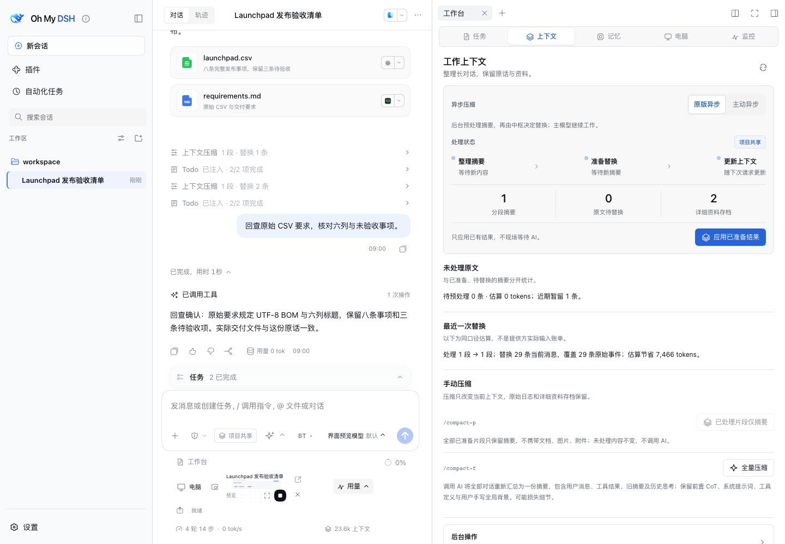
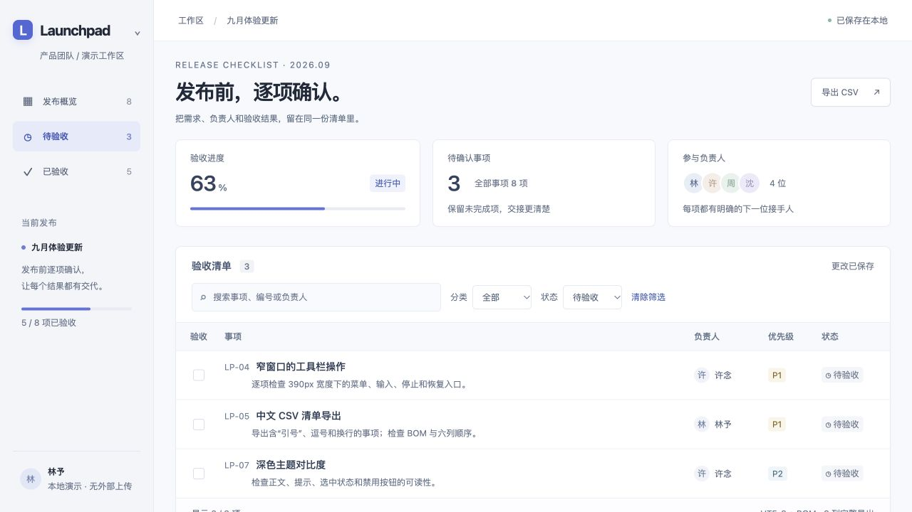
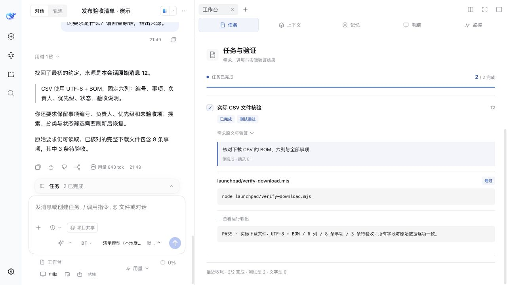
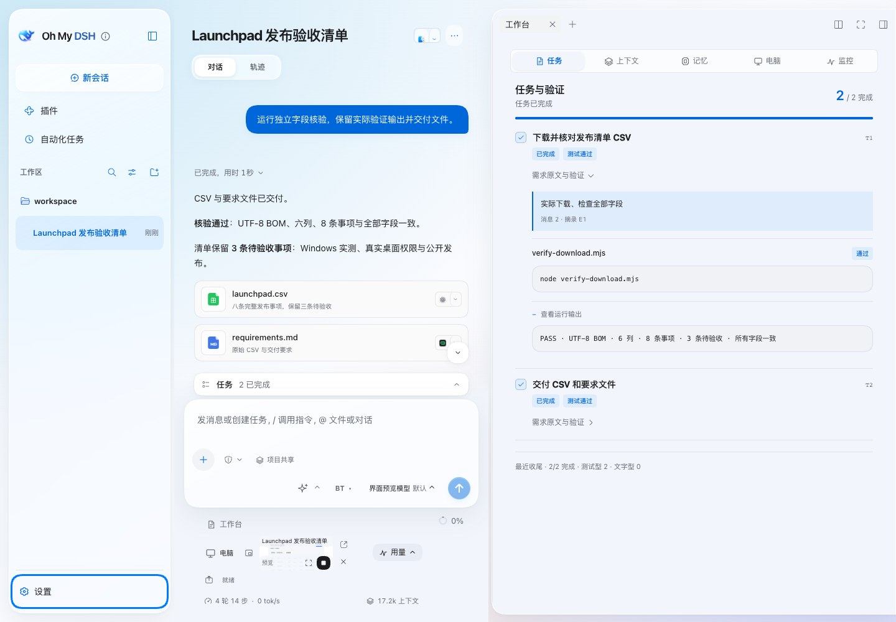

<p align="center"></p>
<h1 align="center">Oh My DSH</h1>
<p align="center"><strong>在熟悉的 DSH 里，把长任务、网页与电脑操作推进到可检查的交付。</strong></p>
<p align="center">
  <strong>简体中文</strong> · <a href="README_EN.md"><strong>English</strong></a> · <a href="#quickstart"><strong>安装 Oh My DSH</strong></a> · <a href="docs/getting-started.md"><strong>首次使用</strong></a>
</p>

[](docs/showcase.md)

<sub>最新本地实现实拍：虚构采购单、受控演示模型，OpenCU 工具与网页保存实际执行；商品配图由 AI 生成，界面未重绘。截图不是公开安装包的功能承诺。[版本与场景说明](docs/showcase.md)</sub>

Oh My DSH（OMD）是 [DeepSeek Harness（DSH）](https://github.com/deepseek-ai/deepseek-harness) 的增强插件。继续使用已有模型、会话、文件、工具和技能，同时获得长任务的上下文整理、任务与验证记录、电脑操作、草稿优化和可定制工作界面。

[功能](#features) · [安装](#quickstart) · [实际场景](#scenarios) · [开始使用](#start) · [外观与设置](#settings) · [插件生态](#plugins) · [更新与卸载](#maintenance) · [平台与 FAQ](#support) · [文档与开发](#docs)

<a id="features"></a>

## 用它完成什么

| 你的工作 | OMD 提供的帮助 |
| --- | --- |
| 一段对话做很久，还要记住最初要求 | 整理上下文，保留原话、附件与详细资料，需要精确细节时回查来源。 |
| 查网页、操作应用、导出资料 | 内置 OpenCU，把目标画面放进对话工作台；可以停止、人工接手，再恢复助手控制。 |
| “做完了”还不够，要检查结果 | 任务账本关联要求、状态与验证记录，生成文件直接在 DSH 中预览或打开。 |
| 想法零散，发出去之前想理清楚 | 轻润色、结构化或规划草稿，保留原稿和版本，可撤销并继续修改。 |
| 不想每次聊天都先建项目 | **主分支预览，尚未发布**：取消已选工作区，首次发送时创建这段聊天自己的目录；以后继续使用同一目录。 |
| 想按习惯布置工作界面 | 五种外观、明暗模式、独立配色与背景，调整字体、布局和工作台。 |
| 想看运行进度、用量与长期记忆 | **主分支预览，尚未发布**：监控查看调用、缓存与上下文；Dream 整理带来源的会话、项目与全局短记忆。 |

模型能力、上下文窗口和服务费用仍由所选提供方决定；后台整理也会产生模型用量。详细边界见[使用指南](docs/usage.md)。

<a id="quickstart"></a>

## 安装

**先核对实际运行的完整 DSH 版本，再选择相同宿主前缀的包。** 当前公开可下载的安装包如下：

| DSH 宿主 | OMD 完整版本 | 固定安装包 |
| --- | --- | --- |
| `0.2.0-rc.2` | `0.2.0-rc.2.omd.0.10.0` | [下载 rc.2 包](https://github.com/gulagala001/oh-my-dsh/releases/download/v0.2.0-rc.2.omd.0.10.0/trisoul_x-0.2.0-rc.2.omd.0.10.0.tgz) |
| `0.2.1-alpha.1` | `0.2.1-alpha.1.omd.0.10.0` | [下载 alpha.1 包](https://github.com/gulagala001/oh-my-dsh/releases/download/v0.2.1-alpha.1.omd.0.10.0/trisoul_x-0.2.1-alpha.1.omd.0.10.0.tgz) |

`main` 的包版本是 **0.2.1-alpha.2.omd.0.16.0，未发布**；它没有对应的公开安装包。上面的 0.10.0 不包含后续监控、Dream 与本地改进。更早宿主保留其历史发行，按[安装与升级指南](docs/upgrade.md)核对，不混装其他宿主的包。

### 已有 DSH Web

需要 Node.js ≥22.19、可用的 DSH 模型，以及公开包对应的运行环境；Windows 使用 PowerShell 7。先等任务结束、停止服务，备份实际 `DSH_HOME`，保留原 profile 和端口。

以下示例用于 **DSH 0.2.1-alpha.1 / `web` profile**：

```sh
npx --yes @deepseek-ai/dsh@0.2.1-alpha.1 plugin --profile web add https://github.com/gulagala001/oh-my-dsh/releases/download/v0.2.1-alpha.1.omd.0.10.0/trisoul_x-0.2.1-alpha.1.omd.0.10.0.tgz
npx --yes @deepseek-ai/dsh@0.2.1-alpha.1 --profile web
```

rc.2 用户将**两条命令的宿主版本**换为 `0.2.0-rc.2`，安装地址换为表中的 rc.2 包；自定义 profile 将 `web` 换为原名称。已使用全局 `dsh` 或服务管理器的环境沿用原启动方式和实际数据目录。也可先下载，再用 `file:/absolute/path/安装包.tgz` 安装。

打开本次启动打印的登录链接，新建会话选择 **Oh My DSH**。已有会话保留原来的 Agent preset。安装后核对“当前版本”，不能只看“最新版本”。[完整步骤](docs/usage.md) · [安装与升级](docs/upgrade.md)

### 官方 DSH 桌面应用

在桌面应用的插件管理入口安装与它的**完整宿主版本**配对的包。桌面使用独立的 `desktop` profile，Web 已装插件需在桌面重新安装；独立 npm CLI 不能代替桌面应用管理该 profile。安装后完整退出并重新打开，关闭窗口或刷新页面不能完成切换。[桌面安装步骤](docs/upgrade.md#desktop) · [Web 转桌面并保留数据](docs/upgrade.md#web-to-desktop)

> **安装会改变运行权限：** OMD 默认设置完整文件／命令访问并关闭执行审批，同时将默认 Agent preset 设为 `trisoul-x`。profile 的显式覆盖优先。安装前确认这符合你的使用方式；macOS 系统授权与 Chrome 扩展首次加载仍需按提示完成。[权限与运行条件](docs/usage.md)

<details>
<summary>让能操作终端或电脑的 AI 协助安装</summary>

把这段话交给 AI，并说明你使用桌面还是 Web：

> 请按 https://github.com/gulagala001/oh-my-dsh/blob/main/docs/upgrade.md 安装或升级 Oh My DSH。先核对实际 DSH 完整版本与对应公开安装包，备份并保留已有模型、会话、数据目录和配置，完成安装与完整重启后核对当前版本。

</details>

<a id="scenarios"></a>

## 实际场景

下面三个场景来自同一份发布清单演示。它使用虚构业务数据与本地受控模型，展示的是实际执行和检查的流程。完整问题、操作与验证范围见[实拍案例](docs/showcase.md)。

### 长对话之后，找回最初的要求

> 整理发布清单。CSV 使用 UTF-8 + BOM，固定六列：编号、事项、负责人、优先级、状态、验收说明；保留未验收项。

持续工作并整理上下文后，让助手回查这条原始要求；在工作台查看来源与原文，确认编码、列序和未验收项要求。

[](docs/site/media/launchpad-recall.jpg)

**结果：** 精简当前上下文后，仍能读取原话并核对具体约定。原始材料留档不代表模型窗口无限大。[上下文记录](docs/site/media/launchpad-context.jpg) · [上下文机制](docs/context-workflow.md)

### 操作网页，保留该留下的事项

> 打开发布清单，检查筛选和刷新后的状态，下载 CSV；不要把待验收项当作已完成。

用 `@Browser` 指定网页，在工作台查看实际画面，执行筛选、刷新与下载。需要自己修改时停止或接手，完成后恢复助手控制。

[](docs/site/media/launchpad-browser.jpg)

**结果：** 导出包含 8 条事项，3 条待验收项得到保留；下载文件随后接受独立字段检查。[电脑操作指南](docs/usage.md#computer-use)

### 交付文件，同时留下检查记录

> 核对下载文件的编码、六列和全部字段，把文件与验收结果交给我。

在任务与验证中关联原始要求和实际运行结果，检查 CSV 的 BOM、列序、记录数与字段内容，再打开交付附件。

[](docs/site/media/launchpad-tasks.jpg)

**结果：** 文件检查通过，交付 CSV 和要求文件。业务清单的初始勾选是示例数据；任务完成状态与运行证据分别记录。[完整演示与证据说明](docs/showcase.md)

<a id="start"></a>

## 开始使用

1. **选模型与会话。** 新建会话选择 Oh My DSH，沿用宿主模型配置；模型需支持原生工具调用，理解截图还需图像输入。
2. **选工作目录。** 在已有项目中工作；主分支预览还可取消工作区选择开始独立聊天，首次发送时才创建独立目录。
3. **说清要交付什么。** 例如“整理这个目录，输出一份清单并检查文件数量”。输入框的草稿优化可先整理表达。
4. **边做边查看。** 从输入区打开工作台查看任务、上下文或文件；通过电脑入口查看目标画面，随时停止与接手。
5. **检查交付。** 打开附件和验证记录，需要追溯细节时让助手回查原始材料。

公开版本与开发源码的入口可能不同，以所装版本文档为准。[首次使用](docs/getting-started.md) · [完整指南](docs/usage.md)

<a id="settings"></a>

## 外观与设置

在 **设置 → Oh My DSH** 调整后台模型、上下文整理、身份、外观与电脑操作。主模型仍在 DSH 模型设置中配置；后台整理可单独选择模型与频率。Better Todo 的待办提醒默认开启，验证提醒默认关闭，可按会话设置。

[](docs/site/media/theme-glass-light.jpg)

| 外观 | 浅色与深色实拍 |
| --- | --- |
| OMD 默认 | [浅色](docs/site/media/theme-omd-light.jpg) · [深色](docs/site/media/theme-omd-dark.jpg) |
| Codex Desktop | [浅色](docs/site/media/theme-codex-light.jpg) · [深色](docs/site/media/theme-codex-dark.jpg) |
| iOS Liquid Glass | [浅色](docs/site/media/theme-glass-light.jpg) · [深色](docs/site/media/theme-glass-dark.jpg) |
| Claude CLI | [浅色](docs/site/media/theme-terminal-light.jpg) · [深色](docs/site/media/theme-terminal-dark.jpg) |
| Google Material | [浅色](docs/site/media/theme-material-light.jpg) · [深色](docs/site/media/theme-material-dark.jpg) |

主题、28 套配色与背景独立选择，也可调整字体、字号、材质、分区颜色、名称和 Logo，导入设置或恢复默认。主题提供视觉风格，不提供对应品牌的账号服务。[外观设置](docs/skins.md) · [设置实拍](docs/site/media/launchpad-appearance.jpg)

<details>
<summary>进阶功能与尚未发布的改进</summary>

<a id="prompts"></a>

系统提示词按 DSH 实际工具、权限和执行模式组织工作，不声明宿主没有的能力。[提示词适配](docs/prompt-adaptation.md)

- **Pro / Ultracode**：在模型原生推理档之上选择工作模式，调整需求拆解、实现与核对方式。[工作流](docs/workflow.md)
- **OMD-PTC / CodeGraph**：按需使用组合工具调用或查询代码关系。[使用指南](docs/usage.md)
- **主分支预览，未发布**：监控查看调用、用量与上下文变化；Dream 增量整理会话、项目和全局短记忆，保留来源，自动整理默认关闭。[监控](docs/monitoring.md) · [Dream](docs/dream-memory.md)
- **最新本地实现，尚未发布**：OpenCU 的浏览器重构使用官方预编译 Electron 44.7.0，统一浏览器入口和标签栏，保留分栏与侧栏。GitHub main 已整合 OpenCU 1.6.1 的浏览器与运行时重构；源码整合不代表发布了新的安装包。公开安装包不包含这些新改动，其他平台也不能据此视为已验证。

</details>

<a id="plugins"></a>

## DSH 与插件生态

OMD 复用 DSH 原生模型、会话、工具循环、技能、文件与内容标签。你可以继续使用其他 DSH 插件；需要随宿主 SDK 更新的插件，应安装各自对应宿主的构建。

**设置 → 推荐插件** 展示用途、作者、版本与核验状态，支持可用条目的安装、更新和卸载。自动更新默认关闭；启用后只检查符合目录规则的已安装插件，需要重启时提示。[目录实拍](docs/site/media/launchpad-plugins.jpg)

兼容性持续核验安装顺序、启停、重启和卸载，目标是让原版 DSH 可用的插件在整套 OMD 启用时继续共存。**这不是所有插件、宿主和平台均已验证的保证**；具体组合、限制与未验证项见[插件兼容性](docs/plugin-compatibility.md)。

推荐自己的插件或开源项目，只需仓库地址和一句用途：[提交插件／申请适配](https://github.com/gulagala001/oh-my-dsh/issues/new?template=plugin-submission.yml) · [投稿说明](docs/plugin-submissions.md)

<a id="maintenance"></a>

## 数据、更新与卸载

安装到现有 DSH 时沿用实际 `DSH_HOME`，OMD 资料保存在其中的 `trisoul-x/`；Web 默认数据目录通常是 `~/.dsh`。桌面与 Web 的插件属于各自 profile，只有使用同一实际数据目录时才共享其中的产品数据。

更新前等任务结束、停止服务或完整退出桌面应用，备份整个数据目录；安装与宿主匹配的固定包，完整重启后核对当前版本、模型与旧会话。源码更新与公开包更新是不同流程。[升级、迁移与回退](docs/upgrade.md)

<details>
<summary>卸载命令与数据保留</summary>

Web 示例（按实际宿主版本和 profile 修改）：

```sh
npx --yes @deepseek-ai/dsh@0.2.1-alpha.1 plugin --profile web remove trisoul_x
```

桌面用户在应用的插件管理中停用或卸载，随后完整退出并重新打开。卸载不删除模型配置、凭据、会话和 OMD 记忆文件；使用 `trisoul-x` preset 的旧会话需要重新安装插件才能继续运行。[维护说明](docs/usage.md)

</details>

<a id="support"></a>

## 平台与常见问题

| 你要使用的能力 | 条件与当前边界 |
| --- | --- |
| 对话、上下文、任务、主题与 Web 工作台 | 基于 DSH；Windows、macOS、Linux 的实际验证范围以对应发行记录为准。 |
| 浏览器操作与日常 Chrome 连接 | 需要可用 Chrome／Chromium；已有 Chrome 首次连接需手动加载扩展。 |
| 公开 0.10.0 的 macOS 原生桌面控制 | macOS 14+、Apple Command Line Tools、辅助功能和屏幕录制权限。 |
| 公开 0.10.0 的 Windows 原生桌面控制 | Windows 10 2004+、PowerShell 7、.NET 10 SDK、解锁的交互桌面；本轮未做 Windows 实机验收。 |
| 最新本地预编译运行时 | 尚未公开发布，不能用来免除旧公开包的原生构建前提；Linux 原生桌面控制不列为已支持能力。 |

<details>
<summary>安装、模型、权限与版本 FAQ</summary>

**装了插件却没有入口？** 核对当前 profile、插件启用状态和实际版本，完成服务或桌面应用的完整重启；新建会话选择 Oh My DSH。

**为什么没有 alpha.2 的下载链接？** 主分支版本 0.16.0 尚未发布。公开安装请使用表中对应宿主的 0.10.0，等待新的配对发行。

**电脑画面模型看不懂？** 模型需要图像输入；仅文本模型仍能读取部分控件文字，但不能自动获得识图能力。

**桌面操作失败？** 检查原生运行环境和系统授权；公开旧包需要本机编译前提。已有 Chrome 连接还需核对扩展是否实际加载。[完整排障](docs/troubleshooting.md)

**已有模型和会话会丢吗？** 插件安装沿用宿主数据；升级仍需完整备份。Web 转桌面不是自动搬迁，先按迁移指南核对数据目录和配置。

**能保证其他插件都兼容吗？** 不能。按完整宿主、插件版本和平台查看已验证组合，遇到冲突提交这些版本及最小复现。[兼容性说明](docs/plugin-compatibility.md)

</details>

<a id="docs"></a>

## 文档与开发

[文档目录](docs/README.md) · [首次使用](docs/getting-started.md) · [完整指南](docs/usage.md) · [安装与升级](docs/upgrade.md) · [实拍案例](docs/showcase.md) · [兼容性](docs/plugin-compatibility.md) · [更新记录](CHANGELOG.md)

<details>
<summary>源码开发入口</summary>

当前主分支使用 DSH `0.2.1-alpha.2`、Node.js ≥22.19 和 `pnpm 11.28.5`，不是公开稳定安装入口。

```sh
git clone https://github.com/gulagala001/oh-my-dsh.git
cd oh-my-dsh
pnpm install --frozen-lockfile
pnpm build
pnpm start
```

开发启动默认使用仓库的 `data/dsh/`、独立 `trisoul-x` profile 和 `3083` 端口，打开终端打印的完整登录链接。使用自己的模型凭据。固定 tag 的构建条件以该 tag 文档为准；通用 Computer Use 在 [OpenCU](https://github.com/gulagala001/opencu) 源仓维护。[参与贡献](CONTRIBUTING.md) · [开发指南](docs/usage.md)

</details>

[反馈 Bug](https://github.com/gulagala001/oh-my-dsh/issues/new?template=bug-report.yml) · [提出建议](https://github.com/gulagala001/oh-my-dsh/issues/new?template=feature-request.yml) · [产品介绍](https://gulagala001.github.io/oh-my-dsh/)

反馈时提供完整 DSH／OMD 版本、平台、使用入口、预期与实际行为，并移除私人数据与凭据。项目代码许可暂未指定；原项目与第三方来源、许可见 [THIRD_PARTY_NOTICES.md](THIRD_PARTY_NOTICES.md)。包名 `trisoul_x` 与 preset ID `trisoul-x` 为兼容旧安装保留。
