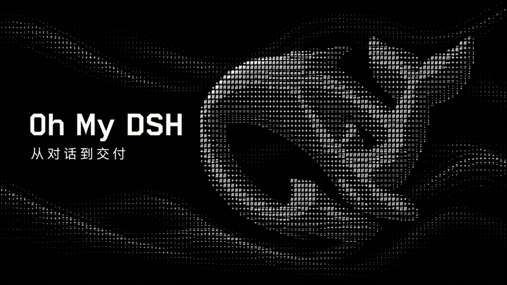
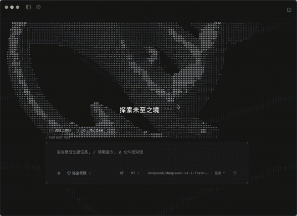
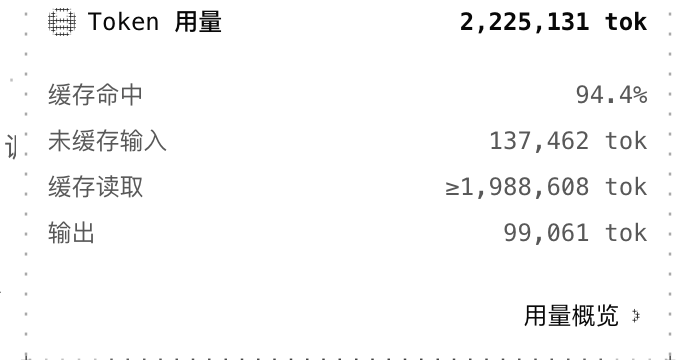
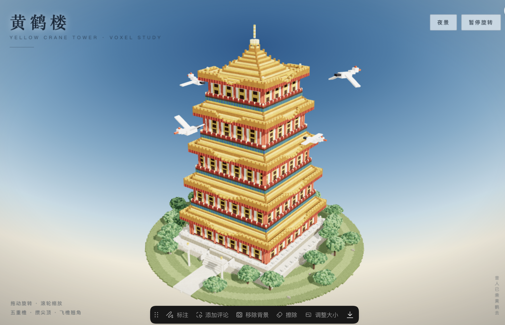
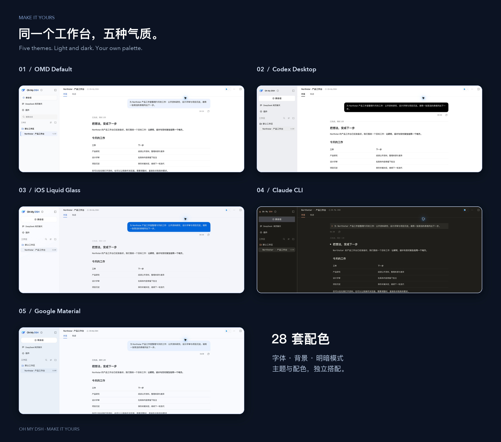

<a id="readme-top"></a>

<h1 align="center">Oh My DSH</h1>

<p align="center"><strong>更顺手的 DSH 工作台，更连贯的长任务。</strong><br>DeepSeek Harness 插件</p>

<p align="center"><strong>简体中文</strong> · <a href="README_EN.md">English</a></p>

<p align="center">
  <a href="https://github.com/gulagala001/oh-my-dsh/releases/tag/v0.2.2-rc.2.omd.1.3.16"></a>
  <a href="https://github.com/gulagala001/oh-my-dsh/releases"></a>
  <a href="#readme-install"></a>
  <a href="https://github.com/gulagala001/oh-my-dsh/stargazers"></a>
</p>

<p align="center"><a href="#readme-install"><strong>开始使用</strong></a> · <a href="docs/README.md">完整文档</a> · <a href="https://github.com/gulagala001/oh-my-dsh/issues">反馈</a></p>

<p align="center"><a href="https://raw.githubusercontent.com/gulagala001/oh-my-dsh/main/docs/images/omd-hero-zh.png"></a></p>

<p align="center"><a href="https://raw.githubusercontent.com/gulagala001/oh-my-dsh/main/docs/images/glyph-animation.gif"></a></p>

<a id="quickstart"></a>
<a id="desktop"></a>
<a id="support"></a>
<a id="readme-install"></a>

## 快速开始

**需要：** DSH **0.2.2-rc.2**，Node.js **24.9.0+**。模型用你在 DSH 里配好的。

### 1. 安装

在 DSH 里打开 **插件 → ＋ 添加插件**，粘贴：

```text
https://github.com/gulagala001/oh-my-dsh/releases/download/v0.2.2-rc.2.omd.1.3.16/oh-my-dsh-0.2.2-rc.2.omd.1.3.16.tgz
```

等手头的任务跑完，按提示启用或重启 DSH，原来的设置和会话都还在。旧版 DSH、升级和卸载见[安装指南](docs/install.md)，校验文件：[SHA256SUMS](https://github.com/gulagala001/oh-my-dsh/releases/download/v0.2.2-rc.2.omd.1.3.16/SHA256SUMS)。

> OMD 默认让 AI 直接读写文件、运行命令，不逐条询问。你在 profile 里设过的权限优先生效。

### 2. 先试一件事

新建会话，预设选 **Oh My DSH**，在一个项目目录里输入：

```text
读一下这个项目的 README，告诉我它是做什么的、怎么启动。只根据读到的内容回答，不要改文件。
```

回答应该引用 README 里的原话。打开右侧的 **OMD 控制台**，能看到这次用了多少上下文、调了哪些工具。

<a id="features"></a>

## 能做什么

<a id="memory"></a>

### 省上下文，也记得住

- **上下文优化**（默认开启）：工具结果里的重复内容会被精简，同一个文件第二次读取时只发变化的部分，上下文和 Token 都更省。需要细节时，点工具卡片上的 **查看原文**，按行号或关键词翻原始结果。
- **自动压缩**：上下文快满时整理历史，你的原话和任务清单原样保留。也可以改用 Billion Context 负责压缩，其他功能照常工作。
- **Dream 记忆**：开启后在后台把对话整理成短记忆，分会话、项目、全局三级，新会话可以接着用。
- 找代码用 AST 搜索和 CodeGraph，读网页只取正文，少走弯路。

[上下文优化](docs/context-optimization.md) · [压缩与原文回查](docs/context-workflow.md) · [Dream](docs/dream-memory.md)

### 过程看得见

- **会话总览**：产出的文件、参考的来源、后台进程、Workflow 和子智能体都在一处，点开任一成员就能接着和它对话。
- **Ultra**：复杂任务可以选 Workflow、Agent Team 或自由协作。
- **Better Todo**：把你的原话、拆出来的任务和验证结果连在一起，做到哪一步一眼就清楚。
- **OMD 控制台**：按日期、模型、组件、会话查看 Token 和费用。服务商没报用量的记为"未知"，不会算成 0。

[日常使用](docs/usage.md) · [Ultra 与 Workflow](docs/workflow.md) · [监控统计](docs/monitoring.md)

### 不用先建项目

新聊天会自动配一个独立文件夹，之后一直用它；改聊天标题不会挪动文件。输入框里的 **✨** 能把你写的话润色、理成结构或拆成步骤，不满意可以撤销。

### 做错了能退回

- 你发的每条消息旁边都有撤回按钮，对话和这之后 AI 改过的文件一起退回。退多了就点 **撤销撤回**。
- `/btw` 问个题外话，主任务继续跑；`/侧栏` 开一个临时聊天，关掉就清空。

[侧问与撤回](docs/usage.md#侧问与回合回滚)

<a id="computer-use"></a>

### 操作浏览器和电脑

内置 OpenCU：AI 可以读网页、填表、点按钮，也能操作桌面应用。默认在后台进行，不抢你的窗口；你可以在页面上圈出位置，告诉它改哪里。DSH 桌面版里还能直接看到内嵌的浏览器画面。

[电脑与浏览器](docs/computer-use.md)

<a id="themes"></a>
<a id="prompts"></a>

### 换外观，也换说话方式

- **外观**：Glyph 动态字符、DSH 原生、Codex Desktop、iOS Liquid Glass、Claude Desktop、Claude CLI、Google Material 七套，另有 30 套配色，背景和字体也能换。
- **人格**：按身份、语言风格、沟通方式、回答呈现四部分来写，可以导入导出 JSON，每个会话单独选。内置两套：
  - **精算**：少说废话、省 Token，直接给结果。作者实测效率提升 50%。
  - **超频**：多想一步，回答更完整，适合需要反复推敲的问题。

<p align="center">
  <a href="https://raw.githubusercontent.com/gulagala001/oh-my-dsh/main/docs/images/economical-token-usage.png"></a>
  <a href="https://raw.githubusercontent.com/gulagala001/oh-my-dsh/main/docs/images/economical-yellow-crane-tower.png"></a>
</p>

<p align="center">用精算人格做黄鹤楼体素场景：用量统计和成品</p>



[外观设置](docs/skins.md) · [人格设置](docs/usage.md#人格预设与自定义身份)

<a id="tools"></a>
<a id="plugins"></a>

### 扩展

- **扩展管理**：在插件页统一管理 Skill、MCP、指令文件、命令和 Hooks，不用手改配置文件。
- **DeepSeek 网页聊天**：在 DSH 里用 DeepSeek 官网聊天，聊到一半可以转成 DSH 会话继续。
- **dsh-ops**（第三方，可选）：更强的文件、文档和命令工具，在设置的第三方功能里安装。

OMD 里的 Workflow、Rewind、Persona、Extensions、DeepSeek Workbench、OpenCU 和主题管理也都能单独安装，见下方项目表。[插件结构与共装](docs/architecture.md)

<a id="docs"></a>

## 使用范围

| 功能 | 需要 |
| --- | --- |
| 对话、外观、任务、记忆 | DSH 0.2.2-rc.2 和一个可用的模型 |
| 浏览器和电脑操作 | 系统权限；内嵌浏览器画面需要配套的 DSH 桌面版 |
| DeepSeek 网页聊天和历史导入 | DSH 桌面版，并登录 DeepSeek 官网账号 |
| 旧版 DSH | 对应的旧版安装包，见[安装指南](docs/install.md) |

`main` 分支可能领先于正式版。安装请用上面的发布包。

## 常见问题

<details>
<summary>装好后找不到 Oh My DSH？</summary>

确认装进了你正在用的那个 DSH（桌面版和网页版用的是不同的 profile），完整重启后在插件页看它是否已启用。然后新建会话，在预设里选 Oh My DSH；已有的会话保持原来的预设。[排障](docs/troubleshooting.md)

</details>

<details>
<summary>为什么没有内嵌浏览器？</summary>

内嵌浏览器、悬浮预览和侧栏批注需要配套的 DSH 桌面版。只装插件时，AI 仍然可以通过 Chrome／Edge 扩展或独立浏览器操作网页。[电脑与浏览器](docs/computer-use.md)

</details>

<details>
<summary>怎么升级？</summary>

等任务跑完，先备份 DSH 数据目录，再用新版安装包覆盖安装。遇到安装问题不要清空数据，先看[升级说明](docs/upgrade.md)。

</details>

## 参与和许可

欢迎提交复现步骤、文档修正和使用案例：[贡献说明](CONTRIBUTING.md) · [开发与构建](docs/development.md)。反馈问题时请写明 DSH 和插件版本、操作步骤、期望和实际结果，日志和截图先去掉个人信息。

OMD 自己的代码用 [MIT 许可证](LICENSE)，第三方代码和素材沿用各自的许可，见[第三方声明](THIRD_PARTY_NOTICES.md)。OMD 是社区项目，与界面里出现的其他产品品牌没有官方关系。

<p align="center"><a href="#readme-top">返回顶部</a> · <a href="https://github.com/gulagala001/oh-my-dsh/releases">版本与下载</a> · <a href="https://github.com/gulagala001/oh-my-dsh/issues">反馈</a></p>

<!-- project-credits:start -->
## 项目、组件与致谢

[完整项目、来源与依赖清单](docs/components.md)

| 项目 | 用途 |
| --- | --- |
| [OpenCU](https://github.com/gulagala001/opencu) | 电脑与浏览器观察、操作、批注和预览 |
| [DSH Workflow](https://github.com/gulagala001/dsh-workflow) | 任务规划、执行、预算与恢复 |
| [DSH Rewind](https://github.com/gulagala001/dsh-undo-plugin) | 完整回合撤回与会话回退 |
| [DSH Persona](https://github.com/gulagala001/dsh-persona-plugin) | 人格导入、管理、全局和会话选择 |
| [DSH Extensions](https://github.com/gulagala001/dsh-extensions) | 管理技能、MCP、指令、命令与 Hooks |
| [DeepSeek Workbench](https://github.com/gulagala001/dsh-deepseek-workbench) | DeepSeek 网页工作台和历史导入 |
| [DSH BTW](https://github.com/gulagala001/dsh-btw) | 临时旁聊、历史、追问和独立停止 |
| [DSH Theme](https://github.com/gulagala001/dsh-theme-plugin) | 主题、配色、背景、字体和外观管理 |
| [Glyph](https://github.com/gulagala001/dsh-theme-plugin) | 动态字符界面与字符鲸鱼视觉 |
| [DSH Response ID Reuse](https://github.com/gulagala001/dsh-response-id-reuse) | Responses 响应 ID 自动续传与完整请求回退 |
| [Billion Context](https://github.com/ranxianglei/billion-context) | 管理长会话的上下文压缩、原文恢复和缓存诊断；在 OMD 上下文页按会话切换。 |
| [dsh-ops](https://github.com/T-Auto/dsh-ops) | 增强文件、文档与命令操作，按需加载工具并复用结果；支持普通模式和 PTC，保留原生工具。 |
| [DSH Intelligent UI](https://github.com/gulagala001/dsh-intelligent-ui) | 在回答中使用交互图表、表单、计算器、模拟和小游戏。 |
| [Oh My Agents Above All](https://github.com/gulagala001/oh-my-agents-above-all) | 在「设置 → OMAA」选择 Codex、Grok Build、Cursor、Pi Coding Agent 或 ZCode 预设，沿用 DSH 会话和工具。 |
| [Subscription Login](https://github.com/V1ki/dsh-plugin-subscriptions) | 登录 ChatGPT、Claude、Grok、Copilot 或 Antigravity 订阅，自动发现模型；支持 ChatGPT Fast、订阅额度及生图。 |
| [OpenDesign](https://github.com/omegapaopao/dsh-open-design) | 使用 52 个设计技能、模板和设计系统，技能入口为 open-design。 |
| [Prompt Optimizer](https://github.com/WestFox-AwA/dsh-prompt-optimizer) | 发送前梳理本轮需求，保留原话，支持审查、自动模式和只读查证；启用后可在输入框选择模式。 |
| [DSH Market](https://github.com/dsh-market/dsh-market) | 在 DSH 内浏览、搜索和安装社区插件与主题，支持分类筛选、更新管理及配置备份。安装后在设置中打开插件市场。 |
| [Infinite Gen 4](https://github.com/Minglink/dsh-infinite-gen-4) | 用于提示词对抗研究和回复状态展示；启用后会向所有会话注入内容生成提示词。 |
| [Status Rotator](https://github.com/01Virex/dsh-status-rotator) | 把“深度求索中…”替换为轮换文案，支持打字机、彩色渐变、弹幕和主题词库，可在设置中编辑。 |
| [DSH × Blender](https://github.com/sixtysevenlf/dsh-blender-plugin) | 让模型直接操控 Blender：查看视口、编辑场景、渲染、批量任务与事务回滚。需要 Blender 及配套连接插件。 |
| [Balance Whale Widget](https://github.com/MeteorNOX/DeepSeek-Balance-Whale-Widget) | 在 DSH 界面显示 DeepSeek 余额、今日用量与每轮消耗，支持拖拽吸附、自定义角色和互动泡泡。 |
<!-- project-credits:end -->
