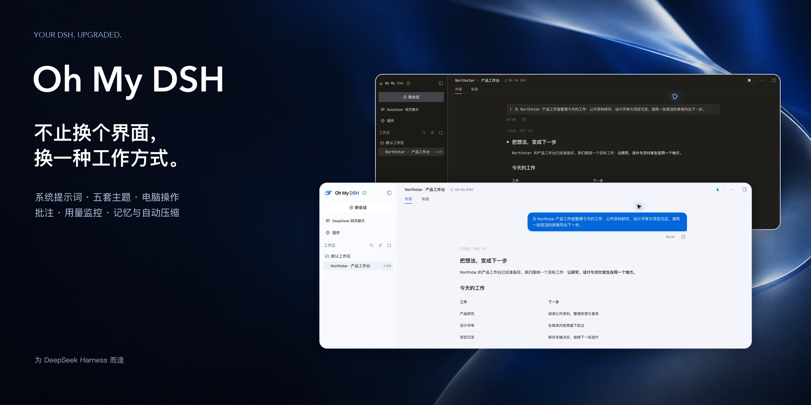
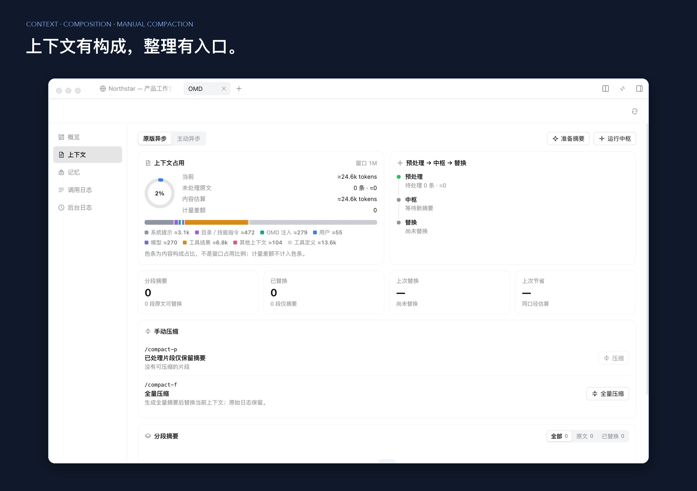
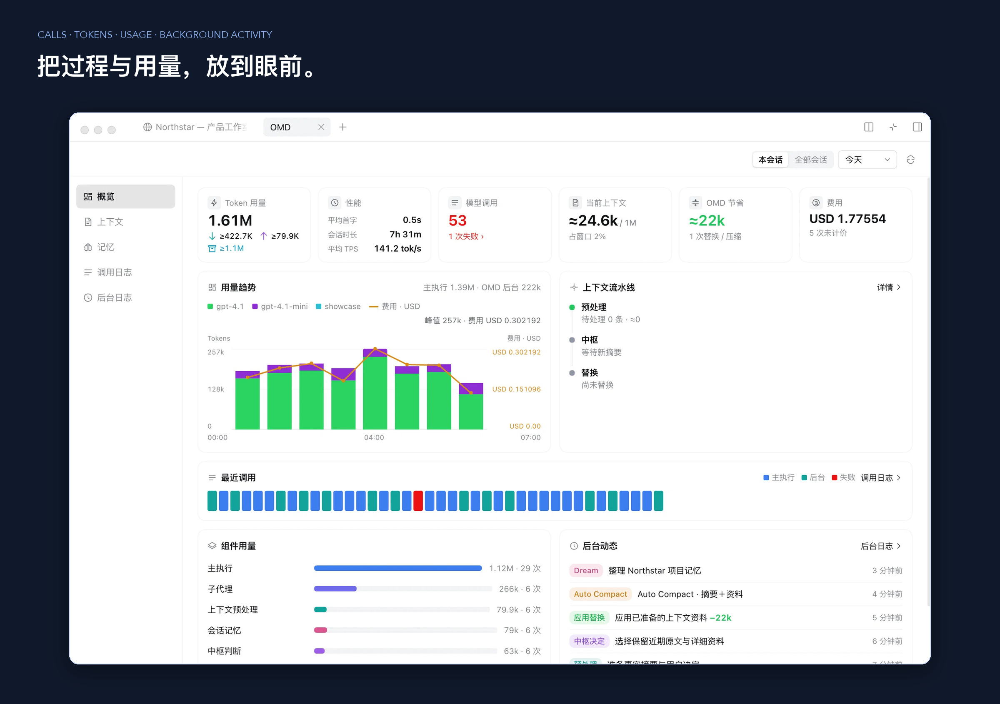

<h1 align="center">Oh My DSH</h1>

<strong>更懂任务的提示词，更顺手的界面，更连贯的长任务。</strong>

系统提示词增强 · 五套主题 · 电脑操作 · 侧栏批注 · 用量监控 · 记忆与自动压缩

<strong>简体中文</strong> · <a href="README_EN.md">English</a> · <a href="#quickstart">安装</a> · <a href="docs/getting-started.md">第一次使用</a> · <a href="docs/README.md">完整文档</a>

**把你已经在用的 DSH，变成更完整的 AI 工作台。**

Oh My DSH（OMD）是 [DeepSeek Harness](https://github.com/deepseek-ai/deepseek-harness) 的增强插件。它不要求你抛弃已有模型、会话、工具和技能，而是把系统提示词、界面、电脑操作、上下文、记忆和任务管理接在一起：从说清要求，到实际执行，再到检查结果，尽量少在不同入口之间来回切换。

> **安装 / Install:** [DSH rc.1 / rc.2 固定版本与安装入口](docs/releases.md)，内置 OpenCU 2.0.0。

## 一个插件，把日常工作的几块短板补齐

| 你想要的 | OMD 带来的变化 |
| --- | --- |
| **不只是回答，而是把任务做下去** | 系统提示词覆盖需求理解、代码工作、工具使用、交付与核验，并随实际工具和模式适配。 |
| **每天打开，都看着顺眼** | 五套主题、明暗模式、28 套配色；布局、材质、字体与背景可以按自己的习惯调整。 |
| **让 AI 走出聊天框** | 内置 OpenCU，操作浏览器与桌面应用，在会话中看到页面、活动和预览。 |
| **“改这里”不用来回解释** | 在网页、图片或支持的内容旁留下批注，把具体位置和意见带回对话。 |
| **聊得长，也能接着做** | 上下文整理、Auto Compact 与 Dream 分工协作；关键要求与原始资料可以回查。 |
| **知道过程，也知道用量** | OMD 控制台集中查看任务背景、上下文、记忆、调用记录和后台日志。 |

## 01 / 先升级 AI 的工作方式

### 系统提示词增强，不是把你的输入润色一下

OMD 把智能体的工作方法放在系统层：先理解目标与约束，读取必要上下文，使用实际存在的工具，完成后核对结果。工具说明、执行模式与动态提醒一起装配，避免把一大段通用提示词原样塞给所有场景。

- **面向交付**：区分计划、已执行动作和实际结果，不把“说做完了”当作检查通过。
- **面向真实工具**：Native 与 OMD-PTC 使用各自的调用方式；OpenCU 保留自己的实时工具契约。
- **面向长任务**：配合需求锚点、后台作业和上下文提醒，减少做到一半偏离最初要求。
- **保留你的习惯**：支持身份／个性设置；Pro、Ultracode 与 Workflow 提供进一步拆解和委派入口。

这是执行策略，不是模型智力升级或成功率保证。输入框星星的**草稿优化**是另一个独立功能，提供轻润色、结构化与步骤规划。

[了解系统级适配 →](docs/prompt-adaptation.md)

## 02 / 不止换色，连工作氛围一起换

**OMD 默认 · Codex Desktop · iOS Liquid Glass · Claude CLI · Google Material**

喜欢克制的桌面布局、通透玻璃、终端风格，还是更鲜明的 Material？五套外观各有自己的布局与材质，均支持明暗模式。主题与 **28 套配色**、自定义背景相互独立，切换主题不必重新配置一切。

字体、分区颜色、Logo 与浏览器标题也能调整；需要安静界面时，可以减少透明和动态效果。主题不附带对应品牌的模型或账号服务。

[查看外观设置 →](docs/skins.md)

## 03 / AI 动手，你看得见，也插得上话

**新版 OpenCU 默认内置，无需再装一份。** 直接在对话里交代浏览器或电脑任务，工具调用会带出真实页面、操作记录和轻量监看，不用另开 CU 控制台。

- **浏览器与桌面应用**：发现目标、读取内容、截图、输入、点击、导航与文件操作。
- **在具体位置给反馈**：网页批注、图片评论和回复文字批注，让“这段”“这里”带着上下文回到草稿；保存批注与发送是两步。
- **预览不绑架任务**：观看目标与操作目标分开，隐藏监看不会等同于停止；人工操作后 AI 需要重新观察。
- **后台优先，边界明确**：选目标不主动抢焦点；后台不支持时报告限制，不偷偷退回全局键鼠。

完整内置浏览器与原生监看需要**匹配的 OpenCU 宿主适配**，不是给任意 stock DSH 装一个插件就能获得全部界面。Chrome／Edge 扩展需首次配对，桌面控制需系统权限。

[OpenCU 使用与边界 →](docs/computer-use.md)

## 04 / 长任务不用靠一遍遍重述背景

三个层次，各做一件事：

| 层次 | 解决什么 |
| --- | --- |
| **上下文整理** | 将当前会话里的事实摘要、用户决定与详细资料分别保存，在后续请求中按需使用。 |
| **Auto Compact** | 上下文达到你设定的 Token 阈值时自动压缩，支持“摘要＋资料”或“仅摘要”。默认关闭，预填阈值为 400,000 tokens。 |
| **Dream 记忆** | 独立整理会话、项目和全局的长期短记忆，保留来源，让后续工作有背景可接。 |

原话、图片与附件仍可通过 `recall` 回查，摘要不代替原始证据。会话隔离、项目共享和全局共享由你选择；无项目 Chat 的自动文件目录不会被误当成共享项目。

Dream 自动整理默认关闭，开启后默认每小时检查；手动和自动整理共用每日 200,000 Token 上限。后台处理也会调用模型，模型窗口仍然有限。

[上下文机制](docs/context-workflow.md) · [Dream 记忆](docs/dream-memory.md)

## 05 / 把“做了什么、花了多少”放到眼前

右侧栏的 **OMD 控制台** 汇集概览、上下文、记忆、调用日志和后台日志。按日期、模型、组件或状态筛选，查看趋势、分组与单次调用，不必翻一整屏工具输出。

用量来自实际回执：**未知不是零，`≥` 表示已知下界**。缺少缓存信息时不计算虚假的命中率；后台调用也纳入本地持久账本。

**Better Todo** 则把需求、来源锚点、任务状态与证据关联起来：勾选任务、命令结束和验证通过是三件不同的事。待办提醒默认开启，验证提醒可单独开启。

[监控统计口径 →](docs/monitoring.md)

## 还有这些，你会在日常工作里用到

| 能力 | 用法 |
| --- | --- |
| **无项目 Chat** | 不必先建项目；首次发送时建立独立文件目录。 |
| **CodeGraph** | 内置运行时，自动准备项目索引，按符号和调用关系理解代码，无需全局安装 CLI。 |
| **Pro / Ultracode / Workflow** | 拆解任务、委派子代理、组合工作流；保留宿主权限与后台 Jobs。 |
| **OMD-PTC** | 用 JavaScript 组合工具调用，不替换宿主 Tools 服务。 |
| **草稿优化** | 发送前轻润色、结构化、步骤规划，保留原稿与版本；自动润色默认关闭。 |
| **DeepSeek Workbench** | 网页聊天／开放平台入口，可提取的历史可导入原生会话；不会替你自动发送下一条。 |
| **插件协作** | 保留 DSH 文件、终端、技能与第三方入口；IUI、OMAA、Subscriptions 等仍是独立项目。 |
| **Fast** | 与匹配的 Subscriptions／Codex 路由配合；不承诺服务端优先级或实际提速。 |

## 安装：先配对版本，再开始工作

1. **核对实际 DSH 完整版本**，选择为该宿主构建的 OMD，不能只改包名或版本号混装。
2. **备份实际 `DSH_HOME`**，保留原 profile、会话、凭据与其他插件。
3. 桌面应用使用其插件管理入口或自带 CLI；Web 使用匹配版本 CLI 和原 profile。安装后按对应说明完整重启，再新建会话选择 **Oh My DSH**。

> **权限提示**：OMD 安装配置默认完整文件／命令访问、关闭执行审批；显式 profile 覆盖优先。安装前确认符合你的用途。OMD 不附带模型账号，模型调用和后台整理按你的提供方计费。

**[查看安装步骤、旧版固定包与新版候选条件 →](docs/install.md)**

## 支持范围，说清楚再用

- 对话、主题、任务与记忆面向匹配 DSH 的 macOS、Windows、Linux。
- OpenCU 的能力随后端、系统权限和应用无障碍支持变化。使用前在“电脑与浏览器”设置中查看当前后端的可用能力；多屏混合缩放不在当前支持范围。
- 社区独立项目，非 DeepSeek、OpenAI、Anthropic、Apple 或 Google 官方产品，亦无上述品牌背书。

## 继续探索

[完整文档](docs/README.md) · [首次使用](docs/getting-started.md) · [开发与构建](docs/development.md) · [插件兼容](docs/plugin-compatibility.md) · [更新记录](CHANGELOG.md)

[反馈问题](https://github.com/gulagala001/oh-my-dsh/issues/new?template=bug-report.yml) · [提出建议](https://github.com/gulagala001/oh-my-dsh/issues/new?template=feature-request.yml) · [推荐插件](docs/plugin-submissions.md) · [参与贡献](CONTRIBUTING.md)

**来源与许可**：核心机制与提示词源自 trisoul，宿主及公共组件源自 DeepSeek Harness。项目代码许可尚未指定；内置 OpenCU 的 REA 资产和扩展宿主库另有上游权利及分发条件，不因可见源码而自动获得再分发授权。详见 [第三方声明](THIRD_PARTY_NOTICES.md) 与 [OpenCU 声明](vendor/opencu/THIRD_PARTY_NOTICES.md)。兼容包名为 `trisoul_x`，Agent preset 为 `trisoul-x`。
