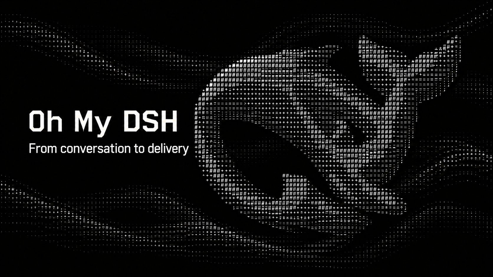

<a id="readme-top"></a>

<h1 align="center">Oh My DSH</h1>

<p align="center"><strong>A more capable DSH workspace for sustained work.</strong><br>DeepSeek Harness plugin</p>

<p align="center"><a href="README.md">简体中文</a> · <strong>English</strong></p>

<p align="center">
  <a href="docs/release-0.101.0.md"></a>
  <a href="https://github.com/gulagala001/oh-my-dsh/releases"></a>
  <a href="#readme-install"></a>
  <a href="https://github.com/gulagala001/oh-my-dsh/stargazers"></a>
</p>

<p align="center"><a href="#readme-install"><strong>Get started</strong></a> · <a href="docs/README_EN.md">Docs</a> · <a href="https://github.com/gulagala001/oh-my-dsh/issues">Report an issue</a></p>

<p align="center"><a href="docs/images/omd-hero-en.png"></a></p>

<p align="center"><a href="docs/images/glyph-animation.gif"></a></p>

<a id="quickstart"></a>
<a id="desktop"></a>
<a id="features"></a>
<a id="prompts"></a>
<a id="themes"></a>
<a id="computer-use"></a>
<a id="memory"></a>
<a id="tools"></a>
<a id="support"></a>
<a id="plugins"></a>
<a id="docs"></a>
<a id="readme-install"></a>

## Quick start

**Required environment：** DSH **0.2.1-rc.3**, Node.js **22.19+**.

Models use your DSH configuration. The default installation grants full file/command access and disables execution approval; explicit profile settings take precedence. OpenCU is included; the full in-app browser and native monitoring also require matching host adapters and OS permissions.

### 1. Install


Open **Plugins → Add plugin** in the DSH instance you use, then paste:

```text
https://github.com/gulagala001/oh-my-dsh/releases/download/v0.2.1-rc.3.omd.0.101.0/oh-my-dsh-0.2.1-rc.3.omd.0.101.0.tgz
```

Wait for active tasks to finish, then follow the host’s activation/restart prompt. Keep your existing profile and data. See the [installation guide](docs/install_EN.md) · [SHA256SUMS](https://github.com/gulagala001/oh-my-dsh/releases/download/v0.2.1-rc.3.omd.0.101.0/SHA256SUMS).

### 2. Try this first

Create a conversation, choose **Oh My DSH**, and use your configured model in a shareable project:

```text
Read this project’s README and explain its purpose and startup steps. Use only what you actually read; do not change files.
```

**Success looks like：** The answer reflects the actual file; the OMD console shows context and call records.

## A composed workspace and independent products

OMD combines **Workflow, Rewind, Persona, Extensions and DeepSeek Workbench** with OpenCU, theme management and its Glyph appearance. Use the composed OMD workspace or choose a published independent product for a specific need.

Workflow handles execution and resumption; Rewind restores conversations and files; Persona manages personalities; Extensions manages skills and tool connections; Workbench handles web chat and migration. Matching independent and embedded entries coordinate service and UI ownership. Optional startup failures retain core conversations, while plugin data, versions and host requirements keep their own boundaries.

[Architecture, independent releases and coinstallation](docs/architecture_EN.md) · [Upgrade and data migration](docs/upgrade_EN.md)

## From conversation to delivery

### Keep the work in view

The session overview brings outputs, sources, background processes, Workflow and subagents together. Open a member to continue its sidebar conversation. **Ultra** offers Workflow, Agent Team and Free collaboration modes. **Better Todo** connects original requirements, tasks and verification results, retaining completed checks and actual execution receipts.

Start without a project: the first message creates a dedicated file directory that subsequent turns reuse. The **✨** composer control offers light polish, structured rewriting and step planning, with saved requirements, versions, undo and redo.

[Everyday usage](docs/usage_EN.md) · [Ultra and Workflow](docs/workflow.md)

### Preserve context and retrieve original results

**Context optimization** is on by default. It shortens recognized read-only results and uses references or deltas when a complete baseline remains available, while retaining actual tool execution and authorized originals. **View original** on a tool card supports line ranges, search, paging and export; evidence archives can migrate with their conversations.

On-demand tool discovery, file and webpage views, AST pattern search and CodeGraph help locate relevant material. History processing, Auto Compact and **Dream** manage context and session/project/global memory. Optional Billion Context can own compaction while Dream, recall, tasks, side questions and branches continue working together.

[Optimization and originals](docs/context-optimization.md#english) · [Compaction and BC](docs/context-workflow.md) · [Dream](docs/dream-memory.md)

### Choose your workspace and voice

**Glyph** combines a three-dimensional character whale, local ripples and character controls. Choose from Glyph, native DSH, Codex Desktop, iOS Liquid Glass, Claude CLI and Google Material, with **29 palettes**, backgrounds, fonts and region colors. Existing appearance choices remain saved.

**Personality management** separates identity, language style, communication and answer presentation. Manage multiple presets, duplicate and edit them, import/export JSON, or use the supplied creation prompt with an AI. Optional session personalities let each main conversation inherit the global preset, select its own, or disable personality guidance.


[Appearance](docs/skins.md) · [Personalities and settings](docs/usage_EN.md#personalities)

### Work with browsers, apps and extensions

Bundled **OpenCU 2.2.0** provides browser and app discovery, observation, background-first actions, annotations and floating previews. Stop and cancellation track actual input release, with explicit outcomes for stalled reads, approval timeouts and replaced targets. Full embedded surfaces require matching host adapters and system permissions.

**Extension management** brings skills, MCP, instruction files, commands and hooks into the plugin page. Optional **dsh-ops** adds file, document, shell and on-demand tool capabilities through a fixed compatibility package for the matching host.

[Computer use](docs/computer-use.md) · [Extensions](docs/extensions.md) · [dsh-ops](docs/dsh-ops_EN.md)

### Keep side discussions and usage visible

`/侧栏` opens a temporary text chat using the current model; closing it stops generation and clears its messages. `/侧栏（网页版）` opens a temporary DeepSeek website conversation. Regular web chat can import readable history and attachments into DSH. `/btw` asks a side question about the main task, while turn rewind can restore conversation history and checkpointed file changes.

The **OMD console** combines context, memory, call logs and background activity. Filter usage and costs by date, model, component or conversation. Unknown usage stays unknown, and `≥` denotes a known lower bound; optimization estimates remain separate from provider billing.

[Side chats and rewind](docs/usage_EN.md#side-questions-and-turn-rewind) · [DeepSeek Workbench](docs/deepseek-workbench.md) · [Monitoring](docs/monitoring.md)

## Supported use

| Scenario | Requirements |
| --- | --- |
| Conversations, appearance, tasks and memory | A matching DSH build and configured model. |
| Browser and desktop actions | An available OpenCU backend and OS permissions; full embedded UI also requires host adapters. |
| Web chat and history import | Corresponding DeepSeek Workbench desktop capabilities and website login; only readable messages and attachments can migrate. |
| Other DSH versions | Use their dedicated builds; rc.1 and rc.2 packages are not interchangeable. |

The main branch may contain improvements not yet included in a fixed Release. Public archives do not change when `main` changes. See [release packages](docs/releases.md) for actual downloads and checksums.

## FAQ

<details>
<summary>Why is Oh My DSH or its settings missing after installation?</summary>

Check that you installed into the profile used by this instance, fully restarted it and enabled the plugin. Choose Oh My DSH in a new conversation; existing conversations retain their presets. [Troubleshooting](docs/troubleshooting_EN.md)

</details>

<details>
<summary>Why is the full in-app browser unavailable?</summary>

The embedded browser, native monitoring and sidebar annotations require matching host adapters. Fixed releases provide source materials, not a complete desktop installer. [Computer Use requirements](docs/computer-use.md)

</details>

<details>
<summary>How do I update or recover an installation?</summary>

Finish active tasks and back up first. Install the fixed package matching the same host, preserving the data directory and profile. Do not clear data or bypass version checks. [Upgrade guide](docs/upgrade_EN.md)

</details>

## Contributing and attribution

Reproducible reports, documentation improvements and practical examples are welcome. [Contributing](CONTRIBUTING.md) · [Development](docs/development_EN.md)

The repository contains code and materials from multiple sources; a blanket MIT claim does not cover them all. Consult individual files and [third-party notices](THIRD_PARTY_NOTICES.md). This is a community project with no official affiliation or endorsement from the referenced brands.

## Documentation and support

| I want to | Where to go |
| --- | --- |
| Install, update or remove | [Installation guide](docs/install_EN.md) |
| Learn the features and limits | [Documentation](docs/README_EN.md) |
| Read release changes | [Releases](https://github.com/gulagala001/oh-my-dsh/releases) |
| Report a problem | [Issues](https://github.com/gulagala001/oh-my-dsh/issues) |

For a bug report, include the full DSH and plugin versions, the entry point, minimal reproduction steps, and expected versus actual behavior. Remove private data before sharing logs or screenshots.

<p align="center"><a href="#readme-top">Back to top</a> · <a href="https://github.com/gulagala001/oh-my-dsh/releases">Versions and downloads</a> · <a href="https://github.com/gulagala001/oh-my-dsh/issues">Feedback</a></p>

[Documentation structure and contributing](docs/documentation.md)

<!-- project-credits:start -->
## Projects, components and acknowledgements

[Complete project, source and dependency inventory](docs/components_EN.md)

| Project | Purpose |
| --- | --- |
| [OpenCU](https://github.com/gulagala001/opencu) | Computer and browser observation, interaction, annotations and previews |
| [DSH Workflow](https://github.com/gulagala001/dsh-workflow) | Task planning, execution, budgets and recovery |
| [DSH Rewind](https://github.com/gulagala001/dsh-undo-plugin) | Turn undo and conversation rewind |
| [DSH Persona](https://github.com/gulagala001/dsh-persona-plugin) | Personality import, management and global or per-chat selection |
| [DSH Extensions](https://github.com/gulagala001/dsh-extensions) | Manage skills, MCP, instructions, commands and hooks |
| [DeepSeek Workbench](https://github.com/gulagala001/dsh-deepseek-workbench) | DeepSeek web workspace and conversation import |
| [DSH BTW](https://github.com/gulagala001/dsh-btw) | Side chats, local history, follow-ups and independent cancellation |
| [DSH Theme](https://github.com/gulagala001/dsh-theme-plugin) | Themes, colors, backgrounds, fonts and appearance management |
| [Glyph](https://github.com/gulagala001/dsh-theme-plugin) | Animated character interface and whale visuals |
| [Billion Context](https://github.com/ranxianglei/billion-context) | Long-context compression, original-content recovery and cache diagnostics. |
| [dsh-ops](https://github.com/T-Auto/dsh-ops) | Bounded file, document and shell tools with on-demand discovery. |
| [DSH Intelligent UI](https://github.com/gulagala001/dsh-intelligent-ui) | Interactive charts, forms, calculators, simulations and games in answers. |
| [Oh My Agents Above All](https://github.com/gulagala001/oh-my-agents-above-all) | Agent presets and interfaces for Codex, Claude Code, Grok, Pi and ZCode workflows. |
| [Subscription Login](https://github.com/V1ki/dsh-plugin-subscriptions) | Connect supported subscription providers and discover models. |
| [OpenDesign](https://github.com/omegapaopao/dsh-open-design) | Design skills, templates and design systems. |
| [Prompt Optimizer](https://github.com/WestFox-AwA/dsh-prompt-optimizer) | Review and clarify requests before sending. |
| [DSH Market](https://github.com/dsh-market/dsh-market) | Browse and manage community plugins and themes. |
| [Infinite Gen 4](https://github.com/Minglink/dsh-infinite-gen-4) | Prompt research and response-state presentation. |
| [Status Rotator](https://github.com/01Virex/dsh-status-rotator) | Rotating activity text in the interface. |
| [DSH × Blender](https://github.com/sixtysevenlf/dsh-blender-plugin) | Connect DSH tools to Blender. |
| [Balance Whale Widget](https://github.com/MeteorNOX/DeepSeek-Balance-Whale-Widget) | Usage and balance widget with interactive characters. |
<!-- project-credits:end -->
