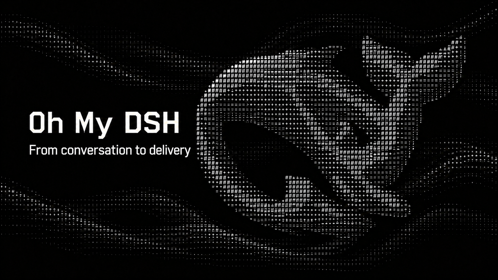
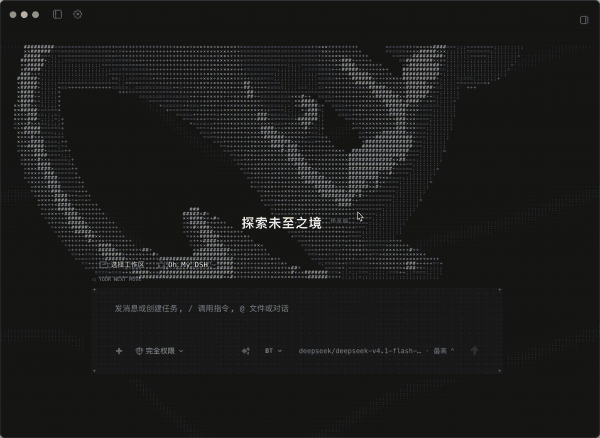
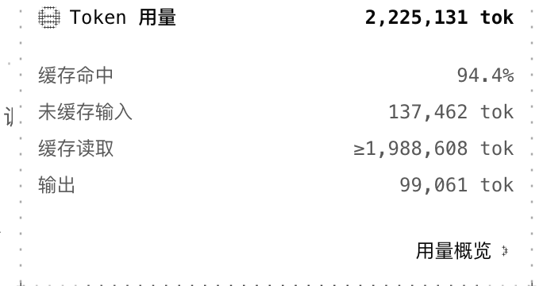
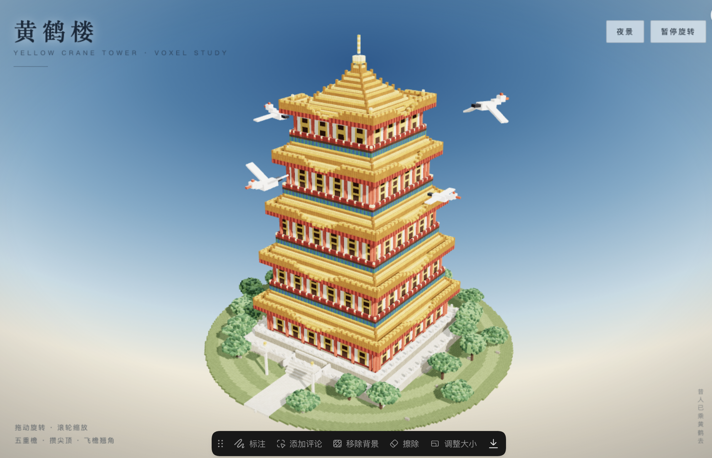
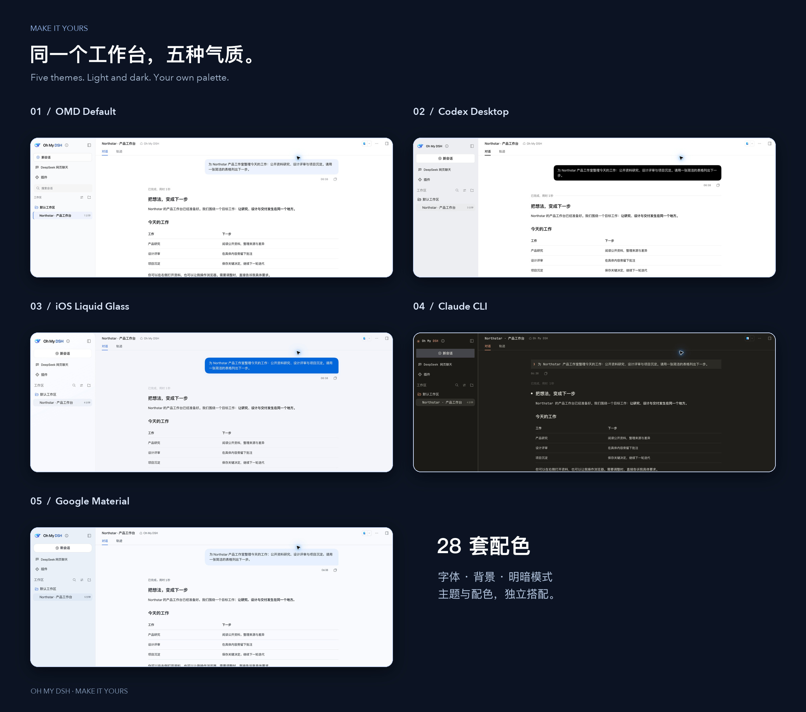

<a id="readme-top"></a>

<h1 align="center">Oh My DSH</h1>

<p align="center"><strong>A more capable DSH workspace for sustained work.</strong><br>DeepSeek Harness plugin</p>

<p align="center"><a href="README.md">简体中文</a> · <strong>English</strong></p>

<p align="center">
  <a href="https://github.com/gulagala001/oh-my-dsh/releases/tag/v0.2.2-rc.1.omd.1.3.12"></a>
  <a href="https://github.com/gulagala001/oh-my-dsh/releases"></a>
  <a href="#readme-install"></a>
  <a href="https://github.com/gulagala001/oh-my-dsh/stargazers"></a>
</p>

<p align="center"><a href="#readme-install"><strong>Get started</strong></a> · <a href="docs/README_EN.md">Docs</a> · <a href="https://github.com/gulagala001/oh-my-dsh/issues">Feedback</a></p>

<p align="center"><a href="https://raw.githubusercontent.com/gulagala001/oh-my-dsh/main/docs/images/omd-hero-en.png"></a></p>

<p align="center"><a href="https://raw.githubusercontent.com/gulagala001/oh-my-dsh/main/docs/images/glyph-animation.gif"></a></p>

<a id="quickstart"></a>
<a id="desktop"></a>
<a id="support"></a>
<a id="readme-install"></a>

## Quick start

**Requires:** DSH **0.2.2-rc.1** and Node.js **24.9.0+**. OMD uses the models you configured in DSH.

### 1. Install

In DSH, open **Plugins → Add plugin** and paste:

```text
https://github.com/gulagala001/oh-my-dsh/releases/download/v0.2.2-rc.1.omd.1.3.12/oh-my-dsh-0.2.2-rc.1.omd.1.3.12.tgz
```

Let running tasks finish, then enable OMD or restart DSH when prompted. Your settings and conversations stay. For older DSH versions, upgrading and removal, see the [installation guide](docs/install_EN.md). Checksums: [SHA256SUMS](https://github.com/gulagala001/oh-my-dsh/releases/download/v0.2.2-rc.1.omd.1.3.12/SHA256SUMS).

> By default OMD lets the AI read and write files and run commands without asking each time. Permissions you set in your profile take precedence.

### 2. Try one thing

Create a session, pick the **Oh My DSH** preset, and in a project directory enter:

```text
Read this project's README and tell me what it does and how to start it. Answer only from what you read and do not change any files.
```

The answer should quote the README. Open the **OMD Console** on the right to see how much context this used and which tools were called.

<a id="features"></a>

## What it does

<a id="memory"></a>

### Uses less context and remembers more

- **Context optimization** (on by default): repeated content in tool results is trimmed, and reading the same file again only sends what changed, saving context and tokens. When you need the details, click **View original** on a tool card and page through the raw result by line number or keyword.
- **Auto compaction**: when the context fills up, history is tidied while your own words and the task list stay intact. You can hand compaction to Billion Context instead, and everything else keeps working.
- **Dream memory**: when on, it turns conversations into short memory in the background at session, project and global level, so new sessions can pick up where you left off.
- AST search and CodeGraph find code, and web pages are read as plain articles, so the AI wastes fewer steps.

[Context optimization](docs/context-optimization.md#english) · [Compaction and lookups](docs/context-workflow.md) · [Dream](docs/dream-memory.md)

### Shows its work

- **Conversation overview**: output files, sources, background processes, Workflow and subagents in one place. Open any member to keep talking to it.
- **Ultra**: for complex tasks, choose Workflow, Agent Team or Free collaboration.
- **Better Todo**: links your words, the tasks derived from them and the verification results, so you can see at a glance how far it got.
- **OMD Console**: tokens and cost by date, model, component or session. Usage a provider did not report shows as unknown, never as 0.

[Usage guide](docs/usage_EN.md) · [Ultra and Workflow](docs/workflow.md) · [Monitoring](docs/monitoring.md)

### No project needed

A new chat gets its own folder and keeps using it; renaming the chat does not move files. The **✨** button in the input box polishes what you wrote, structures it or breaks it into steps, and you can undo.

### Undo mistakes

- Every message you sent has a rewind button that takes back the conversation and the files the AI changed after it. Went too far? Use undo rewind.
- `/btw` asks a side question while the main task keeps running; `/侧栏` opens a temporary chat that clears when closed.

[Side questions and rewind](docs/usage_EN.md#side-questions-and-turn-rewind)

<a id="computer-use"></a>

### Operates browsers and your computer

OpenCU is built in. The AI can read web pages, fill in forms and click buttons, and also operate desktop apps. It works in the background by default without taking over your windows, and you can circle a spot on the page to tell it what to change. In the DSH desktop app you can also watch an embedded browser.

[Computer and browser](docs/computer-use.md)

<a id="themes"></a>
<a id="prompts"></a>

### Changes how it looks and how it talks

- **Appearance**: seven looks (Glyph animated characters, DSH native, Codex Desktop, iOS Liquid Glass, Claude Desktop, Claude CLI, Google Material) and 30 color schemes, with custom backgrounds and fonts.
- **Personalities**: written in four parts (identity, language style, communication, answer presentation), importable and exportable as JSON, and selectable per session. Two are built in:
  - **Economical**: skips filler, saves tokens and goes straight to the result. The author measured a 50% efficiency gain.
  - **Overclock**: thinks one step further and answers more completely, for problems that need careful work.

<p align="center">
  <a href="https://raw.githubusercontent.com/gulagala001/oh-my-dsh/main/docs/images/economical-token-usage.png"></a>
  <a href="https://raw.githubusercontent.com/gulagala001/oh-my-dsh/main/docs/images/economical-yellow-crane-tower.png"></a>
</p>

<p align="center">A voxel Yellow Crane Tower made with the Economical personality: usage and result</p>



[Appearance](docs/skins.md) · [Personalities](docs/usage_EN.md#personalities)

<a id="tools"></a>
<a id="plugins"></a>

### Extensions

- **Extension management**: manage Skills, MCP, instruction files, commands and Hooks on the Plugins page without editing config files.
- **DeepSeek web chat**: use DeepSeek's website chat inside DSH and turn a conversation into a DSH session halfway through.
- **dsh-ops** (third-party, optional): stronger file, document and command tools, installed from the third-party page in Settings.

Workflow, Rewind, Persona, Extensions, DeepSeek Workbench, OpenCU and theme management inside OMD can also be installed on their own; see the project table below. [Plugin structure and running them together](docs/architecture_EN.md)

<a id="docs"></a>

## Where it works

| Feature | Needs |
| --- | --- |
| Conversations, appearance, tasks, memory | DSH 0.2.2-rc.1 and a working model |
| Browser and computer use | System permissions; the embedded browser view needs a matching DSH desktop build |
| DeepSeek web chat and history import | The DSH desktop app and a DeepSeek website account |
| Older DSH versions | The matching older package; see the [installation guide](docs/install_EN.md) |

The `main` branch may be ahead of the release. Install from the release package above.

## FAQ

<details>
<summary>Oh My DSH is missing after installing?</summary>

Check that it went into the DSH you actually use (the desktop and web versions use different profiles), fully restart, and check on the Plugins page that it is enabled. Then create a session and pick Oh My DSH as the preset; existing sessions keep their preset. [Troubleshooting](docs/troubleshooting_EN.md)

</details>

<details>
<summary>Why is there no embedded browser?</summary>

The embedded browser, floating preview and sidebar annotations need a matching DSH desktop build. With just the plugin, the AI can still operate web pages through the Chrome or Edge extension or a separate browser. [Computer and browser](docs/computer-use.md)

</details>

<details>
<summary>How do I upgrade?</summary>

Let tasks finish, back up the DSH data directory, then install the new package over the old one. If installing fails, do not clear your data; see the [upgrade guide](docs/upgrade_EN.md).

</details>

## Contributing and license

Reproduction steps, documentation fixes and examples are welcome: [contributing](CONTRIBUTING.md) · [development](docs/development_EN.md). When reporting a problem, include the DSH and plugin versions, the steps, and what you expected versus what happened, and remove personal data from logs and screenshots.

OMD's own code is under the [MIT license](LICENSE); third-party code and assets keep their own licenses, see [third-party notices](THIRD_PARTY_NOTICES.md). OMD is a community project with no official relationship to the other brands shown in its interface.

<p align="center"><a href="#readme-top">Back to top</a> · <a href="https://github.com/gulagala001/oh-my-dsh/releases">Releases</a> · <a href="https://github.com/gulagala001/oh-my-dsh/issues">Feedback</a></p>

<!-- project-credits:start -->
## Projects, components and acknowledgements

[Complete project, source and dependency inventory](docs/components_EN.md)

| Project | Purpose |
| --- | --- |
| [OpenCU](https://github.com/gulagala001/opencu) | Computer and browser observation, interaction, annotations and previews |
| [DSH Workflow](https://github.com/gulagala001/dsh-workflow) | Task planning, execution, budgets and recovery |
| [DSH Rewind](https://github.com/gulagala001/dsh-undo-plugin) | Turn undo and conversation rewind |
| [DSH Persona](https://github.com/gulagala001/dsh-persona-plugin) | Personality import, management and global or per-chat selection |
| [DSH Extensions](https://github.com/gulagala001/dsh-extensions) | Manage skills, MCP, instructions, commands and hooks |
| [DeepSeek Workbench](https://github.com/gulagala001/dsh-deepseek-workbench) | DeepSeek web workspace and conversation import |
| [DSH BTW](https://github.com/gulagala001/dsh-btw) | Side chats, local history, follow-ups and independent cancellation |
| [DSH Theme](https://github.com/gulagala001/dsh-theme-plugin) | Themes, colors, backgrounds, fonts and appearance management |
| [Glyph](https://github.com/gulagala001/dsh-theme-plugin) | Animated character interface and whale visuals |
| [DSH Response ID Reuse](https://github.com/gulagala001/dsh-response-id-reuse) | Automatic Responses ID continuation and full-request fallback |
| [Billion Context](https://github.com/ranxianglei/billion-context) | Long-context compression, original-content recovery and cache diagnostics. |
| [dsh-ops](https://github.com/T-Auto/dsh-ops) | Bounded file, document and shell tools with on-demand discovery. |
| [DSH Intelligent UI](https://github.com/gulagala001/dsh-intelligent-ui) | Interactive charts, forms, calculators, simulations and games in answers. |
| [Oh My Agents Above All](https://github.com/gulagala001/oh-my-agents-above-all) | Choose a Codex, Grok Build, Cursor, Pi Coding Agent or ZCode preset in Settings → OMAA to use with DSH sessions and tools. |
| [Subscription Login](https://github.com/V1ki/dsh-plugin-subscriptions) | Connect supported subscription providers and discover models. |
| [OpenDesign](https://github.com/omegapaopao/dsh-open-design) | Design skills, templates and design systems. |
| [Prompt Optimizer](https://github.com/WestFox-AwA/dsh-prompt-optimizer) | Review and clarify requests before sending. |
| [DSH Market](https://github.com/dsh-market/dsh-market) | Browse and manage community plugins and themes. |
| [Infinite Gen 4](https://github.com/Minglink/dsh-infinite-gen-4) | Prompt research and response-state presentation. |
| [Status Rotator](https://github.com/01Virex/dsh-status-rotator) | Rotating activity text in the interface. |
| [DSH × Blender](https://github.com/sixtysevenlf/dsh-blender-plugin) | Connect DSH tools to Blender. |
| [Balance Whale Widget](https://github.com/MeteorNOX/DeepSeek-Balance-Whale-Widget) | Usage and balance widget with interactive characters. |
<!-- project-credits:end -->
