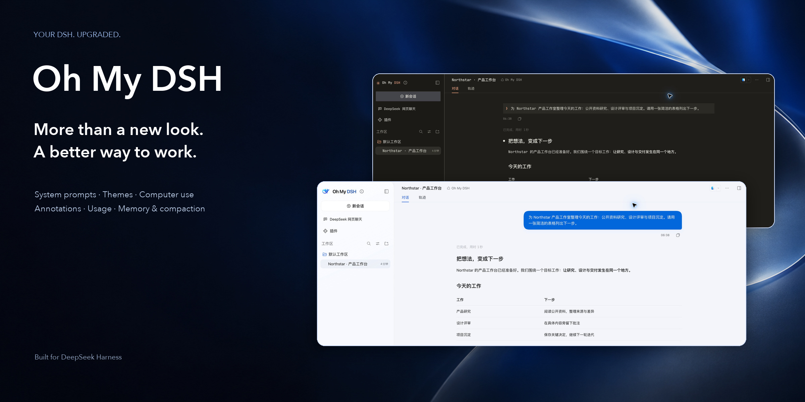

> **Release withdrawn (2026-10-18):** OMD 0.18.0, OpenCU 2.0.1 and OMAA 0.16.0 have been withdrawn while a missing preset selector is investigated. The links below point to previous releases; main-branch changes are not a new verified release. Existing users should keep their data and settings.

<h1 align="center">Oh My DSH</h1>

<strong>Better agent instructions. A workspace that feels yours. Longer work, less repetition.</strong>

System prompts · Five themes · Computer use · Annotations · Usage monitoring · Memory & auto compaction

<a href="README.md">简体中文</a> · <strong>English</strong> · <a href="#quickstart">Install</a> · <a href="docs/getting-started_EN.md">First steps</a> · <a href="docs/README_EN.md">Documentation</a>

**Turn the DSH you already use into a more complete AI workspace.**

Oh My DSH (OMD) enhances [DeepSeek Harness](https://github.com/deepseek-ai/deepseek-harness). Keep your models, conversations, tools and skills. Bring system instructions, appearance, computer use, context, memory and task tracking into one workflow—from explaining the goal to doing the work and checking the result.

> **Install:** [Copy instructions to an AI](docs/install_EN.md#ai) · [Use Add Plugin](docs/install_EN.md#gui). OMD includes OpenCU.

## One plugin. A more complete working day.

| What you want | What OMD adds |
| --- | --- |
| **Work that moves beyond an answer** | System instructions for understanding requirements, working with code, using tools, delivering and checking results. |
| **An interface you enjoy opening** | Five themes, light/dark modes and 28 palettes, with configurable layout, materials, fonts and backgrounds. |
| **An agent that can act outside the chat** | Bundled OpenCU for browser and desktop tasks, with pages, activity and previews in the conversation. |
| **“Change this” without re-explaining everything** | Annotate a page, image or supported content and bring the location and feedback back into the draft. |
| **Continuity across long work** | Context preparation, Auto Compact and Dream, with original requirements and sources available for recall. |
| **Visibility into work and usage** | An OMD Console for context, memory, calls and background activity. |

## 01 / Upgrade how the agent works

### System-level instructions—not just polishing your input

OMD puts working practices in the system layer: understand goals and constraints, read relevant context, use tools that actually exist, and check the outcome. Tool descriptions, execution modes and dynamic reminders are assembled together rather than treating every environment as the same generic prompt.

- **Built around delivery:** distinguish a plan, an executed action and a verified result.
- **Grounded in actual tools:** Native and OMD-PTC get their own calling conventions; OpenCU retains its live tool contract.
- **Designed for long tasks:** requirement anchors, background jobs and context reminders help keep the original goal in view.
- **Room for your preferences:** identity/personality settings, plus Ultra with Workflow, Agent Team and Free modes for decomposition and collaboration; Agent Team is shown only when enabled by DSH.

These are execution strategies, not an intelligence upgrade or a success-rate guarantee. The composer's **draft optimizer** is a separate feature for light polish, structure and step planning.

[How system-level adaptation works →](docs/prompt-adaptation.md) *(Chinese)*

## 02 / Change the atmosphere, not just the accent color

**OMD Default · Codex Desktop · iOS Liquid Glass · Claude CLI · Google Material**

Choose a restrained desktop, translucent glass, a terminal-inspired workspace or expressive Material styling. Each has its own layout and materials, with light and dark modes. Themes, **28 palettes** and custom backgrounds are independent, so changing a theme does not mean starting over.

Adjust fonts, section colors, logos and browser titles. Reduce transparency and motion when you want a quieter workspace. Themes do not include the corresponding brands' models or accounts.

[Appearance settings →](docs/skins.md) *(Chinese)*

## 03 / The agent acts. You can see and collaborate.

**The rewritten OpenCU is bundled—no second installation required.** Describe a browser or desktop task in the conversation. Ordinary tool calls bring up real pages, operation records and lightweight monitoring, without a separate CU console.

- **Browsers and desktop apps:** discover targets, read content, capture screenshots, enter text, click, navigate and work with files.
- **Feedback at the right place:** page annotations, image comments and assistant-text annotations carry specific context into the draft. Saving and sending remain separate.
- **A preview is not a lock:** viewing and control targets are independent. Hiding monitoring does not stop the task; human input requires a fresh observation.
- **Background-first, explicit limits:** selecting a target does not intentionally steal focus. Unsupported background actions fail clearly, without silently switching to global input.

The complete embedded browser and native monitor require a **matching OpenCU host adapter**. Installing the plugin into arbitrary stock DSH does not add every host capability. Chrome/Edge require initial extension pairing; desktop control needs OS permissions.

[Computer-use setup and boundaries →](docs/computer-use.md) *(Chinese)*

## 04 / Long work without repeating the whole backstory

| Layer | Its job |
| --- | --- |
| **Context preparation** | Separately preserve factual summaries, user decisions and detailed material for later requests. |
| **Auto Compact** | Automatically compact when context reaches your chosen token threshold. Choose summary plus material or summary only. Off by default; the prefilled threshold is 400,000 tokens. |
| **Dream memory** | Independently organize sourced session, project and global short memory for future work. |

Original messages, images and attachments remain available through `recall`; summaries are not substitutes for evidence. Choose session isolation, project sharing or global sharing. A projectless Chat's automatically created file directory does not become a shared project.

Automatic Dream is off by default. When enabled, its default check interval is one hour; manual and automatic processing share a daily 200,000-token cap. Background processing uses models too, and model context windows remain finite.

[Context](docs/context-workflow.md) · [Dream memory](docs/dream-memory.md) *(Chinese)*

## 05 / See what happened—and what it used

The right-sidebar **OMD Console** brings together overview, context, memory, call logs and background logs. Filter by date, model, component or status; inspect trends, groups and individual calls instead of digging through a wall of tool output.

Usage comes from actual receipts: **unknown is not zero; `≥` is a known lower bound**. Missing cache information does not produce an invented hit rate. Background calls enter the persistent local ledger too.

**Better Todo** connects requirements, source anchors, task state and evidence. A checked task, a finished command and a passing verification are different things. Task reminders default on; verification reminders can be enabled separately.

[Monitoring and accounting →](docs/monitoring.md) *(Chinese)*

## More tools for everyday work

| Capability | What it does |
| --- | --- |
| **Projectless Chat** | Start without creating a project; the first message creates a separate file directory. |
| **CodeGraph** | Bundled runtime and automatic project preparation for symbol and call-graph exploration, without a global CLI installation. |
| **Ultra / Workflow** | Decompose tasks, delegate work and compose workflows while retaining host permissions and Jobs. |
| **OMD-PTC** | Compose tool calls in JavaScript without replacing the host Tools service. |
| **Draft optimizer** | Light polish, structure and step planning with original/version retention. Automatic polish defaults off. |
| **DeepSeek Workbench** | Web chat/platform entry points and import of extractable history into native conversations, without automatically sending another message. |
| **Plugin coexistence** | Keep DSH files, terminals, skills and third-party entries. IUI, OMAA and Subscriptions remain separate projects. |
| **Fast** | Works with matching Subscriptions/Codex routes; no guarantee of server priority or actual acceleration. |

## Installation: choose one method

1. **[Let an AI install it](docs/install_EN.md#ai)** — copy one instruction block; the AI checks your running DSH and selects the matching package.
2. **[Install through the interface](docs/install_EN.md#gui)** — open **Plugins → ＋ Add Plugin**, paste the URL matching your DSH version, and click **Install**.

Both methods preserve your existing environment. Published packages are available for DSH **0.2.1-rc.2** and **0.2.1-rc.1**. OMD includes OpenCU; complete desktop CU has [additional host requirements](docs/install_EN.md#computer-use).

[Downloads and older versions](docs/releases.md) · [Upgrade an existing installation](docs/upgrade_EN.md)

## Clear boundaries

- Conversations, themes, tasks and memory target matching DSH on macOS, Windows and Linux.
- OpenCU capabilities vary by backend, OS permissions and application accessibility. Check available backend capabilities in Computer & browser settings. Mixed-monitor scaling is outside the current scope.
- This is an independent community project, not an official DeepSeek, OpenAI, Anthropic, Apple or Google product, and is not endorsed by those brands.

## Keep exploring

[Documentation](docs/README_EN.md) · [First steps](docs/getting-started_EN.md) · [Development](docs/development_EN.md) · [Plugin compatibility](docs/plugin-compatibility_EN.md) · [Changelog](CHANGELOG.md)

[Report a bug](https://github.com/gulagala001/oh-my-dsh/issues/new?template=bug-report.yml) · [Suggest a feature](https://github.com/gulagala001/oh-my-dsh/issues/new?template=feature-request.yml) · [Recommend a plugin](docs/plugin-submissions.md) · [Contribute](CONTRIBUTING.md)

**Sources and licensing:** core mechanisms and prompts originate from trisoul; the host and public components originate from DeepSeek Harness. No project code license has been specified. Bundled OpenCU's REA assets and extension-host library retain separate upstream rights and distribution conditions; visible source does not automatically grant redistribution rights. See [third-party notices](THIRD_PARTY_NOTICES.md) and [OpenCU notices](vendor/opencu/THIRD_PARTY_NOTICES.md). Compatibility identifiers remain `trisoul_x` (package) and `trisoul-x` (preset).
