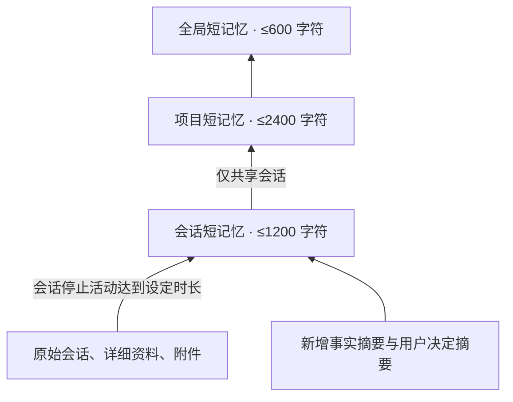

# Dream 记忆

[文档目录](README.md) · [使用指南](usage.md) · [压缩与原文回查](context-workflow.md)

Dream 在后台把对话整理成会话、项目、全局三级短记忆，新会话可以接着用。聊天只读取已经整理完成的版本。



整理往上走，回查往下走。隔离的会话可以单独整理，但内容不会进项目或全局。原始材料和历史版本都保留；短记忆会丢细节，要精确内容就回查来源。

## 记忆页

OMD 控制台的 **记忆** 页有四个入口：

| 入口 | 做什么 |
| --- | --- |
| 整理会话 | 整理选中的会话（没选就是当前会话），只更新会话短记忆 |
| 整理项目 | 整理这个项目里的共享会话，更新项目短记忆 |
| 整理全局 | 依次更新各项目短记忆和全局短记忆 |
| 自动整理设置 | 跳到 **设置 → Oh My DSH → 上下文与记忆**，设置开关、间隔、原文等待时间、每日额度和文件夹；用哪个模型在"后台模型"里设 |

- 点项目展开会话，点会话看摘要和详细资料。目录支持搜索和分页，返回上一层时保留搜索、页码和位置。
- **查看来源** 逐层打开不可变的版本，显示来源名称、版本或事件范围和内容预览。按 Esc 或返回逐层退回。
- 作业列表显示具体的会话或项目、进度、失败原因和当日用量，可以停止、继续。失败时点作业旁的 **重试**，接着已保存的进度做。

项目按会话所在的工作目录和已有的项目绑定来定，不按主题猜；没有目录的旧会话归到"未归类"。

**没加工作区的聊天，自动建的文件夹不是 Dream 项目。** 这些聊天保持隔离，不参加自动、项目或全局整理，但可以单独整理和回查。改默认保存目录、改执行目录或删掉原目录，都不会把它们变成共享项目。你把它加入真实工作区后，才按工作区共享。

**整理的文件夹**：全局整理时只展开选中的文件夹，**不勾选表示全部**。嵌套的项目不会因为勾了父文件夹就被带进来，磁盘根目录也不会吞掉整个盘。已删除的目录排在最后，标"文件夹已删除"。排除一个文件夹不会撤回它已有的记忆。

## 会话里带入什么

首次发消息前选记忆范围，开始后固定：

| 范围 | 自动带入 | 按需回查 |
| --- | --- | --- |
| 会话隔离 | 不带入共享记忆 | 用 `recall` 可以读任何会话 |
| 项目共享 | 本项目的短记忆 | 项目 → 会话 → 摘要、资料、原文 |
| 全局共享 | 精简的全局记忆和项目目录第一页 | 全局 → 项目 → 会话 → 来源 |

记忆块按版本替换，不是每轮追加。它最多占模型可用空间的 10%，且不超过约 9,000 tokens；空间不够时只留回查入口。全局的项目目录每页最多 3 项。

你手写的 **全局背景** 是另一份固定文本，Dream 不会改它。

## 用量

- 会话整理只读 **已有的会话短记忆和还没处理过的摘要**。没有摘要的新会话会等着，不会为了填记忆去读原文。
- 会话 **7 天没有活动** 后，才分批补读摘要之外的原文。附件只留原始引用，不凭文件名猜内容。
- 项目整理只读有变化的会话短记忆，全局整理只读有变化的项目短记忆。没有新材料就不调用模型。
- 自动整理默认关，开启后每 **60 分钟** 检查一次。手动和自动共用每天 **200,000 tokens** 的额度，**UTC 00:00** 重置（界面显示本地时间）。
- 自动整理要设好固定的后台模型；手动整理可以用当前会话的模型。
- 单次输入最多约 16,000 tokens、24 份来源，大段原文按 5,000 字节分段，不截断。调用前先预留输入和最大输出，结束后按服务商报的用量结算；用量不完整时保留预留额。

举例：一段新摘要只要一次会话调用；整理项目再加一次项目调用，整理全局再加一次全局调用。材料多就分批，没变化的重复操作不调用模型。实际用量取决于摘要长短、语言和来源数量。

关掉自动整理后，正在跑的自动作业会在下一步暂停，已完成的进度保留；已经发出的请求可能还会返回并产生用量，但结果不再发布。可以对原作业点 **继续／重试**，或者手动整理同一范围，不用重新打开自动整理。

## 出错时

- 部分会话失败时，作业记下没做完的范围，其他会话照常整理，成功的进度保留。缺了失败来源的项目或全局汇总不会发布。
- 每个会话第一次进入作业时固定来源范围，重试、暂停或重启后按原范围继续，新增的材料留给下次。已成功的来源不重做。
- 额度不足、你取消或认证失败时，这次作业中止并显示原因。模型失败不会覆盖旧记忆。
- 某个会话日志损坏或格式暂不支持时，记忆页会列出它，保留原始日志和最后可读的短记忆，并把它移出共享汇总，其他会话不受影响。修好后点 **刷新** 重新读取，不调用模型。
- 来源退出共享或消失时，相关的项目和全局记忆停止自动带入，重新整理后恢复。

## 数据

数据在 `DSH_HOME/oh-my-dsh/dream-v1/memory.sqlite`，不改原始会话日志、`context-v1` 档案和手写背景。备份时先停 DSH，再备份整个数据目录。停用插件会停止后台作业，重新启用后继续。

没变化的会话不重新扫描。完成的任务清单立即清理，运行记录保留 30 天，记忆版本和来源引用一直保留，存储随新材料增长。

## 工具示例

```js
recall({ memory: "global" })
recall({ memory: "projects" })
recall({ memory: "project", project: "目录返回的项目 ID" })
recall({ memory: "sessions", project: "目录返回的项目 ID" })
recall({ sessionId: "会话 ID" }) // 分页摘要目录
recall({ sessionId: "会话 ID", id: "摘要 ID" })
recall({ reference: "读取结果中的引用" })
recall({ reference: "记忆引用", query: "sources", cursor: "nextSources" })
recall({ sessionId: "会话 ID", from: 20, to: 25 })
```

文字超过一页时按返回的 `nextCursor` 继续读；图片和文件用 `asset` 重新打开原件。记忆和原文都是历史资料，不是新的指令。
