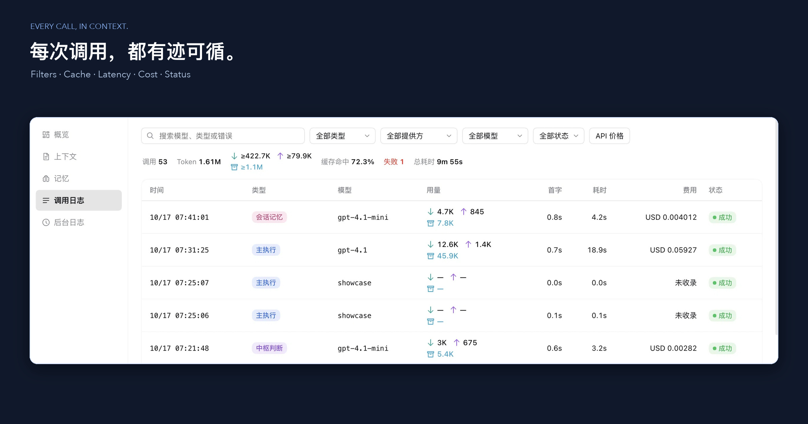

# 监控统计

[文档目录](README.md) · [使用指南](usage.md#监控) · [压缩与原文回查](context-workflow.md) · [Dream](dream-memory.md)

从右侧栏打开 **OMD 控制台**。顶部选本会话或全部会话，以及今天、近 7 天、近 30 天或全部时间。日期按本机时间划分，趋势图今天按小时、其他按天。上下文、记忆和任务证据只看当前会话。

## 各页看什么

| 页面 | 内容 |
| --- | --- |
| **概览** | Token、缓存命中、调用和失败、当前上下文、OMD 节省的量（替换和压缩的估算，不重复算 Auto Compact）、Dream 额度；主执行和后台分色的趋势、最近调用、组件用量、后台动态。点卡片或分布条会跳到对应的日志筛选 |
| **上下文** | 当前占用和构成、已准备的替换预计能省多少、整理进度、手动压缩和分段摘要 |
| **调用日志** | 按类型、服务商、模型、状态筛选和搜索。列出时间、类型、模型、输入、缓存读、输出、首字、耗时、费用、状态，展开看路由、缓存读写、推理 Token 和来源。**API 价格** 里可以查公开单价，也能给特殊路由设自定义价格 |
| **后台日志** | 预处理、中枢决定、替换、压缩、主动异步、Auto Compact、Dream 作业和失败记录，展开看前后 Token 和中枢的选择 |

输入框下方的信息栏是 DSH 原生的读数，点开可以跳到概览或调用日志。**设置 → 通用 → 性能与用量** 选"简洁"时只显示速度和缓存命中。

## 数字怎么读

"本会话"包括 OMD 主会话和它的子智能体；"全部会话"汇总 OMD 记录到的调用和后台工作，不包括其他预设和插件的调用。

| 显示 | 意思 |
| --- | --- |
| 完整数字 | 服务商直接报的，或者能从完整的字段精确算出来 |
| **`≥` 数字** | 只加了已知的部分，实际可能更多 |
| `—`／未返回 | 缺失或算不出来，不是 0 |
| `0` | 服务商确实报了 0 |

- **总 Token**：优先用服务商报的总量；没有总量但字段齐全时由输入加输出算出。只报了一部分时显示已知的最低值和缺失次数。
- **输入** 包括未缓存输入、缓存读和缓存写；推理 Token 单列，不重复加进总量。
- **缓存命中率** = 缓存读取 ÷ 输入总量，只用数据完整的调用算，算不出来就显示 `—`，悬停能看到算了多少次调用。
- 列表里的用量分两行：绿色下箭头是未缓存输入，紫色上箭头是输出，蓝色图标是缓存读取。
- 没有用量的调用仍记录身份、路由、状态、错误和耗时，但不会在趋势图上画成 0。
- 取消和成功、失败分开统计。累计调用耗时会把并行的调用相加，不等于实际经过的时间。
- **首字** 从请求发出算到第一段文字、推理或工具调用到达，主执行、子智能体和后台调用都有。

## 费用

费用按 API 单价乘以用量算出，直接显示金额和币种。不用手动配置：内置 models.dev 的公开价格，每天自动更新，断网时用最近一次成功的价格。

- 匹配顺序：你给路由设的自定义价格 → 已收录的服务商 → 同名模型的公开价格。支持大小写、厂商前缀、日期后缀和 Claude 的点号别名，长上下文自动用对应阶梯价。
- 自定义价格可以用自己的币种。
- 缓存读写没有单独定价时按输入价算，详情里会注明；推理 Token 不重复收费。
- 查不到公开价格的模型显示"未收录"。
- 价格是公开 API 价，不是订阅余额或中转商的账单。更新价格只请求公开价格库，不发送会话、用量或密钥。

## 记录存在哪

调用的身份、所属会话、路由、状态、错误、用量和耗时存在 `DSH_HOME/oh-my-dsh/monitor-v1/usage.sqlite`，不存对话正文。重启后接着读。写入失败时会留诊断，不影响模型调用本身，但那段记录会缺失。

早期版本的记录可能只有累计数，没有日期和模型。它们在"全部时间"里显示为 **历史累计（未归因）**，按日期或模型筛选时不计入。

备份时先停 DSH，再完整复制数据目录。停用或卸载会保留这些记录。

## 上下文和实际输入

上下文是当前会话此刻的占用，累计用量是调用记录，两者分开显示。色块是本地估算，细轨是服务商报的实际输入和缓存读取。DSH 的 Token 计量可能还包括请求封装，所以不一定等于色块之和。模型窗口未知时显示"容量未知"。

## 运行详情

在概览展开 **运行详情**：

- **会话预算**：设置的 Token、轮次和时长。它和 Workflow 的输出目标是两回事。
- **Dream 日额度**：已扣、上限、重置时间、运行和排队的作业。扣减包含预留，不是实际 Token；Dream 的真实调用记在调用日志里。
- **DSH 资源**：进程内存、JS 堆、运行时长和采样时间，不随筛选变化。

## 参考

界面组织参考了 [CCS Analytics](https://docs.ccs.kaitran.ca/features/dashboard/analytics)、[CC Switch](https://github.com/farion1231/cc-switch/blob/main/docs/user-manual/en/4-proxy/4.4-usage.md)、[ccusage](https://ccusage.com/guide/daily-reports)、[Leeman DSH Token Usage](https://github.com/LeemanCheung/dsh-token-usage)、[Linear](https://linear.app/now/dashboards-best-practices) 和 [Vercel Observability](https://vercel.com/docs/observability)，数据以 OMD 的记录和服务商回执为准。
