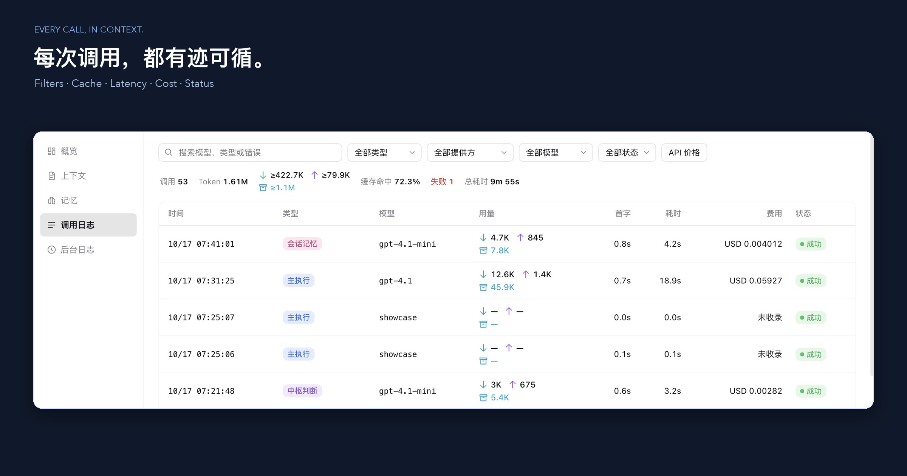

# OMD 功能图集

[中文首页](../README.md) · [English homepage](../README_EN.md) · [外观设置](skins.md) · [电脑操作](computer-use.md)

以下图片用于项目介绍，不构成所有版本、平台或功能的验收证明；实际安装条件见[当前发行与安装](releases.md)。本页不推断图片的拍摄版本或日期。

## 封面 / Covers

[中文封面](images/release/omd-hero-zh.jpg) · [English cover](images/release/omd-hero-en.jpg)

## 五套主题 / Five themes

## 浏览器与批注 / Browser annotations

## 上下文 / Context

## 监控概览 / Usage overview

## 调用日志 / Call log

仓库另有[README 素材清单](images/readme-screenshots.json)与[产品页素材清单](site/media/manifest.json)，各自的来源和适用范围以清单内容为准；本页不把这些记录自动对应到上列图片。
