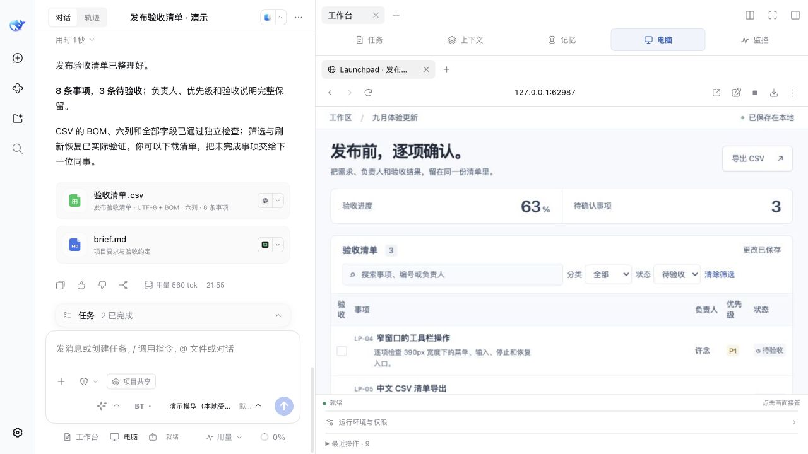
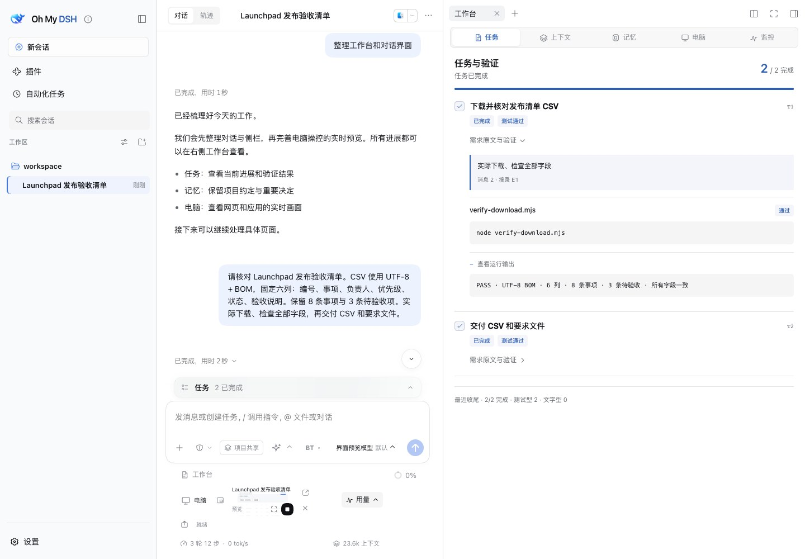

# Recorded Example and Media Sources

[简体中文](showcase.md) · [Project overview](../README_EN.md) · [Documentation](README_EN.md) · [First task](getting-started_EN.md)

These screenshots show fictional business data and a local controlled example model. Files, browser actions, downloads, checks, and delivery actually ran. They do not establish supplier-model performance or features in the current public package. The screenshots use the Chinese interface.

## Current Local Example: Purchase Order

**Problem:** A prepared office-supply order for Qinghe Workshop needs delivery details from the user, followed by the assistant reading the saved result.

**Action:** Open the order from the single **Browser** entry. In the preview, the user entered **2026-10-18**, recipient **林夏 (Lin Xia)**, and the exact note **“请在下午送达，纸箱分批标记。”** (“Deliver in the afternoon and label cartons by batch”). The user actually saved, then control resumed. CU tools read the page and confirmed the entered details, **CNY 3,480**, and **Delivery confirmed**.

**Result:** The saved page retained the entered delivery information, and the assistant read the matching amount and status. Delivery confirmed is fictional order data, not a real purchase or receipt of goods.

This runs in DSH `0.2.0-rc.2` / OMD `0.2.0-rc.2.omd.0.16.0` / OpenCU `1.6.1`, an **unpublished local implementation**. A controlled example model used actual CU tools. Page illustrations were AI-generated; the interface, fields, and results were not edited. Actual control APIs were used for operation and recovery; the visible Stop button was not verified in this recording.

## Launchpad: Requirements to Delivery

The earlier-version CSV workflow below remains a separate task, context, and delivery example.

**Problem:** Export a release checklist without losing items awaiting acceptance.

**Requirement:** Keep eight items, including three pending acceptance. Use UTF-8 with BOM and six fixed Chinese CSV columns: 编号 (ID), 事项 (item), 负责人 (owner), 优先级 (priority), 状态 (status), 验收说明 (acceptance note). Check every field, then deliver CSV and requirements.

| Stage | Actual action and result | Screenshot |
| --- | --- | --- |
| Preserve requirements | Read the requirements and save quotes/anchors in tasks. | [Requirements](site/media/launchpad-requirements.jpg) |
| Operate the page | Search/filter the prepared example page, recover after refresh, export, and save the download. | [Browser](site/media/launchpad-browser.jpg) |
| Check the file | Check BOM, six columns, eight/three counts, every field; retain PASS. | [Tasks](site/media/launchpad-tasks.jpg) |
| Continue long work | Actually organize/compress context and retain original messages. | [Context](site/media/launchpad-context.jpg) |
| Retrieve exact detail | Read the initial encoding and column order after compression. | [Original recall](site/media/launchpad-recall.jpg) |
| Deliver and inspect | Openable CSV/Markdown with workbench completion records. | [Workbench](site/media/launchpad-workbench.jpg) |

**Result:** The file meets the example's requirements and retains pending items. Business Accepted/Pending states are fictional; the two work tasks and file checks actually ran. They are not counts of product engineering acceptance.

Requirements and original-message recall

## Themes and Settings

The same executed task and delivered files appear in five light/dark themes. Names describe appearance, not access to branded models or services.

| Appearance | Light | Dark |
| --- | --- | --- |
| OMD default | [Light](site/media/theme-omd-light.jpg) | [Dark](site/media/theme-omd-dark.jpg) |
| Codex Desktop | [Light](site/media/theme-codex-light.jpg) | [Dark](site/media/theme-codex-dark.jpg) |
| iOS Liquid Glass | [Light](site/media/theme-glass-light.jpg) | [Dark](site/media/theme-glass-dark.jpg) |
| Claude CLI | [Light](site/media/theme-terminal-light.jpg) | [Dark](site/media/theme-terminal-dark.jpg) |
| Google Material | [Light](site/media/theme-material-light.jpg) | [Dark](site/media/theme-material-dark.jpg) |

[Appearance settings](site/media/launchpad-appearance.jpg) · [Plugin directory](site/media/launchpad-plugins.jpg) · [Appearance reference (Chinese)](skins.md)

## Recording Scope

The earlier Launchpad example was recorded on 2026-10-10 in isolated DSH `0.2.1-alpha.2` / OMD `0.13.0` development, with OpenCU `1.5.0`. People, checklist, and states are fictional, and the page was prepared beforehand. The controlled model scheduled responses/calls; the native host loop executed them. The current local purchase-order versions and actions are recorded in its section above.

This does not evaluate supplier autonomy, summary quality, or speed. No real subscription, private material, or native desktop permission was used. It does not prove Windows hardware, all third-party versions, or public release readiness. Recording-specific context settings, preparation batches, and manual compression do not change user defaults.

GitHub alpha.2 OMD `0.16.0` is unpublished and includes an earlier OpenCU 1.6.1 snapshot. The latest local reconstruction has not entered that snapshot. Screenshots are not a public `0.10.0` feature promise.

## Screenshots and Illustrations

Images come from actual execution and interaction. Messages, task states, results, and interface text are not rewritten; crops select visible regions only. [Media manifest](site/media/manifest.json) records dimensions, dates, versions, and checksums. Switching product-page images only browses media.

Mechanism SVGs explain concepts. Brand illustrations introduce products; they are not interface or execution evidence.

## Annotation Example

The [annotation image](images/readme-annotation.png) is a separate element-selection and temporary-style example. Its [manifest](images/readme-screenshots.json) records version/scope. Temporary CSS is not a source edit, and initial business data is not an engineering result.
