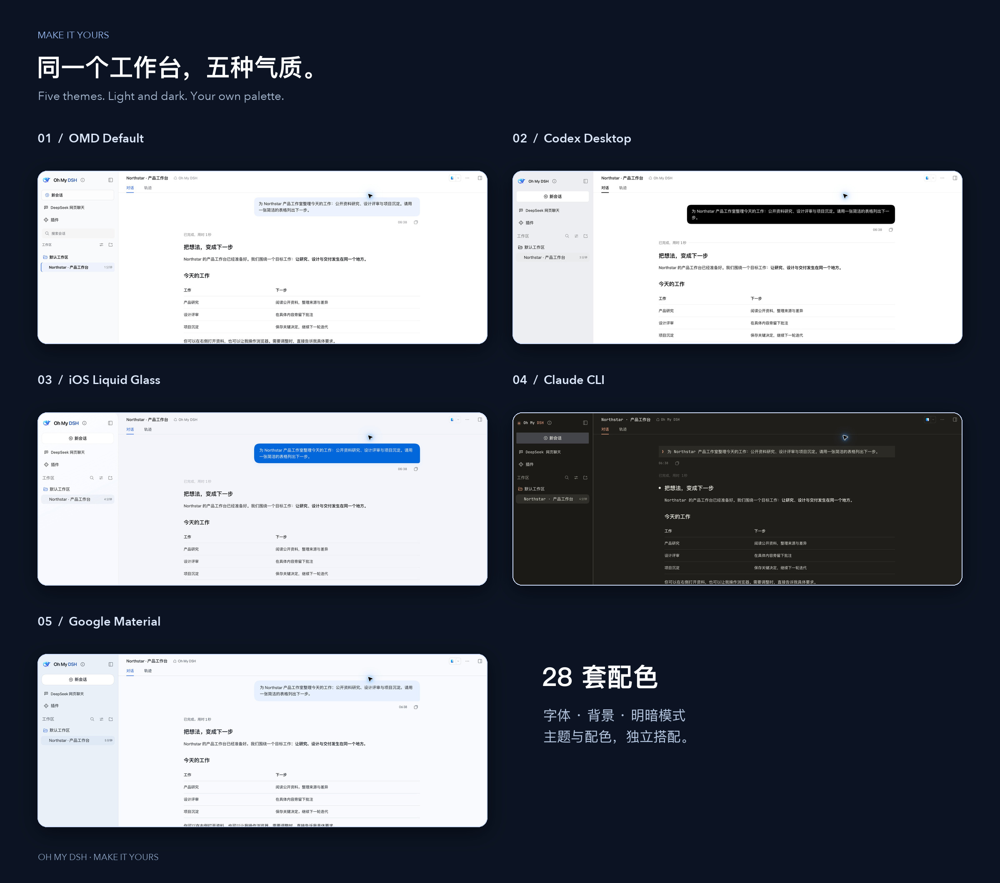
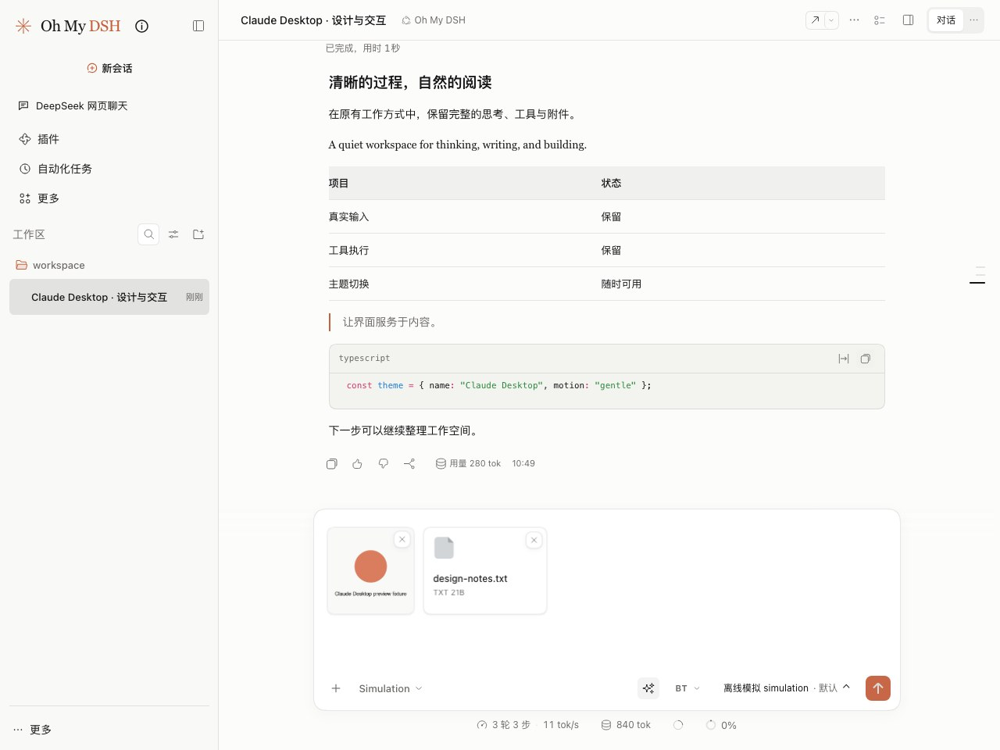
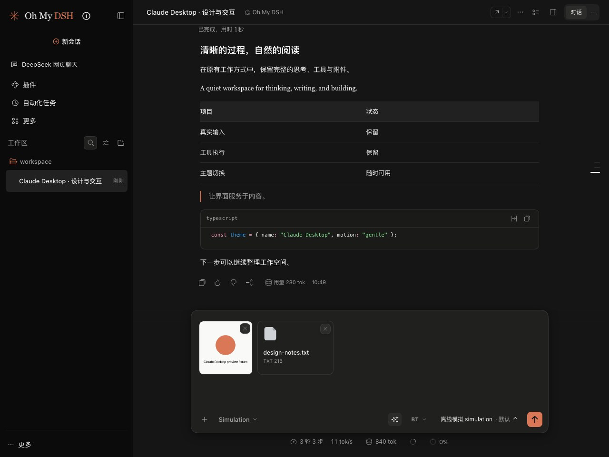

# 外观、配色与背景

[文档目录](README.md) · [首次使用](getting-started.md) · [排障](troubleshooting.md) · [制作皮肤](skin-format.md)

在 **设置 → 外观** 选主题，配色和背景单独选。新装默认用 Glyph；之前保存过的选择不变。选 DSH 原生就是 DSH 自己的外观。

| 主题 | 特点 |
| --- | --- |
| [Glyph 动态字符](../plugins/glyph-theme/README.md) | 黑白、动态的 DeepSeek 字符鲸鱼、字符控件，思考强度最高时有波纹；也能单独装到原生 DSH |
| [Codex Desktop](codex-desktop.md) | 黑白强调、冷灰侧栏、悬浮工作台、系统字体、贯通顶栏 |
| [iOS Liquid Glass](ios-liquid-glass.md) | 圆角玻璃面板、分组设置、悬浮输入区 |
| [Claude CLI](claude-cli-terminal.md) | 暖黑和纸白、陶土橙、等宽字体、终端式输入 |
| [Claude Desktop](#claude-desktop) | 柔和灰白和深色、陶土强调、衬线正文、居中阅读、圆角输入框 |
| [Google Material](google-material-expressive.md) | Android／Google 风格的导航和设置，自带 Google Sans、Noto Sans SC 和 Material Symbols |

每套都覆盖侧栏、对话、输入区、设置和工作台，支持明暗和窄屏。浏览器里如果还选着已经移除的旧皮肤，会恢复默认外观。

## 导入和恢复

- 可以导入 `.omd-skin.json`。导入同一个 id 会更新原来的皮肤；同 id 的导入版本会盖过内置版本，移除后内置版本回来。
- 格式不对的文件不会替换当前皮肤。皮肤文件不执行 JavaScript，也不联网。
- **恢复默认主题** 保留已导入的文件；**移除当前主题** 删掉当前皮肤并恢复默认。
- 界面出问题打不开设置时，在地址后加 `?omd-skin=default`（已有参数就加 `&omd-skin=default`），会临时用 DSH 原生外观打开，去掉参数后恢复。
- 皮肤和降低效果的选项存在当前浏览器、当前站点；明暗模式用 DSH 的设置。
- 随包字体的许可在 [skin-font-licenses](skin-font-licenses)。

**每次加载历史**：在 **设置 → Oh My DSH → 高级 → 其他** 选 50、200 或 500 条，默认 200。只影响打开对话和"加载更早"时显示多少，不改变模型上下文。

## Claude Desktop

在主题列表选 **Claude Desktop · 温润桌面**。它和 Claude CLI 是两套独立的主题。

柔和的灰白和深灰层次、陶土色按钮、衬线正文和无衬线控件。你的消息靠右，回答在中间的阅读区，输入框是圆角带阴影的。侧栏、设置、代码块、键盘焦点和窄屏导航都适配了。可以选"陶土"配色，也可以换别的。

样式参考 [Open Claude UI](https://github.com/Caho1/open-claude-ui)，固定提交和 MIT 许可见[来源记录](../src/client/skins/claude-desktop/source.json)和[第三方声明](../THIRD_PARTY_NOTICES.md#open-claude-ui)。字体用系统字体。

- **细节**：按钮有轻微的按压回弹；模型菜单和 Ultra 强度面板统一用陶土色。附件显示缩略图、完整文件名、上传进度，失败可以重试。思考和工具过程运行时显示三个点，结束后消失。
- **分栏**：拖动超过 4px 才生效，拖动中按 **Esc** 恢复原宽。双击右侧分隔条让对话和预览平分，双击左侧恢复默认侧栏宽度。聚焦分隔条后用方向键调整，**Shift + 方向键** 调得更快，**Enter／Home** 归位。
- **看原图**：双击放大或复原，**Ctrl + 滚轮** 或触控板捏合缩放，放大后可以拖动；底部按钮和 **+／−／0** 分别放大、缩小、适合窗口。
- 系统的减少动态效果或外观页的降低效果会关掉这些动画。Claude 的账号额度、固定模型列表、Cowork、语音和专有字体不在这套主题里。

## 配色

主题管布局、字体、圆角、间距和材质，配色管底色、文字和强调色。配色可以选"主题默认配色"或 30 套内置配色，导入主题带的颜色也会出现在列表里。换配色不会换布局，玻璃透明度仍由主题决定。

| 分组 | 配色 |
| --- | --- |
| 经典 | 黑白灰、冰蓝、暖砂、陶土、晴空蓝、字符黑白 |
| 自然绿 | 薄荷、森林、抹茶、橄榄、翡翠、竹影 |
| 青蓝 | 青瓷、海盐、深海、靛青、极地 |
| 紫粉 | 薰衣草、葡萄、暮紫、丁香、樱花、玫瑰、莓果 |
| 暖色 | 珊瑚、落日、琥珀、奶咖 |
| 中性 | 石墨、羊皮纸 |

每套配色都有单独的浅色和深色，正文、辅助文字、代码、状态和按钮颜色都配好了，不只是换强调色。

## 背景

- 支持本地 PNG、JPEG、WebP，单个不超过 15 MB、4000 万像素。图片会缩到最长边 2560 像素，存在当前浏览器里，不上传，也不会发给模型。
- 显示区域可选 **整个界面**、**仅会话区**、**仅左侧栏**。
- 可以调 0–30 px 模糊、-80% 到 80% 明暗遮罩、20% 到 100% 面板不透明度。不透明度越低壁纸越明显，100% 时完全遮住。文字始终不透明，菜单和弹窗保持实色。
- Glyph 用字符画界面，暂时不显示壁纸，换到别的主题后恢复。

换主题、恢复默认主题或切换明暗，都不会动你选的配色和背景。**恢复默认背景** 只删背景图和背景参数。开启 **降低透明与动态效果** 时暂时隐藏背景。

外观设置只在同一浏览器、同一站点的标签页之间同步，网页版和桌面版不互通。清理浏览器站点数据会删掉外观设置和背景。

## 高级外观设置

在 **设置 → 外观 → 高级设置** 调整，所有主题共用：

- **Logo 与名称**：默认 OMD 标识、固定 Oh My DSH、保留 DSH 原样，或自定义名称和本地图片。选保留原样时，DSH 或其他品牌插件可以接管。图片限 2 MB 的 PNG、JPEG、WebP，会缩到 128 像素，只存在当前浏览器，不支持远程链接和 SVG。
- **浏览器标题**：Oh My DSH、保留 DSH 原样，或自定义名称，会话名仍会自动更新。
- **页面与分区**：页面、左侧栏、会话、顶栏、输入框、工作台、菜单和弹窗、代码、用户消息和工具记录的颜色。
- **文字与交互**：正文、辅助文字、强调色、边框、悬停、选中、焦点和成功／警告／错误的颜色。
- **字体与排版**：界面、正文、代码三类字体，以及各自的字号和正文行高。
- **圆角、边框与材质**：控件、面板、输入框、消息的圆角，边框粗细、面板模糊和阴影。

打开 **启用高级外观定制** 后，浅色和深色分开编辑，没改的项跟随主题。颜色改了立即生效，文字和数字在离开输入框或按 Enter 时保存。关掉开关参数还在，再打开就恢复。每项的 **跟随主题** 只清掉这一项；**恢复全部高级设置** 清掉全部定制和自定义标识，不影响主题、配色和壁纸。保存失败时会保留正在编辑的内容并提示。

壁纸和分区颜色可以一起用。自定义主题如果写死了某些控件的样式，那部分不一定跟着变。`?omd-skin=default` 也会临时跳过高级定制。

想自己做皮肤，看[制作皮肤](skin-format.md)。
