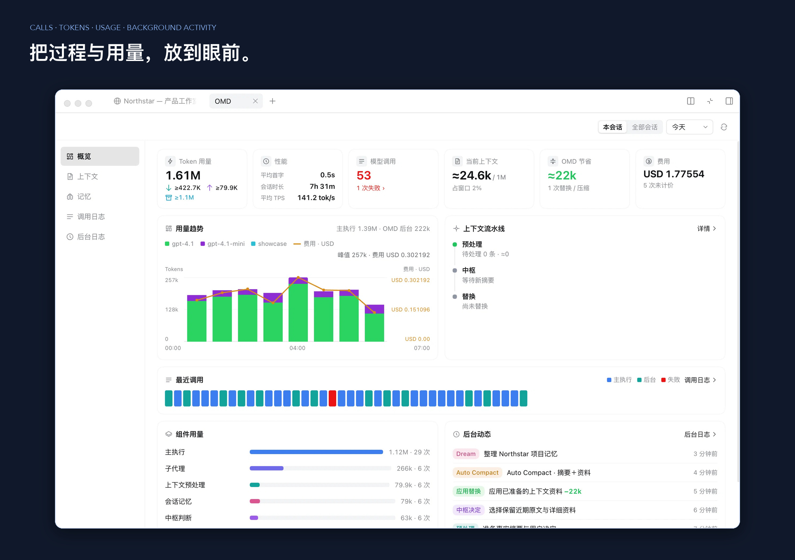

# Oh My DSH 使用指南

[English](usage_EN.md) · [文档目录](README.md) · [首次使用](getting-started.md) · [排障](troubleshooting.md)

安装、升级和卸载见[安装指南](install.md)。装好后完整重启 DSH，新建会话时预设选 **Oh My DSH**；已有会话保持原来的预设。模型和权限沿用你在 DSH 里的设置。

## 新聊天

不用先建项目。点全局的 **新建会话**，OMD 会在 **Documents/DSH/日期/新聊天** 下建一个独立文件夹（重名自动编号），这个聊天之后一直用它。改聊天标题不会挪文件夹，这些聊天显示在"未分组"里。

- **草稿**：每个工作区和全局新聊天各有一份未发送的草稿，切换时文字和附件都在。
- **模型偏好**：每个工作区和全局各自记住上次手动选的渠道、模型、思考档位和 Ultra 模式，新聊天自动沿用。
- **文件夹和记忆是两回事**：自动建的文件夹不算 Dream 项目，不会和别的聊天共享记忆。手动加入真实工作区后，才按工作区共享。见 [Dream](dream-memory.md)。

## OMD 控制台

右侧栏的 **OMD 控制台** 分为五页。输入框下方的信息栏和 BT 菜单也能跳到对应页面。

| 页面 | 能看什么 |
| --- | --- |
| **概览** | Token、缓存命中、调用和失败次数、当前上下文、OMD 节省的量、Dream 额度、用量趋势 |
| **上下文** | 上下文占用构成、整理进度，应用已准备好的压缩结果，查看摘要和资料 |
| **记忆** | 会话、项目、全局三级短记忆，整理作业和自动 Dream 设置 |
| **调用日志** | 每次模型调用的类型、模型、Token、耗时和状态，可搜索、筛选 |
| **后台日志** | 预处理、压缩、Dream 等后台工作的记录 |

## 任务和进度

标题右侧的 **会话总览** 把产出的文件、子智能体、后台进程、参考来源和电脑操作放在一起。点开子智能体可以直接和它对话；后台进程可以看输出、停止；来源可以加为附件。

交代任务时说清目标、材料、范围和交付标准。多步骤的工作，AI 会用 `todo_write` 记下你的原话和拆出的任务，用 `verify_link` 把检查命令和结果挂到对应任务上。

输入框旁的 **BT** 按会话设置提醒：

- **待办提醒**：默认开，有任务没做完时提醒 AI 继续。
- **任务验证**：有 **关闭／默认／开启** 三档。"默认"保留验证工具，但不在收尾时催；"开启"会检查每项任务有没有证据，更稳也更费时间和 Token；"关闭"把验证工具从这个会话撤掉。
- 新会话的默认档位在 **设置 → Oh My DSH → 智能体 → 任务验证默认档位** 里改。

## 模型、Ultra 和 Fast

模型面板保留 DSH 原有的档位，另加 **Ultra**。滑到 Ultra 后点面板顶部的 **Ultra** 按钮，可以选三种协作方式：

- **Workflow**：按计划分阶段执行，见 [Ultra 与 Workflow](workflow.md)。
- **Agent Team**：多个成员分工，需要先在 DSH 里打开 Agent Team。
- **自由**：AI 自己决定怎么协作，第一次用默认是这个。

菜单里的 **思考强度** 单独控制 Ultra 的推理档位，默认 `xhigh`，模型不支持时用它支持的最高档。这些选择会记住，刷新、新聊天和重启后都沿用；选回普通档位就退出 Ultra。

装了 [Subscription Login](https://github.com/V1ki/dsh-plugin-subscriptions) 并且模型支持时，模型旁会出现闪电图标，用来开关 **Fast**。

## 工具

OMD 保留 DSH 原有的工具、权限和取消方式。OMD-PTC 模式下，AI 通过 `run_code` 在一段程序里调用多个工具，后台任务的查看和停止（`job_output`、`job_list`、`job_kill`、`runtime_status`）仍可直接调用。

`run_code` 默认最长运行 120 秒，单次最多 600 秒。超时或取消会返回明确的错误；如果上一次调用还没收尾，同一会话会先等它结束再接受新的调用。

## 上下文与记忆

- **上下文优化**（默认开）：在 **设置 → 上下文与记忆 → 上下文优化** 控制。工具结果会精简，重复读同一个文件时只发变化。点工具卡片上的 **查看原文**，可以按行号、关键词或开头结尾翻原始结果。详见[上下文优化](context-optimization.md#中文)。
- **多图请求修复**（默认开）：一次请求里图片太多时，自动停发较早的图片，原图还能回查。默认上限是 20 张、10 MB，整理后保留 10 张，可以按渠道改。
- **压缩方式**：在 **上下文 → 上下文管理** 里按会话选 OMD 或 Billion Context（需要在第三方功能里装好 0.1.202 版）。两者只是压缩互斥，Dream、档案、回查、任务和人格照常工作。见 [OMD 与 Billion Context](context-workflow.md#omd-与-billion-context)。
- **异步压缩**：后台整理历史，主模型不用停下来等。`/compact` 应用已准备好的方案，`/compact-p` 把准备好的片段换成摘要，`/compact-f` 让模型重新汇总。失败不会删原文。见[压缩与原文回查](context-workflow.md)。
- **记忆缓存模式**（默认开）：后台整理优先复用主请求的模型和前缀，更容易命中缓存。命中与否由服务商决定，后台照样有用量。

首次发送前，在输入框的 **权限菜单 → 记忆范围** 选这个会话的记忆范围，发送后就固定了：

| 范围 | 效果 |
| --- | --- |
| **会话隔离** | 不带入共享记忆，也不往项目或全局里写；主动回查仍能读历史 |
| **项目共享** | 带入同项目的摘要、资料和项目短记忆 |
| **全局共享** | 带入精简的全局短记忆和项目目录，细节按需读取 |

**Dream** 在后台把对话整理成会话、项目、全局三级短记忆。自动整理默认关，开启后每 60 分钟检查一次；手动和自动共用每天 200,000 Token 的额度。关闭自动整理后，已经发出的请求仍可能产生用量。见 [Dream](dream-memory.md)。

## 输入框的 ✨

鼠标移到 **✨** 上展开优化浮层，可以选 **轻润色、结构化、步骤规划**，加额外要求、保存成预设，然后手动开始。结果可以撤销、重做或回到原稿。点一下 ✨ 切换 **每次都优化**，开启后每次发送前多调用一次当前模型，只看你写的文字，不读附件和历史。

优化结果不会自动发送。每个会话最多保留 20 个版本；刷新页面后附件和版本记录会清空，文字草稿由 DSH 保存。

## 设置

OMD 的设置集中在 **设置 → Oh My DSH** 一页，第三方功能在单独的子页。开关改了立即保存；人格正文要点编辑区的保存按钮。保存失败会提示，并恢复到已保存的状态。

| 分组 | 内容 |
| --- | --- |
| 功能 | Workbench、扩展管理、智能交互回答、智能体预设、代码理解、提示词优化，以及第三方功能入口 |
| 人格 | 全局人格、四个模块、人格文件和会话人设 |
| 上下文与记忆 | 多图请求修复、上下文优化、后台预处理、缓存模式、自动压缩、默认记忆范围和 Dream |
| 后台模型／全局背景 | 后台调用用哪个模型，以及你手写的固定背景 |
| 智能体 | 系统提示词风格、运行状态、预算提示、后台等待、任务验证默认档位 |
| 关于／高级 | 版本与更新、插件安装预检、高级参数 |

**系统提示词风格** 有 OMD 默认、DSH 原生、Codex、Cursor、Pi、Grok、ZCode 七种，默认 OMD 默认。打开 **启用会话提示词风格** 后，可以在主会话的权限菜单里给单个会话换风格，下一轮生效。见[提示词来源](prompt-adaptation.md)。

**全局背景** 由你自己写，Dream 不会改它。多处同时编辑冲突时，点 **读取最新版本** 对比后再保存。

运行状态、预算提示、后台优化等选项的说明见[运行状态与后台选项](runtime-state-background.md)。

## 人格

**人格预设** 选全局默认人格，内置默认、超频、精算和精算（英文版）。超频把依据和细节讲透；精算少说重复的话、省 Token，交付质量不打折。精算（英文版）用英文写的人格正文，回答语言仍跟随你。

每个人格分 **身份与人格、语言风格、沟通方式、回答呈现** 四个模块，后三个可以继承默认内容。人格只影响说话方式，不改变权限、工具和任务规则。

- **新建人格**：点 **复制创作提示词** 发给 AI，描述你想要的人格，AI 生成 JSON 文件后用 **导入人格文件** 导入。同名会自动改名，不会覆盖。
- **管理**：展开 **高级** 可以新建、复制、改名、删除和导出。内置人格复制后才能改。
- **会话人设**（默认开）：主会话的权限菜单里可以给单个会话选人格，或者关掉人格，随时能换。

## 外观

Glyph、DSH 原生、Codex Desktop、iOS Liquid Glass、Claude Desktop、Claude CLI、Google Material 七套外观，另有 30 套配色，背景、分区颜色、字体字号、Logo 和标题都能单独改，也可以减少动态效果。见[外观指南](skins.md)。

## 监控

**OMD 控制台** 的概览和日志可以按本会话或全部会话、按时间查看，支持按日期、模型、组件筛选。

数字前的 **`≥`** 表示已知的最低值，实际可能更多。服务商没报的输入、缓存或输出记为未知，不当成 0；缓存命中率只在数据完整时才算。上下文用量是估算，不是账单。见[监控统计](monitoring.md)。

## CodeGraph

内置 CodeGraph 1.6.0，会自动为当前代码目录准备 `.codegraph/` 索引，不用装全局命令。直接问"登录请求经过哪些函数？"就行；要查别的仓库，告诉 AI 路径即可。

第一次查询要等索引准备好。准备失败时，设置里的 **代码理解** 会显示原因，修好环境后点 **重新准备**。索引不进 DSH 会话备份，一般也不用提交到 Git。

## 电脑与浏览器

内置 OpenCU，AI 可以打开网页、读页面、填表，也能操作桌面应用，默认在后台进行，不抢你的窗口。浏览器可以用 Chrome／Edge 扩展、独立浏览器，或配套 DSH 桌面版里的内嵌浏览器；扩展第一次连接要你点允许。关闭预览不会停止任务，要停请用停止按钮。见[电脑与浏览器](computer-use.md)。

## 扩展和第三方功能

在 **设置 → Oh My DSH → 功能** 开关 DeepSeek 工作台、智能交互回答和智能体预设。社区插件集中在 **第三方** 子页：打开开关就自动安装并启用，关掉只是停用，配置和数据都留着；版本、来源、更新和卸载在每行的"详情"里。自动更新默认关。

- **DeepSeek Workbench**（默认开）：在 DSH 里用 DeepSeek 网页聊天和开放平台，可以把网页上的历史导入成 DSH 会话。见 [DeepSeek Workbench](deepseek-workbench.md)。
- **扩展管理**（默认开）：在 **插件** 页增加 Skill、MCP、指令、命令、Hooks 五个标签页，不用手改配置文件。见[扩展管理](extensions.md)。
- **独立插件**：IUI、OMAA、Subscription Login 等是独立项目，按各自的说明安装。共装时的注意事项见[插件兼容](plugin-compatibility.md)。

**插件安装预检**（默认开，在 **关于** 里）：通过 DSH 插件页、工具调用或桌面版 dsh-market 安装、更新或启用插件时，OMD 会先在一个临时 DSH 里试着加载，通过后自动继续。没通过时可以取消、复制修复信息给 AI，或者选 **仍然安装**。预检不复制你的会话和账号，临时目录用完就删。从命令行或手动改目录安装的插件不会经过预检。

## 侧问与撤回

- **`/btw 问题`**：在输入框上方弹出旁聊，用主会话的上下文和模型回答，主任务继续跑。关掉弹窗不会停止回答；旁聊记录只存在当前窗口，刷新就清空，不写进主对话和 Dream。
- **`/侧栏`**：用当前模型开一个临时文字聊天，不带主聊天的上下文，关掉就清空。`/侧栏（网页版）` 用 DeepSeek 网页账号开，关掉时删除这次的官网会话。
- **撤回**：每条你发的消息旁都有撤回按钮，确认后对话和之后 AI 改过的文件一起退回，原来的文字、图片和文件回到输入框。退多了点 **撤销撤回**。会话空闲时连按两次 Esc 或输入 `/rewind` 打开回退列表，`/undo` 撤销上一次撤回。没有备份的旧消息只退回对话，界面会提示。不要同时启用别的改写会话历史的回退插件。

## 数据和备份

数据都在你的 `DSH_HOME`（Web 版默认是用户目录下的 `.dsh`），OMD 自己的在 `oh-my-dsh/`。Dream 记忆在 `dream-v1/memory.sqlite`，监控记录在 `monitor-v1/usage.sqlite`，撤回备份在 `rewind-plus/v1`。人格、撤回备份、Workflow 和网页导入各有自己的数据目录，只复制 `oh-my-dsh/` 不够，按[插件数据归属](architecture.md#数据由对应功能保留)一起备份。停用或卸载不会清掉这些数据。

撤回备份默认空闲时清理到 2 GiB，写入上限 4 GiB，磁盘剩余不足 512 MiB 时暂停新增备份，这段时间改的文件无法撤回。恢复过程中不要手动删 `rewind-plus/v1`。

## 更新

**设置 → Oh My DSH → 关于** 显示当前版本和最新版本，绿点是普通更新，红点是重要修复。检查更新不调用模型，也不上传会话。更新只换 OMD，不会升级 DSH 或自动重启。
