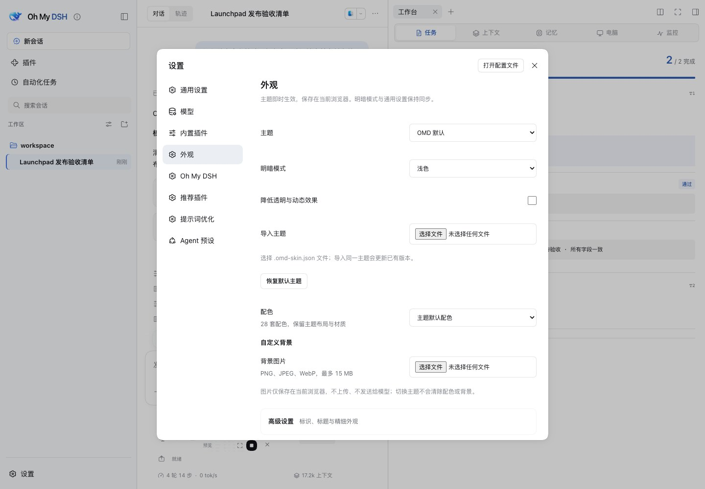
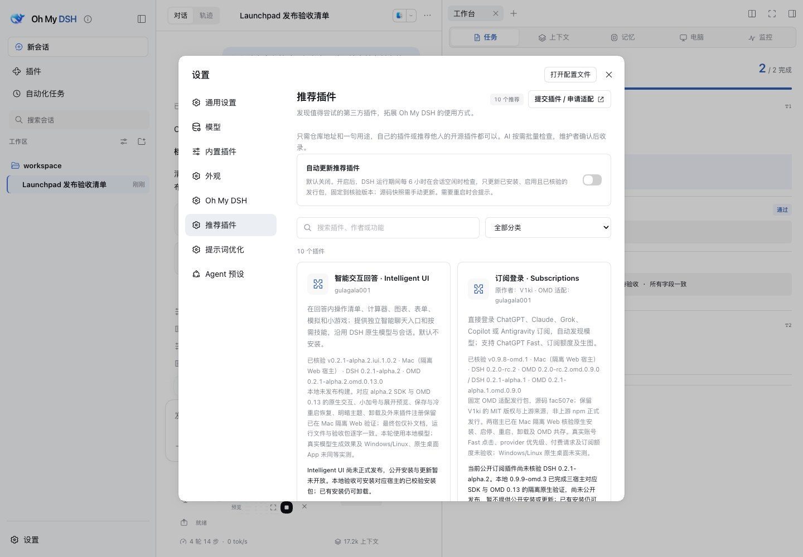

# Oh My DSH Usage Guide

[简体中文](usage.md) · [Documentation](README_EN.md) · [First task](getting-started_EN.md) · [Installation](upgrade_EN.md) · [Update and Remove](#update-uninstall) · [Troubleshooting](troubleshooting_EN.md) · [Development](development_EN.md)

OMD is a DSH plugin. Keep using the host's models, projects, conversations, files, tools, and skills; its additions work around the current conversation.

Public pairs are DSH `0.2.1-alpha.1` with OMD `0.2.1-alpha.1.omd.0.10.0`, or DSH `0.2.0-rc.2` with OMD `0.2.0-rc.2.omd.0.10.0`. GitHub `main` has unpublished alpha.2 OMD `0.16.0` with the OpenCU 1.6.1 browser and runtime reconstruction. Additions are marked below; fixed-tag documentation defines the public package.

<a id="install-in-existing-dsh"></a>

## Install in Existing DSH

Desktop users should follow the [desktop tutorial](upgrade_EN.md#desktop). These commands are for alpha.1 Web. End active work, stop an existing service, and [back it up](upgrade_EN.md#2-stop-and-back-up).

Use Node.js ≥22.19, Git, and pnpm 11.23.0 for the public version; on Windows, use PowerShell 7. Run with the same `DSH_HOME` as the service:

```sh
npx --yes @deepseek-ai/dsh@0.2.1-alpha.1 plugin --profile web add https://github.com/gulagala001/oh-my-dsh/releases/download/v0.2.1-alpha.1.omd.0.10.0/trisoul_x-0.2.1-alpha.1.omd.0.10.0.tgz
npx --yes @deepseek-ai/dsh@0.2.1-alpha.1 --profile web
```

Open the complete login link printed by this launch. A new Web environment defaults to port 3080; retain existing ports and launch methods. Replace `web` with your actual custom profile. Installation and execution must use the same data directory.

The default preset becomes `trisoul-x` (Oh My DSH), with full file/command access and execution approvals disabled. **Explicit profile overrides take priority.** Existing conversations keep their presets. A regular Web CLI cannot manage the desktop app's reserved `desktop` profile.

<a id="update-uninstall"></a>

<details>
<summary>Update, disable, or uninstall</summary>

Back up first and choose the [fixed release for your host](upgrade_EN.md#versions-and-success-criteria). The version panel's Update action uses the current profile's native manager; it does not upgrade DSH or restart it. Do not choose a package by `latest`.

After installing, updating, enabling, or disabling, restart completely. Desktop: use Restart App and Host, or fully quit and reopen. Web: restart the original service. Closing a window or refreshing does not replace the running backend.

Web removal:

```sh
npx --yes @deepseek-ai/dsh@0.2.1-alpha.1 plugin --profile web remove trisoul_x
```

Desktop: use its Plugins page or [bundled CLI](upgrade_EN.md#desktop-cli). Removal retains models, credentials, conversations, and data. Old OMD conversations need their preset restored to continue. A new standard conversation can use DSH; this does not convert old OMD conversations automatically.

</details>

## Projectless Chat

Hover the selected workspace label and click **×** to clear it. Drafts, attachments, model, and access selection remain; you can select another workspace.

Sending the first message creates a separate directory on the DSH host, normally **Documents/DSH/date/first-message-name**, with a number for duplicate names. Unsent conversations create no directory. Refreshing, restarting, or continuing reuses it; another conversation gets a new directory. These chats appear under Ungrouped without registering a workspace.

If access shows Custom, choose a preset first. A failed synchronization retains the draft and offers retry.

<a id="local-development-or-trial"></a>

See [development](development_EN.md) for source runs and isolated trials. Normal installation needs neither cloning nor manual builds.

## Interface and Entry Points

**Workbench** below the composer opens native content tabs on the right. Choose tasks, context, memory, or monitoring. Existing file, terminal, browser, and third-party entries remain available.

| Entry | Purpose |
| --- | --- |
| **Tasks and verification** | Requirements, source anchors, status, and check records. |
| **Context** | Summaries, detailed material, sources, and compression mode. |
| **Memory · Dream** | Development builds' session, project, and global short memory. |
| **Monitoring** | Overview, Usage, and Context views. |
| **Computer** | Current target, or the browser entry when none is selected. |
| Composer **Usage** | Expand/collapse steps, speed, tokens, and cache figures. |
| **Scope / BT** beside the model | Scope before the first message; reminders at any time. |

[](showcase_EN.md)

*Fictional business data and a controlled example model; tools and checks actually ran. [Sources](showcase_EN.md).*

<details>
<summary>Process details, keyboard navigation, and narrow windows</summary>

Consecutive actions are grouped; expand screenshots and individual results when needed. After completion, tool details and reasoning remain accessible, with the final answer outside the process group. Settings → General → Work process display controls density.

The sidebar supports arrows, Home/End, Enter, Escape, and Shift+F10 for its native menu. In narrow windows, dismiss it by selecting a conversation, clicking the backdrop, or pressing Escape. Switching workbench tabs retains edits; returning from source reading retains position.

</details>

## Everyday Work

Give the assistant the goal, material, and constraints together. For longer work, ask it to track tasks and check the output: “Organize this checklist, keep unaccepted items, download the CSV, check its fields, and deliver it.”

**BT** is saved per conversation. Task reminders default on; verification reminders default off. Verification reminders check missing or textual evidence and may use more time and tokens. Turning them off does not disable tasks or verification tools. A blocker can pause this turn's reminders without marking tasks complete.

`todo_write` manages tasks, excerpts, and anchors; `verify_link` manages evidence and actual checks. Development builds additionally retain tool-call identity, command, exit status, and timing. Completion status alone is not a passing check.

[](showcase_EN.md)

### Models and Work Modes

The model control offers native reasoning levels, **Pro**, and **Ultracode**. Pro supports decomposition, delegation when useful, and sustained work; Ultracode adds completeness and adversarial checks. Reasoning levels follow the model's declared capabilities. Modes save separately and survive model changes; choosing a native level or restoring defaults disables the mode. [Workflow reference (Chinese)](workflow.md).

**OMD-PTC** uses tools through `run_code` while retaining OMD context, tasks, skills, and computer control. It shares settings with Oh My DSH; tasks and conversations remain separate. The host's own PTC preset is also retained.

## Context and Memory

Background processing stores factual summaries, user decisions, and detailed material, then replaces historical representations in requests when appropriate. Original messages and attachments remain. For exact conditions, ask: “Retrieve the CSV encoding and column order from my first message.”

[](showcase_EN.md)

Choose before the first message; scope then locks:

| Scope | Purpose and boundary |
| --- | --- |
| **Session isolation** | No automatic shared-memory injection or propagation to project/global memory. |
| **Project sharing** | Project summaries and material; development builds also inject completed project short memory. |
| **Global sharing** (development) | Compact global short memory and a project directory, with detail retrieved as needed. |

Scope controls memory sharing, not file access. Explicit requests can retrieve other conversations in every scope.

<details>
<summary>Compression, Dream, frequency, and cost</summary>

Context → Asynchronous compression selects this conversation's mode. Default Original asynchronous processes event windows; Active asynchronous uses a separate request to decide the range. The main model continues, and the next request applies completed results. Switching cancels unfinished old requests while retaining sources and saved material. [Context reference (Chinese)](context-workflow.md).

Development builds' Memory · Dream organizes sessions, projects, and global memory with searchable, paged source navigation. It normally reads new summaries, supplementing original messages only for long-inactive conversations. Automatic Dream defaults off; when enabled it checks hourly by default. Manual and automatic work share a daily 200,000-token limit; stopping preserves progress. [Dream reference (Chinese)](dream-memory.md).

Common settings default to Moderate frequency. Idle preprocessing defaults off; its default delay when enabled is 90 seconds. Background models may follow the main model or be configured separately and still incur usage. Savings are not guaranteed. Model context windows remain finite, and monitoring distinguishes estimates from reported billed usage.

</details>

## Draft Optimization

Click the star, choose **Light polish**, **Structure**, or **Step planning**, add requirements, and start. Review before sending. Undo, redo, restore the original, refine again, or save a requirement preset.

Automatic polish before sending defaults off. When enabled, each send makes an extra call to the current model using light polish. It does not read attachment contents or the full history. If the draft or attachments change during optimization, the result waits for application; stopping, errors, timeouts, or switching conversations do not send it automatically.

<details>
<summary>Draft persistence and failed sends</summary>

Each conversation keeps up to 20 draft versions. Refresh clears optimizer versions; DSH manages the text draft. Preferences and requirement presets persist in the current browser and synchronize same-origin tabs, not other devices.

Development builds recover originals and versions after failed sends, and retain unsent attachments and optimization history across conversation switches within the current page. If you already started another draft, retained versions appear separately; viewing does not immediately replace the current text. Refreshing or closing discards those files and versions.

</details>

<a id="settings"></a>

## Settings and Saving

Settings → Oh My DSH contains Common, Base components, Model and identity, Experimental, Advanced, and Global background. Click **Save settings** for ordinary edits. Component toggles save immediately; runtime path changes need a restart.

Personality choices include Default, Hard, Soft, Custom, and Off. Saving takes effect on the next model request. Preview built-in text or copy it to Custom; switching does not delete saved custom text.

Global background is manually maintained. On conflict, **Read latest version**, compare, merge or adopt, then save. Reading does not overwrite your draft.

[](skins.md)

Appearance offers OMD default, Codex Desktop, iOS Liquid Glass, Claude CLI, and Google Material, each in light and dark. Themes, 28 palettes, and backgrounds are independent; fonts, sizes, section colors, logo, title, and reduced motion are configurable. [Detailed reference (Chinese)](skins.md) · [Recorded themes](showcase_EN.md#themes-and-settings).

<a id="runtime-state-and-blockers"></a>

<details>
<summary>Experimental options</summary>

Runtime/budget hints default off; background optimization defaults on. CoT placement defaults on and CFR defaults off. Saving affects the next request and respects existing access permissions. [Runtime reference (Chinese)](runtime-state-background.md).

</details>

## CodeGraph

Check readiness in Base components. Selecting a code project prepares `.codegraph/` automatically. Ask “Which functions handle login?” or “Who calls this function?” Retry failed preparation; ordinary file and search tools remain available.

Indexing runs locally, but source returned by queries enters the conversation and is sent to the chosen model. Structure does not replace execution checks.

<details>
<summary>Index maintenance</summary>

Bundled 1.6.0 needs no global CLI. Connections watch changes, release when idle, and catch up on the next query. Ask to update the index. Disabling or uninstalling stops owned processes while retaining `.codegraph/`; project indexes are outside the DSH data backup and normally need not be committed.

</details>

## Computer Use

OMD includes a fixed OpenCU snapshot; no separate installation is required. [OpenCU can also run independently](https://github.com/gulagala001/opencu) without OMD. See [coexistence](plugin-compatibility_EN.md#opencu).

Select a browser/app target and watch while the assistant operates. **Watching is not taking over; closing the preview is not stopping control.**

The latest local implementation has a single **Browser** entry. After the user fills and saves the page, the assistant can resume reading that same page. The [purchase-order recording](showcase_EN.md#current-local-example-purchase-order) shows this flow. It is unpublished; older packages use their fixed-tag controls.

<a id="get-started-with-computer-use"></a>

### Get Started

1. Choose a native-tool model, with image input for screenshot interpretation.
2. Check required components in **Base components** or **Computer → Runtime and permissions**.
3. In the latest local build, use the unified **Browser** entry. Public packages use their version's `@Browser`, connected Chrome tab, or app reference; describe the goal and inputs.
4. Inspect through **Computer**. **Stop / take over** before manual interaction, then **Resume assistant control**.

For example: “Filter pending acceptance, export the full checklist, check the download, and deliver it.” The recorded example actually filtered, recovered after refresh, and downloaded all eight items, including three pending acceptance.

[](showcase_EN.md)

### Platforms and Requirements

| Component | Requirement and this round's limit |
| --- | --- |
| Files, tasks, context, themes | Independent of native desktop control, running with a matching host. |
| Browser | Separate work profile; load the Chrome extension when prompted and reload it after updates. |
| macOS desktop / window sharing | macOS 14+, Accessibility and Screen Recording. Old public packages compile locally and require Apple Command Line Tools. |
| Windows desktop | Targets common single-screen workflows on Windows 10 2004+. Old public builds require .NET 10 SDK. No Windows hardware acceptance was performed this round. |
| Linux | General and browser features; no native Linux desktop control in this version. |

The **latest local reconstruction** uses a pinned official prebuilt browser runtime and supplies prebuilt native components in complete platform packages, so normal installation does not compile. Missing matching components require the complete package; source compilation is an explicit development mode. This is included in GitHub main, but not in public `0.10.0` and does not remove SDK requirements from old packages.

<details>
<summary>Browser controls, downloads, search, and device preview</summary>

Switching tabs changes only what you view. Clicking, typing, navigating, or changing styles stops and takes over. Return to the assistant's current view when needed. Open externally launches the DSH host's default browser, not a remote client's browser.

The address bar provides navigation, refresh, and stop; menus include history, find, downloads, and device tools. History records pages used after this conversation connected. Search, filter, or refresh downloads; clearing records neither deletes files nor cancels downloads.

Size, touch, DPR, and User Agent settings are separate. Applying them takes over; preview zoom changes only display, and screenshot capture observes without stopping control.

Development builds save built-in-browser downloads as persistent attachments accessible in native and OMD-PTC conversations, after stop or restart. Repeat saves reuse the file. Extension-browser downloads remain in their original download location, with records/status synchronized.

Built-in and everyday browser profiles differ. Rebind an existing original tab when possible; a new tab does not copy sessionStorage. Logout, service restart, or expired credentials may still require login.

</details>

<details>
<summary>Window sharing, annotations, and styles</summary>

Share window adds a screenshot and accessibility text to the draft for review; it does not acquire control. Page annotations capture a region or element with image, notes, and element information. Cancel adds nothing.

Style preview pauses the assistant, temporarily changes the real page, captures the result, and restores it; it does not edit source. After source changes based on the annotation, open and check the actual page. Resume before further control.

</details>

<details>
<summary>Export, WebMCP, and recovery</summary>

Export MHTML or loaded images, fonts, styles, and video resources, reporting failures. Files become persistent attachments; load lazy content first. This is not a full session backup or complete streaming/Workspace-format export.

Compatible Chromium 153+ can call page-published WebMCP tools; ordinary control remains when none are registered.

`computer_use` defaults to a 30-second budget, configurable from 1–300000 ms. Stop remains effective. Timeout does not guarantee an action was undone; observe before continuing. Reset clears JavaScript variables, but existing tabs can be rebound to avoid duplicate submissions.

</details>

## Recommended Plugins

The directory shows purpose, author, source, host version, and status. Native management handles standard packages; development-injection projects follow their own instructions.

Automatic updates default off and check only installed, enabled entries with verified releases while idle. They do not install other plugins, restart, or automatically switch host builds. Hiding the page does not uninstall anything.

[](plugin-compatibility_EN.md)

<a id="optional-intent-component"></a>

Intent understanding, Subscriptions, Intelligent UI, and OMAA are optional. Entries missing fixed artifacts or checksums remain unavailable. [Compatibility](plugin-compatibility_EN.md) · [Recommendations/adaptation (Chinese)](plugin-submissions.md).

## Side Questions and Turn Rewind

`/btw question` reuses the latest dispatched main-model request context and displays an answer while work runs, without tools. `/btw cancel` stops only the side question. After cold start, wait for the first main request. Side questions do not enter project/global Dream. [Original project](https://github.com/JasonQQ/dsh-btw-plugin).

Turn Rewind is optional. Its pinned upstream `0.3.9` is refused by alpha.1's native gate; rc.2 permits manual directory installation. Do not bypass checks. [Sources/licenses](../THIRD_PARTY_NOTICES.md).

## Data and Maintenance

Data uses actual `DSH_HOME`, normally the user's `.dsh` for Web, with OMD under `trisoul-x/`. Source trials default to repository `data/dsh/`. Back up profiles, credentials, conversations, attachments, and OMD data together; external projects/indexes need separate backup.

Retired automatic memory is read-only. Uninstall does not delete user material; follow [upgrade guidance](upgrade_EN.md) for migration and rollback.

## Versions and Update Notices

The panel separates current and remote versions, with notes, progress, errors, and restart status. Green indicates ordinary updates, red required fixes. Checking makes no model call or conversation upload; failure is not “up to date.”

Choose a [complete matching pair](upgrade_EN.md#versions-and-success-criteria), then restart and inspect the current version. Plugin updates affect only OMD in this profile; update the host separately.

<a id="development-and-verification"></a>
<a id="idle-preprocessing-and-image-budget"></a>

See [development](development_EN.md) for builds, checks, image budgets, and source structure. Historical documentation records its own scope rather than current compatibility.
