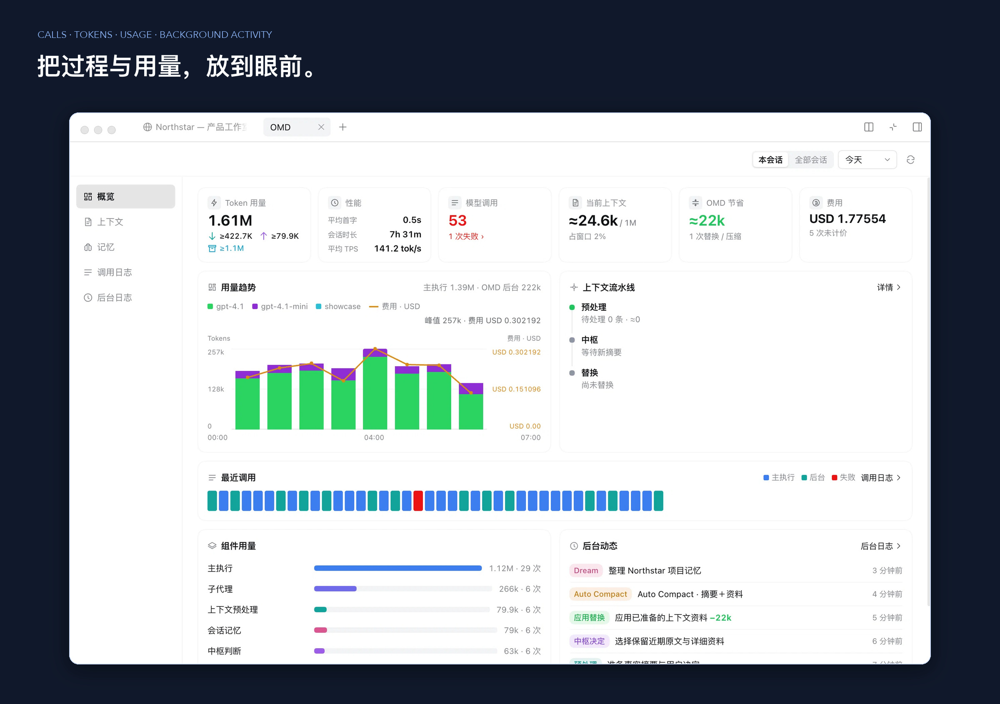

# Oh My DSH usage guide

[中文](usage.md) · [Docs](README_EN.md) · [Getting started](getting-started_EN.md) · [Troubleshooting](troubleshooting_EN.md)

For installing, upgrading and removing OMD, see the [installation guide](install_EN.md). After installing, fully restart DSH and pick the **Oh My DSH** preset when you create a session. Existing sessions keep their preset. Models and permissions come from your DSH settings.

## New chats

You do not need a project first. Click the global **New Session** and OMD creates a folder for the chat under **Documents/DSH/date/新聊天** (numbered if the name exists), which the chat keeps using. Renaming the chat does not move the folder. These chats appear under "Ungrouped".

- **Drafts**: each workspace and the global new chat keep their own unsent draft, with text and attachments, when you switch.
- **Model preferences**: each workspace and the global new chat remember the last channel, model, reasoning level and Ultra mode you picked by hand, and new chats use them.
- **Folders are not memory**: an automatic folder is not a Dream project and never shares memory with other chats. Only after you add a real workspace is memory shared by workspace. See [Dream](dream-memory.md).

## OMD Console

The **OMD Console** in the right sidebar has five pages. The info bar under the input box and the BT menu also jump to the matching page.

| Page | What you see |
| --- | --- |
| **Overview** | Tokens, cache hits, calls and failures, current context, how much OMD saved, Dream quota, usage trends |
| **Context** | What fills the context, cleanup progress, applying prepared compaction, summaries and source material |
| **Memory** | Session, project and global short memory, cleanup jobs and automatic Dream settings |
| **Call log** | Type, model, tokens, duration and status of every model call, searchable and filterable |
| **Background log** | Records of preprocessing, compaction, Dream and other background work |

## Tasks and progress

**Conversation overview**, to the right of the title, collects output files, subagents, background processes, sources and computer use. Open a subagent to talk to it directly, view or stop a background process, or add a source as an attachment.

When you hand over a task, state the goal, material, scope and what counts as done. For multi-step work the AI records your words and the tasks it derived with `todo_write`, and attaches check commands and their results to each task with `verify_link`.

**BT**, next to the input box, sets reminders per session:

- **To-do reminder**: on by default; reminds the AI to continue while tasks remain.
- **Task verification**: **Off / Default / On**. Default keeps the verification tools but does not push for them at the end. On checks every task for evidence, which is more reliable and costs more time and tokens. Off removes the verification tools from the session.
- Change the default for new sessions under **Settings → Oh My DSH → Agent**.

## Models, Ultra and Fast

Click the reasoning level to expand **Enable Agent Teams**. In Ultra, open **More model options**.

The model panel keeps DSH's own levels and adds **Ultra**. Slide to Ultra and click the **Ultra** button at the top of the panel to pick one of three ways of working together:

- **Workflow**: runs a plan in stages. See [Ultra and Workflow](workflow.md).
- **Agent Team**: several members split the work. Turn on Agent Team in DSH first.
- **Free**: the AI decides how to collaborate. This is the default the first time.

**Reasoning effort** in the menu sets the reasoning level for Ultra separately. It defaults to `xhigh`, or the highest level the model supports. These choices are remembered across reloads, new chats and restarts; picking a normal level leaves Ultra.

With [Subscription Login](https://github.com/V1ki/dsh-plugin-subscriptions) installed and a supported model, a lightning icon next to the model turns **Fast** on and off.

## Tools

OMD keeps DSH's tools, permissions and cancellation. In OMD-PTC mode the AI calls several tools from one program through `run_code`, while background-job tools (`job_output`, `job_list`, `job_kill`, `runtime_status`) stay directly callable.

`run_code` runs for up to 120 seconds by default and 600 seconds at most per call. Timeouts and cancellation return a clear error. If the previous call has not finished cleaning up, the session waits for it before accepting new calls.

## Context and memory

- **Context optimization** (on by default): controlled in **Settings → Context and memory → Context optimization**. Tool results are trimmed, and reading the same file again only sends what changed. Click **View original** on a tool card to page through the raw result by line number, keyword, start or end. See [context optimization](context-optimization.md#english).
- **Multi-image request repair** (on by default): when a request carries too many images, older ones stop being sent and can still be looked up. The defaults are 20 images and 10 MB, keeping 10 after cleanup, adjustable per channel.
- **Compaction**: choose OMD or Billion Context per session in **Context → Context management** (Billion Context 0.1.202 must be installed from the third-party page). Only compaction is exclusive; Dream, archives, lookups, tasks and personalities keep working. See [OMD and Billion Context](context-workflow.md#omd-与-billion-context).
- **Asynchronous compaction**: history is tidied in the background so the main model never waits. `/compact` applies the prepared plan, `/compact-p` replaces prepared parts with summaries, and `/compact-f` asks the model to summarize again. A failure never deletes the original. See [compaction and lookups](context-workflow.md).
- **Memory cache mode** (on by default): background cleanup reuses the main request's model and prefix to hit the cache more often. Whether it hits is up to the provider, and background work still uses tokens.

Before the first message, choose the session's memory scope in **Permissions → Memory scope** under the input box. It is fixed once you send:

| Scope | Effect |
| --- | --- |
| **Session isolation** | Brings in no shared memory and writes nothing to project or global memory; explicit lookups can still read history |
| **Project sharing** | Brings in summaries, material and short memory from the same project |
| **Global sharing** | Brings in compact global short memory and a project index, reading details when needed |

**Dream** turns conversations into session, project and global short memory in the background. Automatic Dream is off by default; when on, it checks every 60 minutes. Manual and automatic runs share a quota of 200,000 tokens a day. Requests already sent may still use tokens after you turn automatic Dream off. See [Dream](dream-memory.md).

## The ✨ button

Hover over **✨** in the input box to open the optimizer. Choose **Light polish, Structure, Step planning**, add extra instructions or save them as a preset, then start it. You can undo, redo or go back to the original. Clicking ✨ toggles optimizing every message, which makes one extra call to the current model before sending; it only reads your text, not attachments or history.

Results are never sent automatically. Each session keeps up to 20 versions. Reloading the page clears attachments and versions; DSH keeps the text draft.

## Settings

OMD's settings live on one page, **Settings → Oh My DSH**, with third-party features on a separate subpage. Switches save immediately; personality text is saved with the button in the editor. If saving fails you see a notice and the saved state comes back.

| Group | Contents |
| --- | --- |
| Features | Workbench, extension management, interactive answers, agent presets, code understanding, prompt optimization and the third-party entry |
| Personality | Global personality, the four modules, personality files and per-session personalities |
| Context and memory | Multi-image repair, context optimization, background preprocessing, cache mode, auto compaction, default memory scope and Dream |
| Background model / global background | Which model background calls use, and the fixed background you write yourself |
| Agent | System prompt style, run state, budget hints, background waits and the default task verification level |
| About / advanced | Version and updates, plugin install pre-check, advanced parameters |

**System prompt style** offers OMD default, DSH native, Codex, Cursor, Pi, Grok and ZCode, with OMD default selected. Turn on **Enable per-chat prompt style** to change the style of a single main session from its permissions menu, starting with the next turn. See [prompt sources](prompt-adaptation.md).

**Global background** is written by you; Dream never changes it. If two places edit it at once, click **Read latest version**, compare and save again.

Run state, budget hints, background optimization and similar options are described in [run state and background options](runtime-state-background.md).

## Personalities

**Personality preset** picks the global default. Built in are Default, Overclock (超频), Economical (精算) and Economical English. Overclock explains its reasoning and details fully; Economical cuts repetition and saves tokens without lowering the quality of the work. Economical English uses an English personality text, and replies still follow your language.

Each personality has four modules: identity and personality, language style, communication, and answer presentation. The last three can inherit the default. A personality only changes how the AI talks, not its permissions, tools or task rules.

- **Create one**: click **Copy creation prompt**, send it to the AI and describe the personality you want. When the AI produces a JSON file, add it with **Import personality file**. Duplicate names are renamed, never overwritten.
- **Manage**: expand **Advanced** to create, copy, rename, delete and export. Copy a built-in personality before editing it.
- **Session personalities** (on by default): pick a personality for a single main session, or none, from its permissions menu at any time.

## Appearance

Seven looks: Glyph, DSH native, Codex Desktop, iOS Liquid Glass, Claude Desktop, Claude CLI and Google Material, plus 30 color schemes. Background, section colors, fonts and sizes, logo and title can each be changed, and motion can be reduced. See [appearance](skins.md).

## Monitoring

The Overview and logs in the **OMD Console** can show this session or all sessions over a time range, filtered by date, model or component.

**`≥`** before a number means a known minimum; the real figure may be higher. Input, cache or output a provider did not report is shown as unknown, never as 0, and the cache hit rate is only computed from complete data. Context usage is an estimate, not a bill. See [monitoring](monitoring.md).

## CodeGraph

CodeGraph 1.6.0 is built in and prepares a `.codegraph/` index for the current code directory automatically, with no global command to install. Just ask "Which functions does the login request go through?"; to query another repository, give the AI its path.

The first query waits for the index. If preparation fails, **Code understanding** in Settings shows why; fix the environment and click to prepare again. The index is not part of DSH session backups and usually does not belong in Git.

## Computer and browser

OpenCU is built in. The AI can open web pages, read them and fill in forms, and also operate desktop apps, in the background by default so it never takes over your windows. Use the Chrome or Edge extension, a separate managed browser, or the embedded browser in a matching DSH desktop build; the extension asks you to allow the first connection. Closing the preview does not stop a task; use the stop button. See [computer and browser](computer-use.md).

## Extensions and third-party features

Turn DeepSeek Workbench, interactive answers and agent presets on or off in the Features group. Community plugins are on the **Third-party** subpage: switching one on installs and enables it, switching it off only disables it and keeps its settings and data. Version, source, updates and removal are under **Details** in each row. Automatic updates are off by default.

- **DeepSeek Workbench** (on by default): use DeepSeek web chat and the open platform inside DSH, and import web history as DSH sessions. See [DeepSeek Workbench](deepseek-workbench.md).
- **Extensions** (on by default): adds Skills, MCP, Instructions, Commands and Hooks tabs to the **Plugins** page so you do not edit config files by hand. See [extension management](extensions.md).
- **Separate plugins**: IUI, OMAA, Subscription Login and others are separate projects; install them by their own instructions. Notes on running them alongside OMD are in [plugin compatibility](plugin-compatibility_EN.md).

**Plugin install pre-check** (on by default, under About): when you install, update or enable a plugin from the DSH plugin page, a tool call or the desktop dsh-market, OMD first tries to load it in a temporary DSH and continues automatically if it passes. If it fails, you can cancel, copy the repair details for the AI, or choose to install anyway. The pre-check copies none of your sessions or accounts and deletes its temporary folder afterwards. Plugins installed from the command line or by editing folders are not pre-checked.

## Side questions and rewind

- **`/btw question`**: opens a side chat above the input box that answers with the main session's context and model while the main task keeps running. Closing it does not stop the answer. Side chats live only in the current window, clear on reload and never enter the main conversation or Dream.
- **`/侧栏`**: opens a temporary text chat with the current model and none of the main chat's context; closing it clears it. `/侧栏（网页版）` opens one with your DeepSeek web account and deletes that web conversation when closed.
- **Rewind**: every message you sent has a rewind button. Confirm it and the conversation, plus the files the AI changed afterwards, go back to that point, and your text, images and files return to the input box. If you went too far, use undo rewind. When the session is idle, press Esc twice or type `/rewind` for the rewind list; `/undo` undoes the last rewind. Old messages without a backup only rewind the conversation, and the interface says so. Do not enable other plugins that rewrite conversation history at the same time.

## Data and backups

Everything lives in your `DSH_HOME` (`.dsh` in your user folder for the web version), with OMD's own data in `oh-my-dsh/`. Dream memory is in `dream-v1/memory.sqlite`, monitoring in `monitor-v1/usage.sqlite` and rewind backups in `rewind-plus/v1`. Personalities, rewind backups, Workflow and web imports each keep their own data, so copying `oh-my-dsh/` alone is not enough; back them up together using [plugin data ownership](architecture_EN.md#data-retains-its-owner). Disabling or removing OMD never deletes this data.

Rewind backups are trimmed to 2 GiB when idle, capped at 4 GiB, and paused when less than 512 MiB of disk is free; files changed during that time cannot be rewound. Do not delete `rewind-plus/v1` by hand while a restore is running.

## Updates

**Settings → Oh My DSH → About** shows the current and latest version: a green dot is a normal update, a red dot an important fix. Checking for updates calls no model and uploads no sessions. Updating only replaces OMD; it never upgrades DSH or restarts it.
