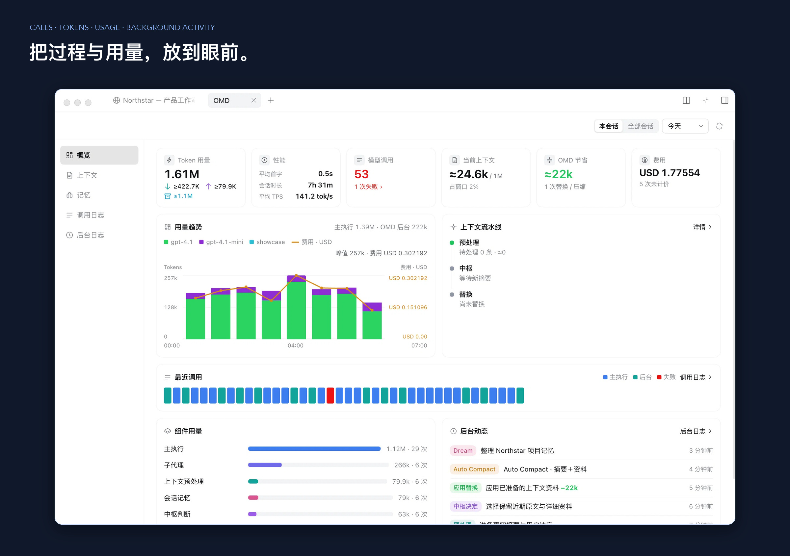

# Oh My DSH usage guide

[中文](usage.md) · [Docs](README_EN.md) · [Getting started](getting-started_EN.md) · [Troubleshooting](troubleshooting_EN.md)

See [installation](install_EN.md) to install, upgrade or remove OMD. Fully restart DSH after installing, then choose **Oh My DSH** for new sessions. Existing sessions keep their preset; DSH settings supply models and permissions.

## New chats

**New Session** creates a chat in **Documents/DSH/date/新聊天**, numbered if taken. Renaming keeps its folder.

The sidebar has collapsible **Pinned → Workspaces → Recent** sections. Pinned chats appear at the top; Recent includes workspace chats, ordered by activity. All three headers show actions on hover or keyboard focus, always on touchscreens.

- **Drafts**: workspaces and global chats retain separate text and attachments.
- **Models**: new chats inherit the channel, model, reasoning level and Ultra mode last chosen for that workspace or global chat.
- **Memory**: automatic folders share no memory. Add a real workspace for shared project memory. See [Dream](dream-memory.md).

## OMD Console

The right-sidebar **OMD Console** has five pages, also linked from the input info bar and BT:

| Page | What you see |
| --- | --- |
| **Overview** | Tokens, cache hits, calls and failures, current context, how much OMD saved, Dream quota, usage trends |
| **Context** | What fills the context, cleanup progress, applying prepared compaction, summaries and source material |
| **Memory** | Session, project and global short memory, cleanup jobs and automatic Dream settings |
| **Call log** | Type, model, tokens, duration and status of every model call, searchable and filterable |
| **Background log** | Records of preprocessing, compaction, Dream and other background work |

## Tasks and progress

**Conversation overview** opens when a new chat first has an output, source, subagent, background process or computer session. It stays open until you close it. Use the header button to toggle it or drag its edge to resize. Turn off auto-open in Settings → Oh My DSH → Features.

State your goal, material, scope and completion criteria. For multi-step work, `todo_write` records your words and derived tasks; `verify_link` attaches each task's check commands and results.

**BT**, next to the input box, sets reminders per session:

- **To-do reminder**: on by default; reminds the AI to continue while tasks remain.
- **Task verification**: **Off / Default / On**. Default keeps the verification tools but does not push for them at the end. On checks every task for evidence, which is more reliable and costs more time and tokens. Off removes the verification tools from the session.
- Change the default for new sessions under **Settings → Oh My DSH → Agent**.

## Models, Ultra and Fast

Click the reasoning level to expand **Enable Agent Teams**. In Ultra, open **More model options**.

The model panel adds **Ultra** alongside DSH's levels. Slide to Ultra, then click the panel's **Ultra** button to choose:

- **Workflow**: runs a plan in stages. See [Ultra and Workflow](workflow.md).
- **Agent Team**: several members split the work. Turn on Agent Team in DSH first.
- **Free**: the AI decides how to collaborate. This is the default the first time.

**Reasoning effort** sets Ultra's level separately: `xhigh` by default, or the model's highest supported level. Choices survive reloads, new chats and restarts. Picking a normal level leaves Ultra.

With [Subscription Login](https://github.com/V1ki/dsh-plugin-subscriptions) installed and a supported model, a lightning icon next to the model turns **Fast** on and off.

## Tools

OMD keeps DSH's tools, permissions and cancellation. In OMD-PTC mode the AI calls several tools from one program through `run_code`, while background-job tools (`job_output`, `job_list`, `job_kill`, `runtime_status`) stay directly callable.

`run_code` defaults to 120 seconds, with a 600-second maximum per call. Timeouts and cancellation return errors. New calls wait for the previous call's cleanup.

**Unharnessed** is off by default. Enable it in **Settings → Oh My DSH → Experimental presets** and select it in a new chat. `ipython` provides persistent Python, shell, MCP, skills and attachments. Requires Python 3.11+. Shell commands and autonomous checks need Bash; Windows finds Git Bash, including its plugin's configured path. WSL is unsupported. Python works without Bash.

Per-session checkpoints restore variables and serializable functions after restart with matching directory, permissions and Python version; background processes need restarting. `/unharnessed-reset` resets Python; `/goal` manages goals. Before disabling, finish running work and background commands, pause active goals and change the default preset if needed. Re-enabling preserves history and checkpoints.

Unharnessed subagents have separate Python kernels. Toggle them under **Experimental presets → Unharnessed**.

## Context and memory

- **Context optimization** (on by default): controlled in **Settings → Context and memory → Context optimization**. Tool results are trimmed, and reading the same file again only sends what changed. Click **View original** on a tool card to page through the raw result by line number, keyword, start or end. See [context optimization](context-optimization.md#english).
- **Multi-image request repair** (on by default): when a request carries too many images, older ones stop being sent and can still be looked up. The defaults are 20 images and 10 MB, keeping 10 after cleanup, adjustable per channel.
- **Compaction**: choose OMD or Billion Context per session in **Context → Context management** (Billion Context 0.1.202 must be installed from the third-party page). Only compaction is exclusive; Dream, archives, lookups, tasks and personalities keep working. See [OMD and Billion Context](context-workflow.md#omd-与-billion-context).
- **Asynchronous compaction**: history is tidied in the background so the main model never waits. `/compact` applies the prepared plan, `/compact-p` replaces prepared parts with summaries, and `/compact-f` asks the model to summarize again. A failure never deletes the original. See [compaction and lookups](context-workflow.md).
- **Memory cache mode** (on by default): background cleanup reuses the main request's model and prefix to hit the cache more often. Whether it hits is up to the provider, and background work still uses tokens.

Before the first message, choose the session's memory scope in **Permissions → Memory scope** under the input box. It is fixed once you send:

| Scope | Effect |
| --- | --- |
| **Session isolation** | Brings in no shared memory and writes nothing to project or global memory; explicit lookups can still read history |
| **Project sharing** | Brings in summaries, material and short memory from the same project |
| **Global sharing** | Brings in compact global short memory and a project index, reading details when needed |

**Dream** turns conversations into session, project and global short memory in the background. Automatic Dream is off by default; when on, it checks every 60 minutes. Manual and automatic runs share a quota of 200,000 tokens a day. Requests already sent may still use tokens after you turn automatic Dream off. See [Dream](dream-memory.md).

## The ✨ button

Hover over **✨** in the input box to open the optimizer. Choose **Light polish, Structure, Step planning**, add extra instructions or save them as a preset, then start it. You can undo, redo or go back to the original. Clicking ✨ toggles optimizing every message, which makes one extra call to the current model before sending; it only reads your text, not attachments or history.

Results are never sent automatically. Each session keeps up to 20 versions. Reloading the page clears attachments and versions; DSH keeps the text draft.

## Settings

Use **Settings → Oh My DSH**, with third-party features on a subpage. Switches save immediately; personality text uses the editor's save button. Failed saves show a notice and restore the saved state.

| Group | Contents |
| --- | --- |
| Features | Workbench, extension management, interactive answers, agent presets, code understanding, prompt optimization and the third-party entry |
| Personality | Global personality, the four modules, personality files and per-session personalities |
| Context and memory | Multi-image repair, context optimization, background preprocessing, cache mode, auto compaction, default memory scope and Dream |
| Background model / global background | Which model background calls use, and the fixed background you write yourself |
| Agent | System prompt style, run state, budget hints, background waits and the default task verification level |
| Experimental presets | The optional Unharnessed persistent Python preset, off by default |
| About / advanced | Version and updates, plugin install pre-check, advanced parameters |

**System prompt style** defaults to OMD; alternatives are DSH native, Codex, Cursor, Pi, Grok and ZCode. **Enable per-chat prompt style** allows changes in a main session's permissions menu from the next turn. See [prompt sources](prompt-adaptation.md).

**Global background** is user-written; Dream never edits it. For conflicting edits, **Read latest version**, compare and save again.

See [run state and background options](runtime-state-background.md) for run state, budget hints and background optimization.

## Personalities

**Personality preset** picks the global default. Built in are Default, Overclock (超频), Economical (精算) and Economical English. Overclock explains its reasoning and details fully; Economical cuts repetition and saves tokens without lowering the quality of the work. Economical English uses an English personality text, and replies still follow your language.

Personalities have four modules: identity and personality, language style, communication, and answer presentation. The last three can inherit defaults. Personalities affect speech, not permissions, tools or task rules.

- **Create one**: click **Copy creation prompt**, send it to the AI and describe the personality you want. When the AI produces a JSON file, add it with **Import personality file**. Duplicate names are renamed, never overwritten.
- **Manage**: expand **Advanced** to create, copy, rename, delete and export. Copy a built-in personality before editing it.
- **Session personalities** (on by default): pick a personality for a single main session, or none, from its permissions menu at any time.

## Appearance

New installs use the DSH theme, logo and title. Upgrades keep your choices. In **Settings → Appearance**, choose from seven themes and 30 color schemes, or customize your background, fonts, branding and motion. See [appearance](skins.md).

## Monitoring

In **OMD Console**, filter usage by session, date or model, including standalone and bundled Unharnessed sessions. In Call log → API prices, refresh prices, choose USD or CNY, and fetch or enter an exchange rate. **`≥`** marks a known minimum. See [monitoring](monitoring.md).

## CodeGraph

CodeGraph 1.6.0 is built in and prepares a `.codegraph/` index for the current code directory automatically, with no global command to install. Just ask "Which functions does the login request go through?"; to query another repository, give the AI its path.

The first query waits for the index. If preparation fails, **Code understanding** in Settings shows why; fix the environment and click to prepare again. The index is not part of DSH session backups and usually does not belong in Git.

## Computer and browser

OpenCU is built in. The AI can open and read web pages, fill in forms and operate desktop apps in the background. Use the sidebar browser in the stock DSH desktop app, a separate managed browser or the Chrome or Edge extension. The extension asks you to allow the first connection. The task continues when you close the preview. To end it, click the stop button. See [computer and browser](computer-use.md).

## Extensions and third-party features

Turn DeepSeek Workbench, interactive answers and agent presets on or off in the Features group. Community plugins are on the **Third-party** subpage: switching one on installs and enables it, switching it off only disables it and keeps its settings and data. Version, source, updates and removal are under **Details** in each row. Automatic updates are off by default.

- **DeepSeek Workbench** (on by default): use DeepSeek web chat and the open platform inside DSH, and import web history as DSH sessions. See [DeepSeek Workbench](deepseek-workbench.md).
- **Extensions** (on by default): adds Skills, MCP, Instructions, Commands and Hooks tabs to the **Plugins** page so you do not edit config files by hand. See [extension management](extensions.md).
- **Separate plugins**: IUI, OMAA, Subscription Login and others are separate projects; install them by their own instructions. Notes on running them alongside OMD are in [plugin compatibility](plugin-compatibility_EN.md).

**Plugin install pre-check** (on by default, under About): installs, updates and enabling through the DSH plugin page, tools or desktop dsh-market first load the plugin in a temporary DSH. Passing continues automatically; on failure, cancel, copy repair details for the AI or install anyway. No sessions or accounts are copied, and the temporary folder is deleted afterwards. Command-line and folder installs skip this check.

## Side questions and rewind

- **`/btw question`**: opens a side chat above the input box that answers with the main session's context and model while the main task keeps running. Closing it does not stop the answer. Side chats live only in the current window, clear on reload and never enter the main conversation or Dream.
- **`/侧栏`** or **Sidebar chat**: opens a separate native chat with the current model, attachments, tools and stop controls. Closing clears it. `/侧栏（网页版）` opens and deletes a temporary DeepSeek web chat.
- **Rewind**: every message you sent has a rewind button. Confirm it and the conversation, plus the files the AI changed afterwards, go back to that point, and your text, images and files return to the input box. If you went too far, use undo rewind. When the session is idle, press Esc twice or type `/rewind` for the rewind list; `/undo` undoes the last rewind. Old messages without a backup only rewind the conversation, and the interface says so. Do not enable other plugins that rewrite conversation history at the same time.

## Data and backups

Data lives in `DSH_HOME` (`~/.dsh` for web), with OMD data in `oh-my-dsh/`. Dream memory is in `dream-v1/memory.sqlite`, monitoring in `monitor-v1/usage.sqlite` and rewind backups in `rewind-plus/v1`. Personalities, rewind backups, Workflow and web imports each keep their own data, so copying `oh-my-dsh/` alone is not enough; back them up together using [plugin data ownership](architecture_EN.md#data-retains-its-owner). Disabling or removing OMD never deletes this data.

Rewind backups are trimmed to 2 GiB when idle, capped at 4 GiB, and paused when less than 512 MiB of disk is free; files changed during that time cannot be rewound. Do not delete `rewind-plus/v1` by hand while a restore is running.

## Updates

**Settings → Oh My DSH → About** shows current/latest versions: green for updates, red for important fixes. Checks call no model and upload no sessions. Updates replace OMD without upgrading or restarting DSH.
