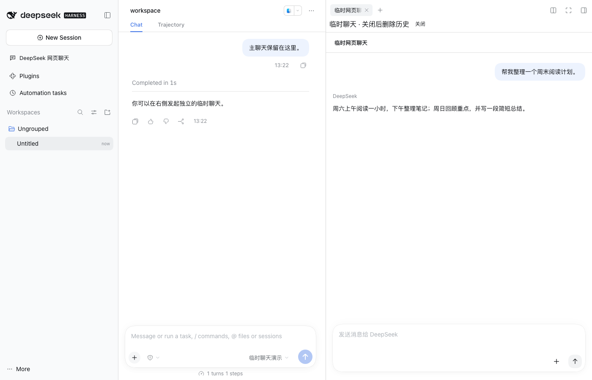

<a name="readme-top"></a>

<h1 align="center">DeepSeek Workbench</h1>

<p align="center"><strong>在 DSH 里直接用 DeepSeek 网页聊天，聊到一半可以转成 DSH 会话接着做。</strong><br>DeepSeek Harness 插件</p>

<p align="center"><strong>简体中文</strong> · <a href="README_EN.md">English</a></p>

<p align="center">
  <a href="https://github.com/gulagala001/dsh-deepseek-workbench/releases/tag/v0.1.8-dsh.0.2.2-rc.2"></a>
  <a href="https://github.com/gulagala001/dsh-deepseek-workbench/releases"></a>
  <a href="#readme-install"></a>
  <a href="https://github.com/gulagala001/dsh-deepseek-workbench/stargazers"></a>
</p>

<p align="center"><a href="#readme-install"><strong>开始使用</strong></a> · <a href="docs/usage.md">完整用法</a> · <a href="https://github.com/gulagala001/dsh-deepseek-workbench/issues">反馈</a></p>

<p align="center"><a href="docs/images/temporary-chat.png"></a></p>

<a name="readme-install"></a>

## 快速开始

**需要：** DSH **0.2.2-rc.2** 桌面版，Node.js **24.9.0+**。浏览器版 DSH 只能从外部浏览器打开网页聊天。

### 1. 安装

在 DSH 里打开 **插件 → ＋ 添加插件**，粘贴：

```text
https://github.com/gulagala001/dsh-deepseek-workbench/releases/download/v0.1.8-dsh.0.2.2-rc.2/dsh-deepseek-workbench-0.1.8-dsh.0.2.2-rc.2.tgz
```

等手头的任务跑完，按提示启用或重启 DSH，原来的设置和会话都还在。命令行安装、升级和卸载见[安装指南](docs/install.md)，校验文件：[SHA256SUMS](https://github.com/gulagala001/dsh-deepseek-workbench/releases/download/v0.1.8-dsh.0.2.2-rc.2/SHA256SUMS)。

### 2. 先试一件事

点左侧栏的 **DeepSeek 网页聊天**，登录 `chat.deepseek.com`，打开一条以前的聊天，再点 **在 DSH 中继续**。

DSH 会新建一个会话，把这条聊天的消息和附件带过来。要不要发下一条消息由你决定。

## 能做什么

- **网页聊天**：在 DSH 主界面里看官网历史、发消息，用深度思考、联网搜索和附件。
- **临时侧栏**：输入 `/侧栏（网页版）`，开一个独立的临时聊天，边看主聊天边问。关闭时会删掉这条官网会话。
- **在 DSH 中继续**：把网页聊天转成 DSH 会话，之后用 DSH 里配好的模型和工具接着做。原来的官网聊天还在。
- **API 开放平台**：从 **设置 → 账号** 进入 DeepSeek 平台，管理 API Key。

官网聊天账号和 API 平台账号是分开登录的。

## 使用范围

| 环境 | 可用功能 |
| --- | --- |
| DSH 桌面版 | 网页聊天、临时侧栏、转成 DSH 会话、平台入口；重启后要重新登录，不能下载官网文件 |
| 打过桌面适配的 DSH | 以上全部，另外登录跨重启保留、可以下载官网文件、平台页内嵌显示，见[桌面适配](docs/desktop-host.md) |
| 浏览器版 DSH | 只能从外部浏览器打开 |

转成 DSH 会话时，只带过来能读到的内容。读不到的附件会提示你，网页里的指令和工具调用不会被重新执行。

## 常见问题

<details>
<summary>为什么每次重启都要重新登录官网？</summary>

标准 DSH 桌面版不保存这类网页的登录状态。要跨重启保留，需要打过[桌面适配](docs/desktop-host.md)的 DSH。另外，官网聊天和 API 平台是两个账号，需要分别登录。

</details>

<details>
<summary>关闭临时侧栏为什么要等一下？</summary>

关闭时会先删掉这次的官网会话，删完才关。删除失败（比如断网）时面板会留着并显示错误，网络恢复后再点一次关闭即可。

</details>

<details>
<summary>更新或卸载会删掉聊天记录吗？</summary>

不会。转过来的 DSH 会话存在 DSH 里，普通官网聊天存在官网上。更新或卸载前先关掉临时侧栏，确认它已经清理完。

</details>

## 开发和许可

安装包名是 `dsh-deepseek-workbench`，只从本仓库的 Release 下载。

```bash
node scripts/prepare-host-sdk.mjs
pnpm install --frozen-lockfile --ignore-scripts --config.strict-dep-builds=false
pnpm build
```

代码用 [MIT](LICENSE) 许可，第三方来源见 [THIRD_PARTY_NOTICES.md](THIRD_PARTY_NOTICES.md)。

反馈问题请写明 DSH 和插件版本、操作步骤、期望和实际结果，日志和截图先去掉个人信息：[Issues](https://github.com/gulagala001/dsh-deepseek-workbench/issues)。
