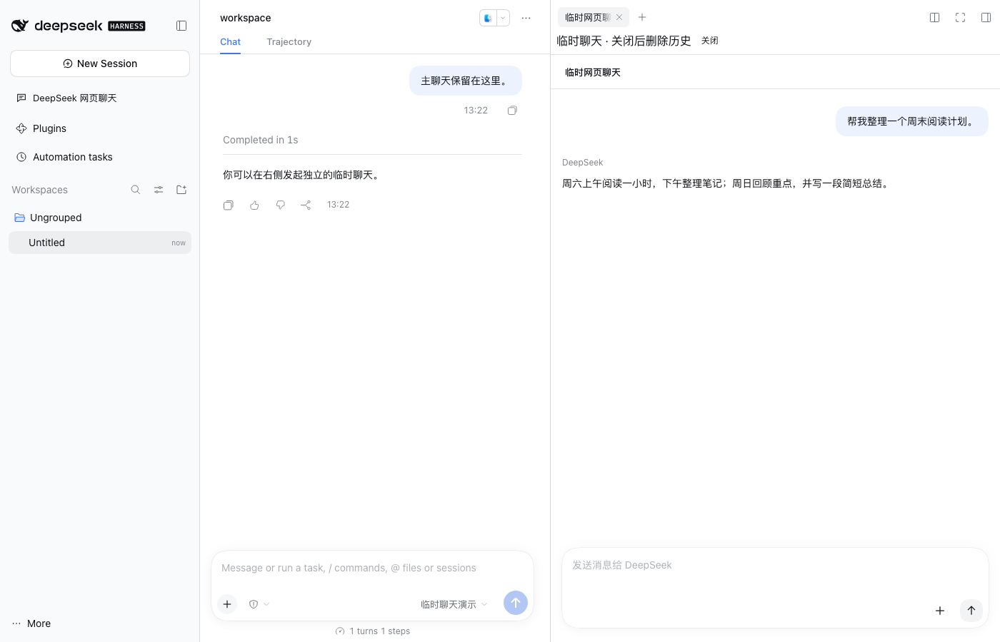

<a name="readme-top"></a>

<h1 align="center">DeepSeek Workbench</h1>

<p align="center"><strong>在 DSH 中使用网页聊天，并把历史带回原生会话。</strong><br>DeepSeek Harness 插件</p>

<p align="center"><strong>简体中文</strong> · <a href="README_EN.md">English</a></p>

<p align="center">
  <a href="https://github.com/gulagala001/dsh-deepseek-workbench/releases/tag/v0.1.1-dsh.0.2.1-rc.2"></a>
  <a href="https://github.com/gulagala001/dsh-deepseek-workbench/releases"></a>
  <a href="#readme-install"></a>
  <a href="https://github.com/gulagala001/dsh-deepseek-workbench/stargazers"></a>
</p>

<p align="center"><a href="#readme-install"><strong>开始使用</strong></a> · <a href="docs/usage.md">完整文档</a> · <a href="https://github.com/gulagala001/dsh-deepseek-workbench/issues">反馈</a></p>

<p align="center"><a href="docs/images/temporary-chat.png"></a></p>

<a name="readme-install"></a>

## 快速开始

**适用环境：** DSH **0.2.1-rc.2**, Node.js **22.19+**.

内嵌网页聊天需要 DSH 桌面版；跨重启登录、官网下载与扩展平台页面需要匹配的桌面适配。Web 版提供外部网页入口。官网聊天账号与 API 平台授权分别管理。

### 1. 安装

打开实际使用的 DSH 实例，在 **插件 → ＋ 添加插件** 中粘贴：

```text
https://github.com/gulagala001/dsh-deepseek-workbench/releases/download/v0.1.1-dsh.0.2.1-rc.2/dsh-deepseek-workbench-0.1.1-dsh.0.2.1-rc.2.tgz
```

等当前任务结束后，按宿主提示启用或完整重启该实例，沿用原 profile 与数据。其他宿主、升级和卸载见[安装指南](docs/install.md) · [SHA256SUMS](https://github.com/gulagala001/dsh-deepseek-workbench/releases/download/v0.1.1-dsh.0.2.1-rc.2/SHA256SUMS).

### 2. 先试这一件事

点击左侧栏的 **DeepSeek 网页聊天**，完成官网聊天登录，打开一条普通官网会话。

**成功标志：** 可查看官网历史；点击“在 DSH 中继续”后生成原生会话，由你决定是否发送下一条消息。

## 网页聊天与原生工作衔接

- **网页聊天**：在主内容区查看官网历史、发送消息，使用深度思考、联网搜索与附件。
- **临时侧栏**：输入 `/侧栏（网页版）` 开独立临时会话，边看主聊天边提问。
- **在 DSH 中继续**：把可读取的历史和附件迁移为原生会话，继续使用 DSH 模型与工具。
- **API 开放平台**：从设置的账号页进入平台；具备相应宿主接口时沿用当前 API 授权。

普通网页聊天保留官网历史。临时侧栏使用独立官网会话，关闭时等待删除完成；失败保留面板供重试。主聊天与其他官网会话保持独立。

## 使用条件

| 场景 | 支持与条件 |
| --- | --- |
| 标准 rc.2 桌面内嵌网页 | 隔离网页与页面读取，需官网聊天登录。 |
| 跨重启登录、下载、扩展平台页面 | 需要匹配桌面源码适配。 |
| 浏览器版 DSH | 提供外部网页入口。 |
| 历史迁移 | 仅迁移可读取内容；不可获取的附件会提示，不重放网页指令或工具。 |

[桌面宿主说明](docs/desktop-host.md) · [完整用法](docs/usage.md)

## 常见问题

<details>
<summary>为什么官网聊天要求再次登录？</summary>

官网聊天账号和 API 平台授权是两条独立路径。持久登录还取决于匹配桌面宿主的存储能力；以插件显示的能力提示为准。

</details>

<details>
<summary>关闭临时侧栏为什么会等待？</summary>

关闭会先删除这次临时官网会话。清理失败时面板保留，可重试；不要把“隐藏面板”误当已删除官网记录。

</details>

<details>
<summary>更新或卸载会删除已有聊天吗？</summary>

先关闭临时面板并确认清理成功，再安装匹配更新或卸载并重启。已迁移会话与普通官网历史由各自服务保存，官网登录数据由桌面宿主管理。

</details>

## 开发与许可

```bash
pnpm install --frozen-lockfile --ignore-scripts --config.strict-dep-builds=false
pnpm build
```

采用 [MIT](LICENSE)，第三方来源见 [THIRD_PARTY_NOTICES.md](THIRD_PARTY_NOTICES.md)。

## 文档与支持

| 我想做什么 | 去哪里 |
| --- | --- |
| 安装、升级、卸载 | [安装指南](docs/install.md) |
| 了解使用方法与边界 | [使用文档](docs/usage.md) |
| 查看版本变化 | [Releases](https://github.com/gulagala001/dsh-deepseek-workbench/releases) |
| 反馈问题 | [Issues](https://github.com/gulagala001/dsh-deepseek-workbench/issues) |

反馈时请提供完整 DSH／插件版本、实际入口、最小复现步骤，以及预期和实际表现；日志与截图先移除私人数据。

<p align="center"><a href="#readme-top">返回顶部</a> · <a href="https://github.com/gulagala001/dsh-deepseek-workbench/releases">版本与下载</a> · <a href="https://github.com/gulagala001/dsh-deepseek-workbench/issues">反馈</a></p>

[文档结构与贡献](docs/documentation.md)
