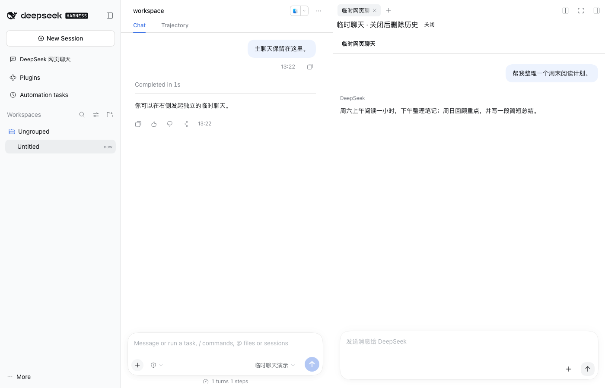

<a name="readme-top"></a>

<h1 align="center">DeepSeek Workbench</h1>

<p align="center"><strong>Use DeepSeek web chat inside DSH, and turn a chat into a DSH conversation when you want to keep working on it.</strong><br>A DeepSeek Harness plugin</p>

<p align="center"><a href="README.md">简体中文</a> · <strong>English</strong></p>

<p align="center">
  <a href="https://github.com/gulagala001/dsh-deepseek-workbench/releases/tag/v0.1.6-dsh.0.2.2-rc.2"></a>
  <a href="https://github.com/gulagala001/dsh-deepseek-workbench/releases"></a>
  <a href="#readme-install"></a>
  <a href="https://github.com/gulagala001/dsh-deepseek-workbench/stargazers"></a>
</p>

<p align="center"><a href="#readme-install"><strong>Get started</strong></a> · <a href="docs/usage_EN.md">Full usage</a> · <a href="https://github.com/gulagala001/dsh-deepseek-workbench/issues">Feedback</a></p>

<p align="center"><a href="docs/images/temporary-chat.png"></a></p>

<a name="readme-install"></a>

## Quick start

**Requires:** the DSH **0.2.2-rc.2** desktop app and Node.js **24.9.0+**. In the browser version of DSH, web chat only opens in an external browser.

### 1. Install

In DSH, open **Plugins → Add plugin** and paste:

```text
https://github.com/gulagala001/dsh-deepseek-workbench/releases/download/v0.1.6-dsh.0.2.2-rc.2/dsh-deepseek-workbench-0.1.6-dsh.0.2.2-rc.2.tgz
```

When your current task finishes, enable the plugin or restart DSH when prompted. Your settings and conversations stay as they were. For command-line installs, upgrades and removal, see the [installation guide](docs/install_EN.md). Checksums: [SHA256SUMS](https://github.com/gulagala001/dsh-deepseek-workbench/releases/download/v0.1.6-dsh.0.2.2-rc.2/SHA256SUMS).

### 2. Try it

Click **DeepSeek web chat** in the left sidebar, sign in to `chat.deepseek.com`, open an earlier chat and click **Continue in DSH**.

DSH creates a new conversation with that chat's messages and attachments. Whether to send the next message is up to you.

## What it does

- **Web chat**: browse your DeepSeek history and send messages in the main DSH view, with DeepThink, web search and attachments.
- **Temporary sidebar**: type `/侧栏（网页版）` to open a separate temporary chat beside the main one. Closing it deletes that DeepSeek conversation.
- **Continue in DSH**: turn a web chat into a DSH conversation and carry on with the models and tools configured in DSH. The original web chat stays.
- **API platform**: open the DeepSeek platform from **Settings → Account** to manage API keys.

The web chat account and the API platform account sign in separately.

## Scope

| Environment | What works |
| --- | --- |
| DSH desktop app | Web chat, temporary sidebar, Continue in DSH, platform entry. You sign in again after each restart, and DeepSeek downloads are unavailable |
| DSH desktop with the desktop adaptation | All of the above, plus sign-in that survives restarts, DeepSeek downloads and an embedded platform page. See [desktop adaptation](docs/desktop-host_EN.md) |
| DSH in a browser | Opens in an external browser only |

Continue in DSH brings over only what it can read. You are told about attachments it cannot read, and instructions or tool calls in the web chat are never run again.

## FAQ

<details>
<summary>Why do I have to sign in to DeepSeek after every restart?</summary>

The standard DSH desktop app does not keep sign-in state for these pages. To keep it across restarts, use DSH with the [desktop adaptation](docs/desktop-host_EN.md). The web chat and the API platform are separate accounts and need separate sign-ins.

</details>

<details>
<summary>Why does closing the temporary sidebar take a moment?</summary>

It deletes this temporary DeepSeek conversation first and closes once that is done. If deletion fails, for example when offline, the panel stays open with an error. Close it again once you are back online.

</details>

<details>
<summary>Do updates or uninstalling delete my chats?</summary>

No. Converted conversations are stored in DSH, and normal web chats stay on DeepSeek. Before updating or uninstalling, close the temporary sidebar and make sure it finished cleaning up.

</details>

## Development and license

The package name is `dsh-deepseek-workbench`. Download it only from this repository's releases.

```bash
node scripts/prepare-host-sdk.mjs
pnpm install --frozen-lockfile --ignore-scripts --config.strict-dep-builds=false
pnpm build
```

Code is [MIT](LICENSE) licensed; third-party sources are listed in [THIRD_PARTY_NOTICES.md](THIRD_PARTY_NOTICES.md).

When reporting a problem, include your DSH and plugin versions, the steps, and what you expected versus what happened. Remove personal data from logs and screenshots first: [Issues](https://github.com/gulagala001/dsh-deepseek-workbench/issues).
