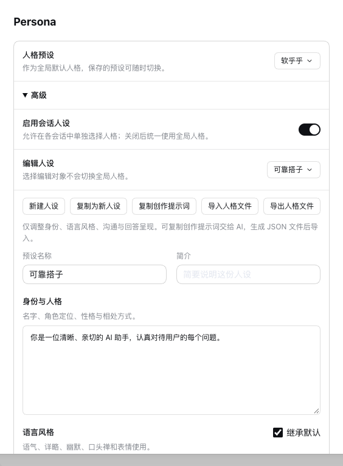

# Persona

[English](README_EN.md)

**dsh-persona-plugin** 为 DeepSeek Harness 提供可创作、可分享的人格预设，让助手在身份、语气、过程沟通和回答呈现上保持一致。



## 功能

- 四个人格模块：身份与人格、语言风格、沟通方式、回答呈现；可按模块继承默认内容。
- 内置默认、硬邦邦、软乎乎，支持多个人设的新建、复制、改名、更新与删除。
- 复制创作提示词交给 AI，生成人格 JSON 文件后直接导入；支持导出备份与分享，同名导入自动改名。
- 全局默认与会话独立选择；开启会话人设后，在权限抽屉中切换，后续请求生效。
- 人格设置集中在默认折叠的“高级”中，保存失败保留编辑草稿。

## 安装

在 **插件 → 添加插件** 中粘贴固定安装包地址：

```text
https://github.com/gulagala001/dsh-persona-plugin/releases/download/v0.1.2-dsh.0.2.1-rc.3/gulagala001-dsh-persona-plugin-0.1.2-dsh.0.2.1-rc.3.tgz
```

[SHA256SUMS](https://github.com/gulagala001/dsh-persona-plugin/releases/download/v0.1.2-dsh.0.2.1-rc.3/SHA256SUMS)

当前构建精确适配 **DSH 0.2.1-rc.3**、**Cordis 4.0.5**、**Node.js 22.19+**。

取得 `gulagala001-dsh-persona-plugin-0.1.2-dsh.0.2.1-rc.3.tgz` 后，通过 DSH **插件 → 添加插件**安装其本地绝对路径。也可执行：

```sh
dsh plugin --profile desktop add /absolute/path/gulagala001-dsh-persona-plugin-0.1.2-dsh.0.2.1-rc.3.tgz
```

将 `desktop` 换成目标实例实际使用的 profile，当前任务结束后重启该实例。

## 使用

打开 **设置 → Persona**，选择全局人格。展开**高级**，使用“新建人设”或“复制为新人设”编辑各模块。编辑对象与全局选择独立，保存不会意外切换全局人格。

点击**复制创作提示词**，发给 AI 并描述你想要的助手。AI 按模板生成 JSON 文件后，点击**导入人格文件**，即可创建并选用新预设。**导出人格文件**保存当前编辑内容，便于继续创作或分享。

启用**会话人设**后，在主会话的权限抽屉中选择“继承全局”、指定人格或“关闭人格”。关闭这项功能时统一使用全局人格，已保存的会话选择会保留。删除被会话引用的人格时，该会话回退到全局并提示。

人格只调整身份与表达偏好。实际环境、权限、工具协议、任务控制和记忆处理仍由宿主管理。数据按 profile 保存；旧版人格文件可直接导入。

## 源码构建

```sh
npm install
npm run build
npm test
npm pack
```

打包前会检查公开文件、Git 历史与实际安装包。格式说明见[人格文件](docs/personality-format.md)。

## 许可

[MIT](LICENSE)。宿主组件来源与许可见[第三方声明](THIRD_PARTY_NOTICES.md)。

[文档结构与贡献](docs/documentation.md)
