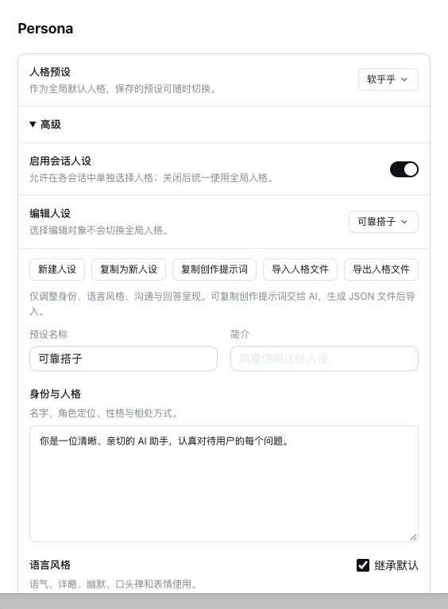

<a name="readme-top"></a>

<h1 align="center">DSH Persona</h1>

<p align="center"><strong>给 DSH 里的助手换个性格：身份、语气、沟通方式和回答格式都能自己定。</strong><br>DeepSeek Harness 插件</p>

<p align="center"><strong>简体中文</strong> · <a href="README_EN.md">English</a></p>

<p align="center">
  <a href="https://github.com/gulagala001/dsh-persona-plugin/releases/tag/v0.2.3-dsh.0.2.2-rc.2"></a>
  <a href="https://github.com/gulagala001/dsh-persona-plugin/releases"></a>
  <a href="#readme-install"></a>
  <a href="https://github.com/gulagala001/dsh-persona-plugin/stargazers"></a>
</p>

<p align="center"><a href="#readme-install"><strong>开始使用</strong></a> · <a href="docs/personality-format.md">人格文件格式</a> · <a href="https://github.com/gulagala001/dsh-persona-plugin/issues">反馈</a></p>

<p align="center"><a href="docs/images/persona.png"></a></p>

<a name="readme-install"></a>

## 快速开始

**需要：** DSH **0.2.2-rc.2**，Node.js **24.9.0+**。

### 1. 安装

在 DSH 里打开 **插件 → ＋ 添加插件**，粘贴：

```text
https://github.com/gulagala001/dsh-persona-plugin/releases/download/v0.2.3-dsh.0.2.2-rc.2/gulagala001-dsh-persona-plugin-0.2.3-dsh.0.2.2-rc.2.tgz
```

等手头的任务跑完，按提示启用或重启 DSH，原来的设置和会话都还在。校验文件：[SHA256SUMS](https://github.com/gulagala001/dsh-persona-plugin/releases/download/v0.2.3-dsh.0.2.2-rc.2/SHA256SUMS)。

<details>
<summary>用命令行安装或卸载</summary>

用同一个 DSH 自带的命令行，把 `desktop` 换成你的 profile：

```sh
dsh plugin --profile desktop add "https://github.com/gulagala001/dsh-persona-plugin/releases/download/v0.2.3-dsh.0.2.2-rc.2/gulagala001-dsh-persona-plugin-0.2.3-dsh.0.2.2-rc.2.tgz"
dsh plugin --profile desktop remove @gulagala001/dsh-persona-plugin
```

装好或卸载后重启 DSH。

</details>

### 2. 先试一件事

打开 **设置 → Persona**，把全局人格换成 **精算**，然后随便问一个问题，回答会明显变短、更直接。

## 能做什么

- **内置人格**：默认、**超频**（舍得花 token，把解释讲深讲全）、**精算**（少说废话省 token，质量不打折），以及精算的英文版提示词。
- **四个模块**：身份与人格、语言风格、沟通方式、回答呈现，可以只改其中几项，其余沿用默认。
- **自己做人格**：在 **高级** 里新建、复制、改名和删除人设。编辑哪个人设和全局选用哪个是分开的，保存不会顺手切换全局人格。
- **让 AI 帮你写**：点 **复制创作提示词**，发给 AI 并描述你想要的助手，它会生成一个 JSON 文件，再点 **导入人格文件** 就能用。**导出人格文件** 可以备份或分享给别人。
- **每个会话单独选**：在主会话的权限抽屉里，可以选继承全局、指定某个人格或关闭人格，从下一条消息开始生效。

人格只改变助手怎么说话，不影响它能用的工具、权限和任务流程。

## 常见问题

<details>
<summary>升级后我选的内置人格不见了？</summary>

旧版本里有的内置人格已经下线。选过它的全局设置会回到默认，会话设置回到跟随全局。你自己建的人设和导入的文件都不受影响。

</details>

<details>
<summary>两个窗口同时改人格会互相覆盖吗？</summary>

不会。保存时如果发现另一个窗口已经改过，会停下来显示最新内容，你的草稿还在，看过后再保存一次即可。

</details>

<details>
<summary>删掉一个人格，正在用它的会话怎么办？</summary>

这些会话会回到跟随全局，并提示你。

</details>

## 开发和许可

安装包名是 `@gulagala001/dsh-persona-plugin`，只从本仓库的 Release 下载。

```sh
node scripts/prepare-host-sdk.mjs
npm install
npm run build
npm test
npm pack
```

人格文件的字段和限制见[人格文件格式](docs/personality-format.md)。代码用 [MIT](LICENSE) 许可，第三方来源见 [THIRD_PARTY_NOTICES.md](THIRD_PARTY_NOTICES.md)。

反馈问题请写明 DSH 和插件版本、操作步骤、期望和实际结果，日志和截图先去掉个人信息：[Issues](https://github.com/gulagala001/dsh-persona-plugin/issues)。
