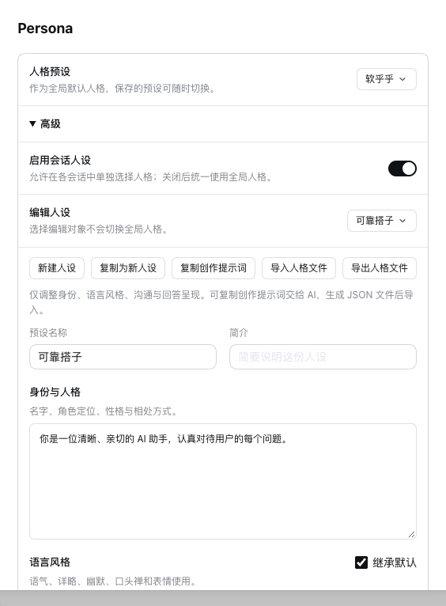

<a name="readme-top"></a>

<h1 align="center">DSH Persona</h1>

<p align="center"><strong>Give the assistant in DSH a personality of your choice: identity, tone, how it communicates and how it formats answers.</strong><br>A DeepSeek Harness plugin</p>

<p align="center"><a href="README.md">简体中文</a> · <strong>English</strong></p>

<p align="center">
  <a href="https://github.com/gulagala001/dsh-persona-plugin/releases/tag/v0.2.3-dsh.0.2.2-rc.2"></a>
  <a href="https://github.com/gulagala001/dsh-persona-plugin/releases"></a>
  <a href="#readme-install"></a>
  <a href="https://github.com/gulagala001/dsh-persona-plugin/stargazers"></a>
</p>

<p align="center"><a href="#readme-install"><strong>Get started</strong></a> · <a href="docs/personality-format.md">Personality file format</a> · <a href="https://github.com/gulagala001/dsh-persona-plugin/issues">Feedback</a></p>

<p align="center"><a href="docs/images/persona.png"></a></p>

<a name="readme-install"></a>

## Quick start

**Requires:** DSH **0.2.2-rc.2** and Node.js **24.9.0+**.

### 1. Install

In DSH, open **Plugins → Add plugin** and paste:

```text
https://github.com/gulagala001/dsh-persona-plugin/releases/download/v0.2.3-dsh.0.2.2-rc.2/gulagala001-dsh-persona-plugin-0.2.3-dsh.0.2.2-rc.2.tgz
```

When your current task finishes, enable the plugin or restart DSH when prompted. Your settings and conversations stay as they were. Checksums: [SHA256SUMS](https://github.com/gulagala001/dsh-persona-plugin/releases/download/v0.2.3-dsh.0.2.2-rc.2/SHA256SUMS).

<details>
<summary>Install or remove from the command line</summary>

Use the CLI that belongs to the same DSH, replacing `desktop` with your profile:

```sh
dsh plugin --profile desktop add "https://github.com/gulagala001/dsh-persona-plugin/releases/download/v0.2.3-dsh.0.2.2-rc.2/gulagala001-dsh-persona-plugin-0.2.3-dsh.0.2.2-rc.2.tgz"
dsh plugin --profile desktop remove @gulagala001/dsh-persona-plugin
```

Restart DSH after installing or removing.

</details>

### 2. Try it

Open **Settings → Persona**, switch the global personality to **Economical (精算)**, and ask anything. Answers get noticeably shorter and more direct.

## What it does

- **Built-in personalities**: Default, **Overclock (超频)** for thorough, in-depth explanations, **Economical (精算)** for fewer wasted words at the same quality, and an English-prompt version of Economical.
- **Four modules**: identity, language style, communication and answer presentation. Change only the ones you want; the rest use defaults.
- **Make your own**: create, copy, rename and delete presets under **Advanced**. The preset you are editing is separate from the one in global use, so saving never switches your global personality.
- **Let an AI write one**: copy the creation prompt, send it to an AI with a description of the assistant you want, and import the JSON file it produces. Export a personality to back it up or share it.
- **Per-conversation choice**: in the permissions drawer of a conversation, follow the global setting, pick a personality or turn personalities off. It applies from the next message.

A personality only changes how the assistant talks. Its tools, permissions and task flow stay the same.

## FAQ

<details>
<summary>The built-in personality I used is gone after upgrading?</summary>

Some older built-in personalities were retired. A global setting that used one goes back to Default, and conversation settings go back to following the global one. Presets you created or imported are untouched.

</details>

<details>
<summary>Do two windows editing personalities overwrite each other?</summary>

No. If another window saved first, the save stops and shows the latest settings. Your draft stays, so you can review it and save again.

</details>

<details>
<summary>What happens to conversations using a personality I delete?</summary>

They go back to following the global setting, and you get a notice.

</details>

## Development and license

The package name is `@gulagala001/dsh-persona-plugin`. Download it only from this repository's releases.

```sh
node scripts/prepare-host-sdk.mjs
npm install
npm run build
npm test
npm pack
```

Fields and limits of personality files are in the [personality file format](docs/personality-format.md). Code is [MIT](LICENSE) licensed; third-party sources are listed in [THIRD_PARTY_NOTICES.md](THIRD_PARTY_NOTICES.md).

When reporting a problem, include your DSH and plugin versions, the steps, and what you expected versus what happened. Remove personal data from logs and screenshots first: [Issues](https://github.com/gulagala001/dsh-persona-plugin/issues).
