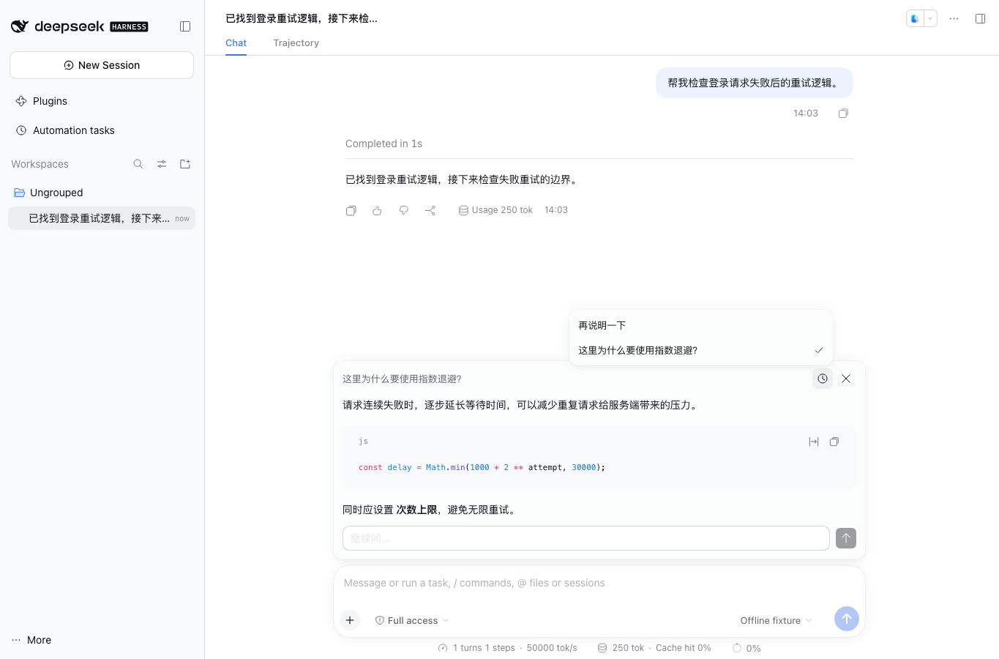

<a name="readme-top"></a>

<h1 align="center">DSH BTW</h1>

<p align="center"><strong>主任务继续跑，旁边随时问一句。</strong><br>DeepSeek Harness 插件</p>

<p align="center"><strong>简体中文</strong> · <a href="README_EN.md">English</a></p>

<p align="center">
  <a href="https://github.com/gulagala001/dsh-btw/releases/tag/v0.1.9-dsh.0.2.2-rc.2"></a>
  <a href="https://github.com/gulagala001/dsh-btw/releases"></a>
  <a href="#readme-install"></a>
  <a href="https://github.com/gulagala001/dsh-btw/stargazers"></a>
</p>

<p align="center"><a href="#readme-install"><strong>开始使用</strong></a> · <a href="docs/install.zh.md">安装指南</a> · <a href="https://github.com/gulagala001/dsh-btw/issues">反馈</a></p>

<p align="center"><a href="docs/images/side-chat.png"></a></p>

<a name="readme-install"></a>

## 快速开始

**需要：** DSH **0.2.2-rc.2**，Node.js **24.9.0+**。旁聊用当前会话的模型，按正常用量计费。

### 1. 安装

在 DSH 里打开 **插件 → ＋ 添加插件**，粘贴：

```text
https://github.com/gulagala001/dsh-btw/releases/download/v0.1.9-dsh.0.2.2-rc.2/gulagala001-dsh-btw-0.1.9-dsh.0.2.2-rc.2.tgz
```

等手头的任务跑完，按提示启用或重启 DSH，原来的设置和会话都还在。命令行安装、升级和卸载见[安装指南](docs/install.zh.md)，校验文件：[SHA256SUMS](https://github.com/gulagala001/dsh-btw/releases/download/v0.1.9-dsh.0.2.2-rc.2/SHA256SUMS)。

### 2. 先试一件事

在一个已经聊过几句的会话里输入：

```text
/btw 用两句话解释刚才方案里最重要的取舍。
```

输入框上方会弹出旁聊回复，主任务照常运行，这次问答不会写进主对话。

## 怎么用

- 输入 `/btw 你的问题` 直接提问；只输入 `/btw` 打开弹窗和历史记录。
- 弹窗里能看 Markdown、复制代码、接着追问。旁聊能看到主会话已有的内容，包括已经完成的工具结果，但看不到正在生成的那条回复。
- 旁聊只回答，不调用工具，也不改文件。
- 点停止只取消这次旁聊；按 Esc 或关闭按钮只是收起弹窗，回答会在后台继续，主任务不受影响。

旁聊会沿用主会话的消息开头和模型设置，只在后面追加你的问题，这样服务商的提示词缓存有机会命中，省一部分费用；能不能命中由服务商决定。

## 常见问题

<details>
<summary>旁聊记录能保留多久？</summary>

每个主会话最多保留最近 20 条，只存在当前窗口里。刷新页面、关闭窗口或停用插件后就没了。

</details>

<details>
<summary>为什么有时候用不了旁聊？</summary>

主会话里至少要先发过一条消息，旁聊才有上下文可用。旁聊只接收文字；输入框里带着附件时会提示你，草稿和附件都会留着。

</details>

<details>
<summary>关掉弹窗后回答还在继续？</summary>

是的，关闭只是收起界面。要取消这次旁聊，用弹窗里的停止按钮；它不会停掉主任务。

</details>

## 开发和许可

安装包名是 `@gulagala001/dsh-btw`，只从本仓库的 Release 下载。

```bash
node scripts/prepare-host-sdk.mjs
npm ci
npm run build
npm test
```

前端用 DSH 自带的界面组件和输入框扩展；后端读取主会话的只读快照，另外发起一条流式请求。代码用 [MIT](LICENSE) 许可。

反馈问题请写明 DSH 和插件版本、操作步骤、期望和实际结果，日志和截图先去掉个人信息：[Issues](https://github.com/gulagala001/dsh-btw/issues)。
