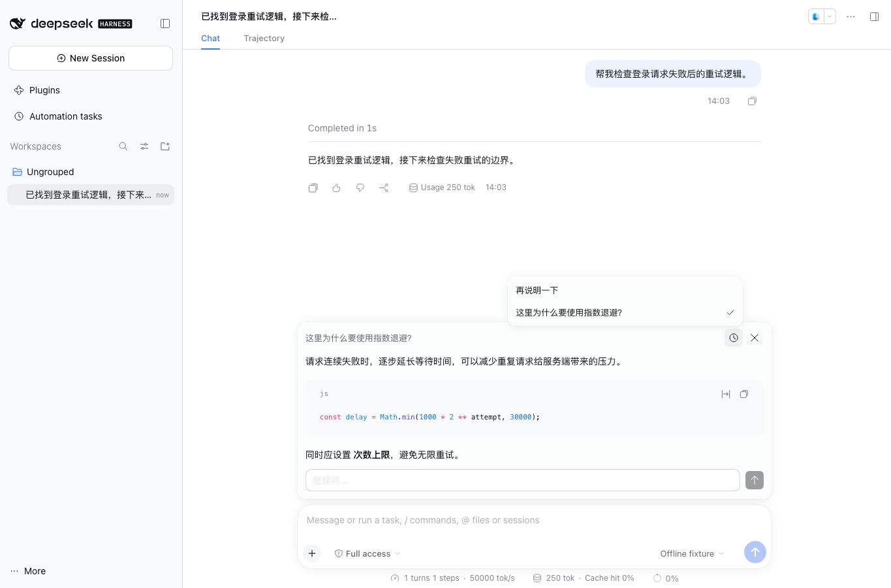

<a name="readme-top"></a>

<h1 align="center">DSH BTW</h1>

<p align="center"><strong>Ask a quick side question while the main task keeps running.</strong><br>A DeepSeek Harness plugin</p>

<p align="center"><a href="README.md">简体中文</a> · <strong>English</strong></p>

<p align="center">
  <a href="https://github.com/gulagala001/dsh-btw/releases/tag/v0.1.10-dsh.0.2.2-rc.3"></a>
  <a href="https://github.com/gulagala001/dsh-btw/releases"></a>
  <a href="#readme-install"></a>
  <a href="https://github.com/gulagala001/dsh-btw/stargazers"></a>
</p>

<p align="center"><a href="#readme-install"><strong>Get started</strong></a> · <a href="docs/install.md">Installation guide</a> · <a href="https://github.com/gulagala001/dsh-btw/issues">Feedback</a></p>

<p align="center"><a href="docs/images/side-chat.png"></a></p>

<a name="readme-install"></a>

## Quick start

**Requires:** DSH **0.2.2-rc.3** and Node.js **24.9.0+**. Side chats use the current conversation's model and are billed as normal usage.

### 1. Install

In DSH, open **Plugins → Add plugin** and paste:

```text
https://github.com/gulagala001/dsh-btw/releases/download/v0.1.10-dsh.0.2.2-rc.3/gulagala001-dsh-btw-0.1.10-dsh.0.2.2-rc.3.tgz
```

When your current task finishes, enable the plugin or restart DSH when prompted. Your settings and conversations stay as they were. For command-line installs, upgrades and removal, see the [installation guide](docs/install.md). Checksums: [SHA256SUMS](https://github.com/gulagala001/dsh-btw/releases/download/v0.1.10-dsh.0.2.2-rc.3/SHA256SUMS).

### 2. Try it

In a conversation that already has a few messages, type:

```text
/btw In two sentences, what is the most important trade-off in the plan above?
```

The answer pops up above the composer. The main task keeps running, and this exchange is not added to the main conversation.

## How to use it

- Type `/btw your question` to ask directly; type `/btw` alone to open the popover and its history.
- The popover renders Markdown, lets you copy code and ask follow-ups. It can see what the main conversation already contains, including finished tool results, but not the reply that is still being generated.
- Side chats only answer. They do not call tools or change files.
- Stop cancels only this side chat. Esc or the close button just hides the popover; the answer keeps coming in the background and the main task is unaffected.

A side chat reuses the main conversation's opening messages and model settings and only appends your question, so the provider's prompt cache has a chance to hit and save some cost. Whether it hits is up to the provider.

## FAQ

<details>
<summary>How long is side-chat history kept?</summary>

Up to the latest 20 per main conversation, in the current window only. Reloading, closing the window or disabling the plugin clears it.

</details>

<details>
<summary>Why is the side chat sometimes unavailable?</summary>

The main conversation needs at least one sent message before there is any context to use. Side chats accept text only; if the composer holds attachments you get a notice, and your draft and attachments stay put.

</details>

<details>
<summary>The answer keeps going after I close the popover?</summary>

Yes, closing only hides it. To cancel the side chat, use the stop button in the popover. It never stops the main task.

</details>

## Development and license

The package name is `@gulagala001/dsh-btw`. Download it only from this repository's releases.

```bash
node scripts/prepare-host-sdk.mjs
npm ci
npm run build
npm test
```

The client uses DSH's own UI components and composer extension points. The backend reads a read-only snapshot of the main conversation and makes a separate streaming request. Code is [MIT](LICENSE) licensed.

When reporting a problem, include your DSH and plugin versions, the steps, and what you expected versus what happened. Remove personal data from logs and screenshots first: [Issues](https://github.com/gulagala001/dsh-btw/issues).
