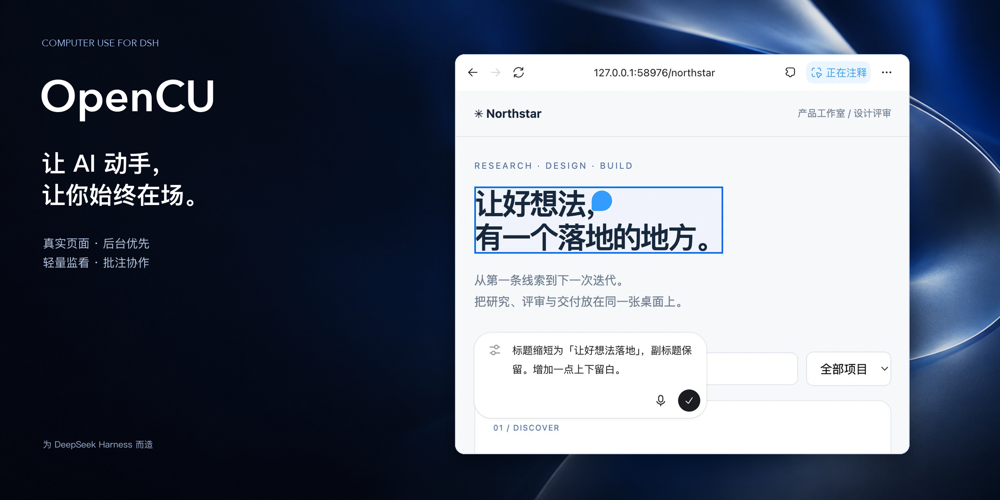

<p align="center"></p>
<h1 align="center">OpenCU</h1>
<p align="center"><strong>电脑与浏览器操作，直接发生在 DSH 对话里。</strong></p>
<p align="center">真实页面 · 后台优先 · 轻量监看 · 批注协作</p>
<p align="center"><strong>简体中文</strong> · <a href="README_EN.md">English</a> · <a href="docs/install.md">安装与升级</a> · <a href="DEVELOPMENT.md">开发与后端细节</a></p>

**把“你去操作一下”，变成你能看见、能指出问题的工作过程。**

OpenCU 是 [DeepSeek Harness](https://github.com/deepseek-ai/deepseek-harness) 的电脑操作插件。AI 发现浏览器或应用，读取页面、点击、输入、导航和处理文件；你在同一个会话里看实际现场、留批注、继续协作。无需另开控制服务，也没有一套必须手动进入的 CU 控制台。

> **已装 OMD？无需再装 OpenCU。** 请沿用 [OMD 安装与升级指南](https://github.com/gulagala001/oh-my-dsh/blob/main/docs/install.md)。独立使用请看 [OpenCU 安装步骤](docs/install.md)，按 DSH 完整版本选择固定包。

## 能操作，也能一起工作

| 能力 | 你会看到什么 |
| --- | --- |
| **浏览器操作** | 真实标签页、导航、内容读取、表单输入、文件选择与下载，而不是截图伪装的网页。 |
| **桌面应用** | 基于系统无障碍接口与输入路由发现、观察和操作目标窗口；可用能力取决于系统与应用。 |
| **轻量监看** | 操作自然带出预览与活动；点击回到对应现场，隐藏预览不等于停止任务。 |
| **批注与 @** | 指出具体页面位置、图片或文字，把反馈连同上下文加入对话草稿。 |
| **目标与焦点分离** | 默认后台选择与操作，不因看一眼或绑定目标就主动切走你的窗口。 |
| **持久记录** | 下载、批注、浏览历史和恢复状态保存在本地；失败不清空状态冒充成功。 |

## 浏览、检查、反馈，在同一个地方


普通工具调用驱动页面与活动呈现。你可以看它正在操作的页面，也可以暂时收起预览继续看对话。

- 网页批注把“这里改一下”落到具体位置。
- 图片评论与标记、支持内容的预览和回复文字批注，减少口头描述的来回。
- **保存批注不自动发送**；明确提交后才进入相应对话草稿。
- 你动手操作时，AI 获得活动通知并需要重新观察，不要求强制接管或点“恢复”。

前端沿用 REA 提取的真实组件与薄适配，来源及权利边界见[第三方声明](THIRD_PARTY_NOTICES.md)。

## 三种浏览器路径，不强迫你换习惯

| 路径 | 适合什么 | 前提 |
| --- | --- | --- |
| **DSH 内置浏览器** | 对话旁边直接看页面、批注与操作 | 匹配的桌面 Host、Client 与 preload 适配。 |
| **托管 Chromium** | 独立浏览环境，不混入日常浏览器数据 | 匹配 Playwright 浏览器资源；缺少时可从设置安装。 |
| **Chrome / Edge 扩展** | 在你选择的现有浏览器 profile 工作 | 安装扩展并首次允许配对；不擅自连接所有 profile。 |

扩展连接由本机 loopback bridge 管理。首次使用点击“允许并记住”，保留身份与数据的正常重启后可恢复连接；撤销配对后需重新允许。

## 后台优先，不等于无限权限

**绑定目标不激活窗口；后台不可用就直说，不偷偷用全局键鼠兜底。**

- 浏览器按目标页发送输入；新标签可在后台创建。
- macOS 使用定向事件与 Accessibility；键盘受应用内部当前键盘窗口限制。
- Windows 使用 UI Automation；Linux 使用 AT-SPI／X11 或 Wayland portal，能力各不相同。
- 返回 `FOREGROUND_REQUIRED` 或具体限制时，需经用户同意，再明确聚焦并使用前台模式。
- 系统权限、应用访问授权与任务要求分别生效。取消时释放实际持键／持鼠；释放失败明确保留错误。

一次动作回执只是已派发，不代表界面真的成功。OpenCU 的工作方式是 **观察 → 操作 → 再观察**。

## 给智能体的一套连贯接口

`computer_use` 提供持久 JavaScript 环境，复用浏览器、页面与应用绑定，将一组确定操作与一次必要观察放在一起。首次使用自动给基础说明；绑定目标时按需补浏览器／原生文档与初始 AX。

```js
const browser = await cua.getBrowser({ id: discoveredBrowserId });
const tab = await browser.tabs.get(discoveredTabId);
await tab.playwright.getByRole('textbox', { name: 'Search' }).fill('release notes');
await tab.playwright.getByRole('button', { name: 'Search', exact: true }).click();
await tab.getAXState();
```

先发现真实浏览器和标签，再使用对应 ID；示例中的控件名需以目标页面为准。

- **紧凑观察**：默认返回语义树；完整节点与几何通过 `details:true` 获取。
- **可靠差分**：稳定身份与完整基线下返回差分；失效后回全量，不拿旧元素继续点。
- **常用定位器**：角色、文本、标签、CSS、正则、嵌套 frame 与开放 Shadow DOM；不是完整 Playwright API 的等价实现。
- **自动等待**：只重试确定未派发输入的失败，结果不明时不重放动作。
- **长会话恢复**：`cua.rewriteDocumentation()` 恢复文档与观察基线，不重置绑定。

[运行时 API 契约](src/dsh/computer-docs.mjs) · [开发文档](DEVELOPMENT.md)

<a id="install"></a>

## 安装与第一次使用

**已装 OMD，无需再单独安装 OpenCU。** 按 [OMD 安装与升级指南](https://github.com/gulagala001/oh-my-dsh/blob/main/docs/install.md) 更新即可。还没有 DSH 时，先按 [DSH 官方说明](https://github.com/deepseek-ai/deepseek-harness) 安装宿主。

独立安装有两种方式，见 [OpenCU 安装指南](docs/install.md)：

1. **复制给 AI**：整段复制安装指令，AI 核对实际宿主、版本和数据目录后安装。
2. **自己点界面**：打开 **插件 → 右上角「+ 添加插件」**，在可输入“包名 / GitHub 仓库地址 / 本地路径”的输入框中粘贴对应版本的固定包 URL，点击 **安装**。

当前 OpenCU **2.0.4** 为 `0.2.1-rc.1`／`0.2.1-rc.2` 分别提供固定包，指南包含可直接复制的地址；不要与 `0.2.0-rc.*` 混用。升级保留原 profile、`DSH_HOME`、数据及第三方插件，完成后重启受影响实例。

固定 Release 没有完整桌面安装器。完整内置浏览器、原生监看和相关界面需要匹配的 Host／Client／preload 源码适配；只装插件不会自动补齐。主干的新修复也不代表已进入固定发行包，见[发行说明](docs/releases.md)。

## 平台边界

| 平台 | 运行条件 |
| --- | --- |
| **macOS** | Accessibility、窗口截图、定向输入；系统权限由用户授予，可用操作取决于应用的无障碍支持。 |
| **Windows** | Windows 10 1703+、UI Automation／Win32、系统 .NET Framework；受 UIPI 限制，不自动提权。 |
| **Linux X11** | 系统 Python 3、X11/XTest；语义操作需要 AT-SPI。 |
| **Linux Wayland** | RemoteDesktop／ScreenCast portal、PipeWire 和相关系统依赖；由用户选择共享显示器，截图范围为整个共享显示器。 |

多屏混合缩放不在当前支持范围。模型理解截图需要图像输入能力；实际任务表现仍取决于模型和目标应用。

## 数据、来源与贡献

数据优先保存在配置的 `dataDir`，否则使用 `DSH_HOME/opencu`，再回退到 `~/.opencu`。历史记录、下载和配对信息需要妥善保管；清理下载历史不删除已交付文件。不要在反馈中上传凭据、私人截图或整个数据目录。

[开发与实现细节](DEVELOPMENT.md) · [组件来源](REFERENCE.md) · [第三方声明](THIRD_PARTY_NOTICES.md)

社区独立项目，非 DeepSeek 或 OpenAI 官方产品。**REA 提取不授予专有资产再分发权**；扩展宿主库 `electron-chrome-extensions` 的 GPL-3.0 或商业许可条件也需分别满足。公开分发前须核对相关授权，本地构建成功不等于获得发布许可。
