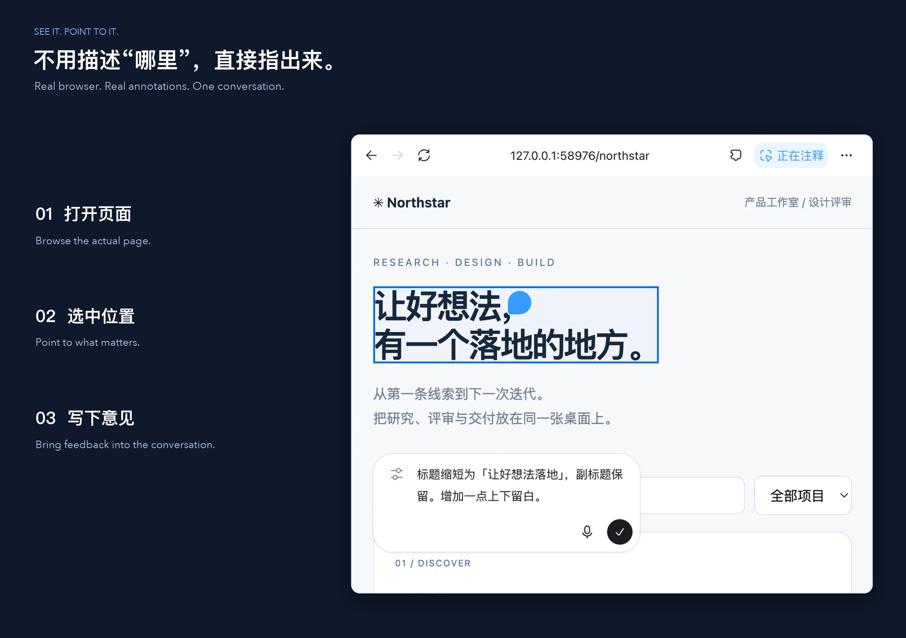

<a name="readme-top"></a>

<h1 align="center">OpenCU</h1>

<p align="center"><strong>让 AI 替你操作浏览器和电脑上的应用，过程你看得见，也随时能插手。</strong><br>DeepSeek Harness 插件</p>

<p align="center"><strong>简体中文</strong> · <a href="README_EN.md">English</a></p>

<p align="center">
  <a href="https://github.com/gulagala001/opencu/releases/tag/v2.2.12-dsh.0.2.2-rc.2"></a>
  <a href="https://github.com/gulagala001/opencu/releases"></a>
  <a href="#readme-install"></a>
  <a href="https://github.com/gulagala001/opencu/stargazers"></a>
</p>

<p align="center"><a href="#readme-install"><strong>开始使用</strong></a> · <a href="docs/install.md">安装指南</a> · <a href="https://github.com/gulagala001/opencu/issues">反馈</a></p>

<p align="center"><a href="docs/images/browser-annotations.jpg"></a></p>

<a id="install"></a>
<a name="readme-install"></a>

## 快速开始

**需要：** DSH **0.2.2-rc.2**，Node.js **24.9.0+**。已经装了 OMD 的话不用再装，OMD 里已经带了 OpenCU。

### 1. 安装

在 DSH 里打开 **插件 → ＋ 添加插件**，粘贴：

```text
https://github.com/gulagala001/opencu/releases/download/v2.2.12-dsh.0.2.2-rc.2/opencu-2.2.12-dsh.0.2.2-rc.2.tgz
```

等手头的任务跑完，按提示完整重启 DSH，原来的设置和会话都还在。命令行安装、升级和卸载见[安装指南](docs/install.md)，校验文件：[SHA256SUMS](https://github.com/gulagala001/opencu/releases/download/v2.2.12-dsh.0.2.2-rc.2/SHA256SUMS)。

### 2. 先试一件事

打开 **设置 → 电脑与浏览器**，确认状态可用，然后在会话里输入：

```text
用浏览器打开 https://example.com，读取页面标题和主要文字，不填写或提交任何内容。
```

AI 会返回页面上的实际内容，会话里能看到它打开的页面和每一步操作。

## 能做什么

AI 像调用其他工具一样操作真实的浏览器和桌面应用。打开的页面、每一步操作和实时画面都留在会话里，你可以旁观，也可以在画面上圈出位置告诉它改哪里。

- **浏览器**：找到标签页、读内容、跳转、填表、选文件上传、下载。
- **桌面应用**：通过系统的辅助功能接口查看和操作应用窗口，能做到什么取决于系统和应用本身。
- **批注反馈**：在网页、图片和文字上做批注，位置和上下文都会保留。保存批注和发给 AI 是两步，你决定什么时候发。

<a id="后台操作"></a>

### 默认在后台操作

AI 选中一个窗口或标签页时不会把它切到前台，也不会抢你的鼠标键盘，你可以继续干自己的事。遇到只能在前台完成的操作，它会先问你，得到同意才切过去。

你自己动手改过页面后，AI 会重新看一遍再继续。任务停止时，它按下的键和鼠标都会松开。

## 选哪种浏览器

| 浏览器 | 说明 |
| --- | --- |
| Chrome 或 Edge 扩展 | 用你自己的浏览器和登录状态；第一次需要装扩展并允许连接，之后自动连上 |
| 托管 Chromium | 单独的干净浏览器，不碰你的资料；缺浏览器文件时可以在设置里一键准备 |
| DSH 内置浏览器 | 页面直接显示在 DSH 侧栏；需要打过配套适配的 DSH 桌面版，构建方法见[开发文档](DEVELOPMENT.md) |

## 支持的系统

- macOS：用辅助功能（Accessibility）权限，需要在系统设置里授权。
- Windows：用 UI Automation，Windows 10 1703 及以上。
- Linux：用 AT-SPI 和 X11，Hyprland 和 Wayland 也能用一部分。

能操作什么取决于系统权限和目标应用自己支持到什么程度。用浏览器访问 DSH Web 版时，AI 控制的是运行 DSH 的那台机器，不是你眼前这台电脑。

暂不支持：多块屏幕缩放比例不同的情况、声音、完全等同 Playwright 的全部能力。

## 常见问题

<details>
<summary>为什么 AI 看得到窗口，却没法在后台输入？</summary>

有些应用只允许前台输入。这时 AI 会说明原因并问你能不能切到前台，你同意后它才会切。

</details>

<details>
<summary>关掉预览画面，任务会停吗？</summary>

不会，只是不显示了，任务照常进行。要停止任务，用会话里的停止按钮。重新打开预览就能看到当前画面。

</details>

<details>
<summary>升级会清掉浏览器配对吗？</summary>

不会。原来的 profile 和 OpenCU 数据都会留着，重启后扩展会自动重新连上。升级前建议先备份，见[安装指南](docs/install.md)。

</details>

## 开发和来源

AI 通过 `computer_use` 工具操作，接口说明见 [computer-docs.mjs](src/dsh/computer-docs.mjs)。构建、打包和测试见[开发文档](DEVELOPMENT.md)，接口行为见[技术参考](docs/technical-reference.md)。

界面组件的来源和各自的许可见 [THIRD_PARTY_NOTICES.md](THIRD_PARTY_NOTICES.md)。本仓库没有一个覆盖全部内容的统一开源许可，第三方界面素材不能当作本项目的原创内容使用。

反馈问题请写明 DSH 和插件版本、操作系统、用的哪种浏览器、操作步骤、期望和实际结果，日志和截图先去掉个人信息：[Issues](https://github.com/gulagala001/opencu/issues)。
