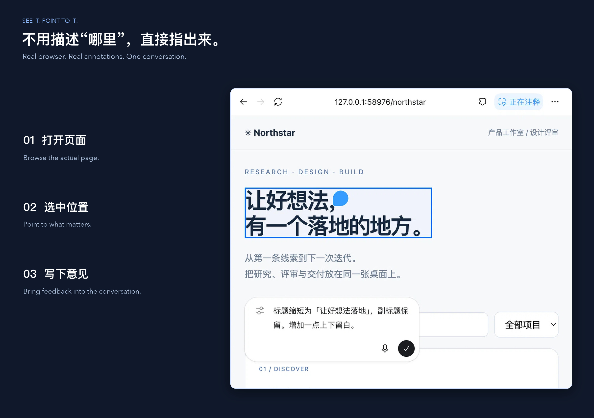

<a name="readme-top"></a>

<h1 align="center">OpenCU</h1>

<p align="center"><strong>Browser and desktop actions you can observe and guide.</strong><br>DeepSeek Harness plugin</p>

<p align="center"><a href="README.md">简体中文</a> · <strong>English</strong></p>

<p align="center">
  <a href="https://github.com/gulagala001/opencu/releases/tag/v2.2.1-dsh.0.2.1-rc.3"></a>
  <a href="https://github.com/gulagala001/opencu/releases"></a>
  <a href="#readme-install"></a>
  <a href="https://github.com/gulagala001/opencu/stargazers"></a>
</p>

<p align="center"><a href="#readme-install"><strong>Get started</strong></a> · <a href="DEVELOPMENT.md">Docs</a> · <a href="https://github.com/gulagala001/opencu/issues">Report an issue</a></p>

<p align="center"><a href="docs/images/browser-annotations.jpg"></a></p>

<a id="install"></a>
<a name="readme-install"></a>

## Quick start

**Required environment：** DSH **0.2.1-rc.3**, Node.js **22.19+**.

The full in-app browser, sidebar annotations and native monitoring require matching Host/Client/preload adapters. Installing the plugin does not patch the host. Chrome/Edge extensions require pairing; desktop control requires OS permissions.

### 1. Install

Open **Plugins → Add plugin** in the DSH instance you use, then paste:

```text
https://github.com/gulagala001/opencu/releases/download/v2.2.1-dsh.0.2.1-rc.3/opencu-2.2.1-dsh.0.2.1-rc.3.tgz
```

Wait for active tasks to finish, then follow the host’s activation/restart prompt. Keep your existing profile and data. See the [installation guide](docs/install_EN.md) · [SHA256SUMS](https://github.com/gulagala001/opencu/releases/download/v2.2.1-dsh.0.2.1-rc.3/SHA256SUMS).

### 2. Try this first

Open **Settings → Computer & Browser**, confirm an available backend, then ask:

```text
Open https://example.com in a browser and read its title and main text. Do not fill in or submit anything.
```

**Success looks like：** The tool returns actual page content; matching host adapters also display an in-conversation preview and activity.

## Observe, act and verify

OpenCU uses native DSH tool calls to operate real browsers and desktop applications. Pages, activity and previews stay with the conversation. Watch the target, point to a specific location, or hide the preview and continue reading.

- **Browsers**: discover tabs, read content, navigate, fill forms and handle file selection and downloads.
- **Desktop apps**: observe and act through accessibility APIs and input routing, with actual capabilities reported by the backend.
- **Feedback**: web, image and text annotations retain their locations and context. Saving an annotation and submitting it to the conversation are separate actions.

## Choose a browser path

| Path | Requirements |
| --- | --- |
| DSH in-app browser | Matching desktop Host, Client and preload adapters. |
| Managed Chromium | An independent browser environment; prepare missing browser resources in settings. |
| Chrome/Edge extension | Your selected profile, paired on first use. Revoking the pairing requires authorization again. |

Target selection and actions prefer the background. Binding or viewing a target does not activate its window. Unsupported background actions return a specific limitation; foreground actions require the user’s consent. After manual interaction, observe again. Cancellation releases held input; dispatch alone does not prove success.

When opening a preview, scrolling, resizing, or changing focus prevents an action from continuing, the existing session is retained. If input has started, OpenCU confirms release of that target's held input and requires a fresh observation before continuing; it never automatically replays the action. Waiting for application or browser approval does not consume the execution deadline or clear bindings. Unconfirmed input release and target identity changes remain protected.

## Scope

macOS uses Accessibility and targeted input, Windows uses UI Automation, and Linux uses AT-SPI/X11, Hyprland IPC or Wayland portals.
Capabilities depend on the backend, OS permissions and application. A Web deployment operates the server’s machine, not automatically the computer viewing its page.

Mixed-scale multi-monitor operation, audio, account cloud services and complete Playwright equivalence are outside the current scope. Full real-device coverage is not complete across platforms; installation alone does not establish support for every application.

## FAQ

<details>
<summary>Why can OpenCU observe a target but not type in the background?</summary>

Observation and input are separate capabilities. Follow the returned limitation and choose a supported target. When foreground input is necessary, obtain consent and explicitly focus the target rather than hiding failure behind global input.

</details>

<details>
<summary>Does closing a preview stop the task?</summary>

Closing it only hides the viewing target. The task and operation binding continue. Use the native Stop action to cancel; reopen the preview to see the current state.

</details>

<details>
<summary>Will updating remove pairings and history?</summary>

Back up, install a matching package and retain the same profile, DSH_HOME and OpenCU data directory. A normal restart preserving identity and data can restore extension pairings. [Installation and maintenance](docs/install_EN.md)

</details>

## Development and attribution

`computer_use` provides a persistent JavaScript environment with documentation and observations supplied when a browser or app is selected. [API contract](src/dsh/computer-docs.mjs) · [Development](DEVELOPMENT.md)

The frontend uses components sourced through REA and thin adapters. Rights and source-specific terms are documented in [THIRD_PARTY_NOTICES.md](THIRD_PARTY_NOTICES.md). The repository does not declare a single open-source license covering all materials; third-party UI assets are not original-project grants.

## Documentation and support

| I want to | Where to go |
| --- | --- |
| Install, update or remove | [Installation guide](docs/install_EN.md) |
| Learn the features and limits | [Documentation](DEVELOPMENT.md) |
| Read release changes | [Releases](https://github.com/gulagala001/opencu/releases) |
| Report a problem | [Issues](https://github.com/gulagala001/opencu/issues) |

For a bug report, include the full DSH and plugin versions, the entry point, minimal reproduction steps, and expected versus actual behavior. Remove private data before sharing logs or screenshots.

<p align="center"><a href="#readme-top">Back to top</a> · <a href="https://github.com/gulagala001/opencu/releases">Versions and downloads</a> · <a href="https://github.com/gulagala001/opencu/issues">Feedback</a></p>

[Documentation structure and contributing](docs/documentation.md)
