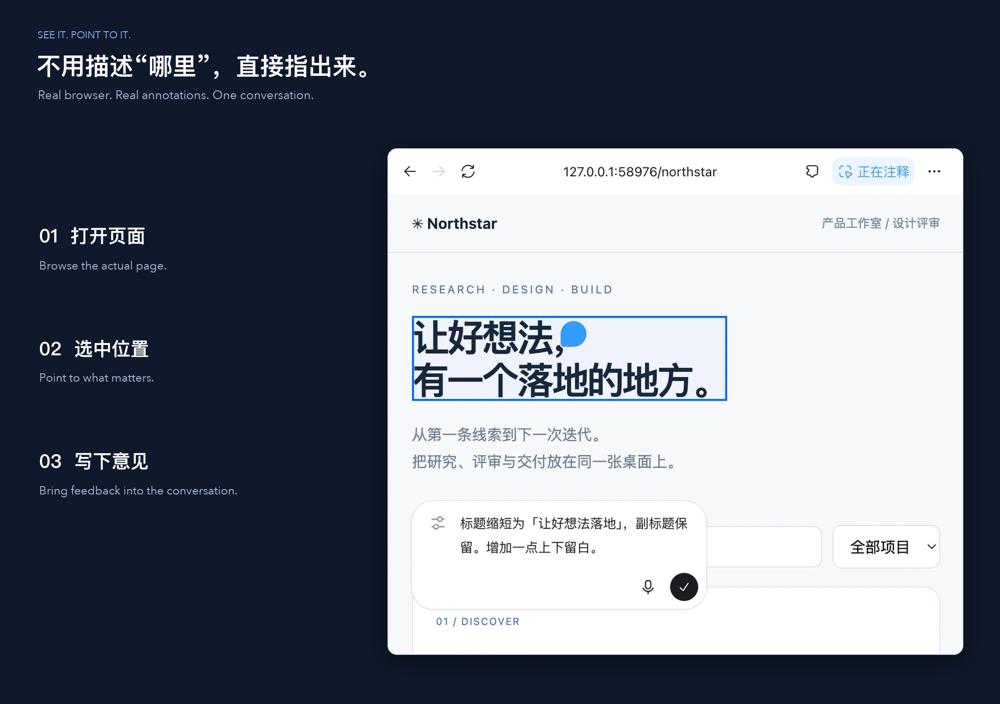

<a name="readme-top"></a>

<h1 align="center">OpenCU</h1>

<p align="center"><strong>Let the AI operate your browser and desktop apps while you watch and step in whenever you like.</strong><br>A DeepSeek Harness plugin</p>

<p align="center"><a href="README.md">简体中文</a> · <strong>English</strong></p>

<p align="center">
  <a href="https://github.com/gulagala001/opencu/releases/tag/v2.2.14-dsh.0.2.2-rc.3"></a>
  <a href="https://github.com/gulagala001/opencu/releases"></a>
  <a href="#readme-install"></a>
  <a href="https://github.com/gulagala001/opencu/stargazers"></a>
</p>

<p align="center"><a href="#readme-install"><strong>Get started</strong></a> · <a href="docs/install_EN.md">Installation guide</a> · <a href="https://github.com/gulagala001/opencu/issues">Feedback</a></p>

<p align="center"><a href="docs/images/browser-annotations.jpg"></a></p>

<a id="install"></a>
<a name="readme-install"></a>

## Quick start

**Requires:** DSH **0.2.2-rc.3** and Node.js **24.9.0+**. If you already use OMD, skip this: OMD includes OpenCU.

### 1. Install

In DSH, open **Plugins → Add plugin** and paste:

```text
https://github.com/gulagala001/opencu/releases/download/v2.2.14-dsh.0.2.2-rc.3/opencu-2.2.14-dsh.0.2.2-rc.3.tgz
```

When your current task finishes, fully restart DSH when prompted. Your settings and conversations stay as they were. For command-line installs, upgrades and removal, see the [installation guide](docs/install_EN.md). Checksums: [SHA256SUMS](https://github.com/gulagala001/opencu/releases/download/v2.2.14-dsh.0.2.2-rc.3/SHA256SUMS).

### 2. Try it

Open **Settings → Computer & Browser**, check that it shows as available, then ask in a conversation:

```text
Open https://example.com in the browser, read the page title and main text, and do not fill in or submit anything.
```

The AI returns what is actually on the page, and the conversation shows the page it opened and each step it took.

## What it does

The AI operates real browsers and desktop apps the same way it calls any other tool. Pages, each action and a live view stay in the conversation. You can watch, or mark a spot on the view to show it what to change.

- **Browsers**: find tabs, read content, navigate, fill in forms, pick files to upload, download.
- **Desktop apps**: view and operate app windows through the system accessibility interfaces. What works depends on the system and the app.
- **Annotations**: mark up web pages, images and text, with position and context kept. Saving an annotation and sending it to the AI are separate steps, so you decide when to send.

<a id="background-operation"></a>

### Works in the background by default

Selecting a window or tab does not bring it to the front or take over your mouse and keyboard, so you can keep working. When an action only works in the foreground, the AI asks first and switches only with your consent.

If you change a page yourself, the AI looks again before continuing. When a task stops, any keys or mouse buttons it was holding are released.

## Which browser to use

| Browser | Notes |
| --- | --- |
| Chrome or Edge extension | Your own browser and sign-ins. Install the extension and allow the connection once; it reconnects automatically after that |
| Managed Chromium | A separate, clean browser that never touches your profile. If browser files are missing, set them up from Settings in one click |
| DSH built-in browser | Pages show right in the DSH sidebar. Needs a DSH desktop build with the matching adaptation; see [development](DEVELOPMENT.md) |

## Supported systems

- macOS: uses Accessibility, which you grant in System Settings.
- Windows: uses UI Automation, on Windows 10 1703 or later.
- Linux: uses AT-SPI and X11; Hyprland and Wayland work in part.

What can be operated depends on system permissions and how much the target app supports. When you open DSH Web in a browser, the AI controls the machine running DSH, not the computer in front of you.

Not supported yet: multiple displays with different scaling, audio, and everything Playwright can do.

## FAQ

<details>
<summary>Why can the AI see a window but not type into it in the background?</summary>

Some apps only accept input in the foreground. The AI explains this and asks whether it may switch; it switches only if you agree.

</details>

<details>
<summary>Does closing the preview stop the task?</summary>

No. It only hides the view, and the task keeps going. To stop the task, use the stop button in the conversation. Reopen the preview to see the current view.

</details>

<details>
<summary>Does upgrading remove the browser pairing?</summary>

No. Your profile and OpenCU data stay, and the extension reconnects after a restart. Back up before upgrading; see the [installation guide](docs/install_EN.md).

</details>

## Development and sources

The AI works through the `computer_use` tool, documented in [computer-docs.mjs](src/dsh/computer-docs.mjs). Build, packaging and tests are in [development](DEVELOPMENT.md), and interface behavior is in the [technical reference](docs/technical-reference.md).

Sources and licenses of the interface components are listed in [THIRD_PARTY_NOTICES.md](THIRD_PARTY_NOTICES.md). This repository has no single open-source license covering everything, and third-party interface assets must not be treated as original work of this project.

When reporting a problem, include your DSH and plugin versions, operating system, which browser you used, the steps, and what you expected versus what happened. Remove personal data from logs and screenshots first: [Issues](https://github.com/gulagala001/opencu/issues).
