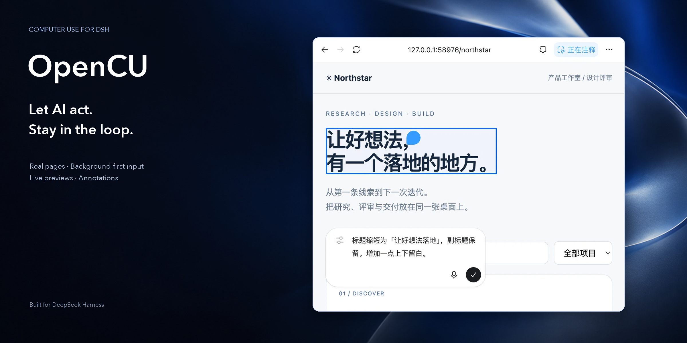

<p align="center"></p>
<h1 align="center">OpenCU</h1>
<p align="center"><strong>Computer and browser work, right inside your DSH conversation.</strong></p>
<p align="center">Real pages · Background-first input · Live previews · Annotations</p>
<p align="center"><a href="README.md">简体中文</a> · <strong>English</strong> · <a href="#install">Installation</a> · <a href="DEVELOPMENT.md">Developer reference (Chinese)</a></p>

**Turn “go do this” into a process you can see and collaborate on.**

OpenCU is a computer-use plugin for [DeepSeek Harness](https://github.com/deepseek-ai/deepseek-harness). AI discovers browsers and apps, reads content, clicks, types, navigates and works with files. You see the actual workspace, add feedback and continue in the same conversation—without starting a separate control service or entering a dedicated CU console.

> **安装 / Install:** [DSH rc.1 / rc.2 固定版本与安装入口](docs/releases.md)。完整浏览器与原生监看需要对应宿主适配。

## More than remote clicks

| Capability | What it brings |
| --- | --- |
| **Browser tasks** | Real tabs, navigation, content reading, form input, file selection and downloads—not a screenshot pretending to be a page. |
| **Desktop apps** | Window discovery, observation and control through OS accessibility and input routes, subject to application and platform support. |
| **Lightweight monitoring** | Actions naturally bring up activity and previews. Click back to the target; hiding a preview does not stop the task. |
| **Annotations and @ references** | Point to a page location, image or text and bring the feedback and context into your draft. |
| **Targets separate from focus** | Binding or viewing a target does not intentionally steal focus. Background input is the default. |
| **Local continuity** | Downloads, annotations, history and recovery state persist locally; errors are not erased to pretend success. |

## Browse, review, give feedback


Ordinary tool calls drive pages and activity. Watch the page being used, or tuck the preview away and keep reading the conversation.

- Page annotations put “change this” at a specific location.
- Image comments and markup, supported content previews and assistant-text annotations reduce back-and-forth descriptions.
- **Saving does not send.** Explicit submission adds feedback to the corresponding conversation draft.
- Human interaction notifies AI to observe again, without a mandatory takeover/resume ritual.

The frontend uses actual extracted REA components with thin adapters. See [third-party notices](THIRD_PARTY_NOTICES.md) for provenance and rights.

## Three browser routes

| Route | Best for | Requires |
| --- | --- | --- |
| **DSH embedded browser** | Pages, annotations and activity beside the conversation | Matching desktop Host, Client and preload adapters. |
| **Managed Chromium** | A separate environment, apart from your daily browser data | Matching Playwright browser resources, installable through settings when missing. |
| **Chrome / Edge extension** | Working in an existing browser profile you choose | The extension and initial pairing permission—not automatic access to every profile. |

A local loopback bridge manages extension connections. Choose “Allow and remember” on first use; ordinary restarts retaining identity and data can reconnect. Revoking pairing requires new permission.

## Background-first does not mean unrestricted

**Binding does not activate the window. If background input is unavailable, report it—never silently substitute global keyboard or mouse input.**

- Browsers receive input addressed to their page; new tabs can open in the background.
- macOS uses directed events and Accessibility; keyboard delivery is limited by the application's internal keyboard window.
- Windows uses UI Automation. Linux uses AT-SPI/X11 or Wayland portals. Their capabilities differ.
- `FOREGROUND_REQUIRED` or a specific limitation requires user consent before explicit focus and foreground input.
- OS permissions, application-access grants and task instructions are separate. Cancellation releases actually held input and retains errors when release fails.

An action acknowledgement is not proof that the interface changed. The workflow is **observe → act → observe again**.

## A coherent interface for agents

`computer_use` provides persistent JavaScript, reusable browser/tab/app bindings, and batched deterministic actions followed by a necessary observation. First use supplies core instructions; binding a target supplies its browser/native documentation and initial AX state.

```js
const browser = await cua.getBrowser({ id: discoveredBrowserId });
const tab = await browser.tabs.get(discoveredTabId);
await tab.playwright.getByRole('textbox', { name: 'Search' }).fill('release notes');
await tab.playwright.getByRole('button', { name: 'Search', exact: true }).click();
await tab.getAXState();
```

Discover real browsers/tabs before using their IDs. Control names in this example must match the actual page.

- **Compact observations:** semantic trees by default, full nodes and geometry with `details:true`.
- **Reliable diffs:** only with stable identity and complete baselines; invalidation restores full output instead of reusing stale elements.
- **Common locators:** roles, text, labels, CSS, regex, nested frames and open Shadow DOM—not full Playwright API equivalence.
- **Auto-waiting:** retries only failures known not to have dispatched input, never ambiguous actions.
- **Long-session recovery:** `cua.rewriteDocumentation()` restores docs and observation baselines without resetting bindings.

[Runtime API contract](src/dsh/computer-docs.mjs) · [Developer reference (Chinese)](DEVELOPMENT.md)

<a id="install"></a>

## Installation and first use

### Already using new-generation OMD?

**No second installation needed.** New OMD bundles OpenCU by default. A standalone coinstallation shares the same core and tools; complete UI features still need matching host adapters.

### Standalone OpenCU

1. Check the complete DSH version. Obtain an OpenCU build **for that version** and matching host, and back up the actual `DSH_HOME`.
2. Desktop: use the app's plugin manager or bundled CLI. Web: use the matching host CLI and actual profile to load the local package. Do not mix hosts through relabeling, relaxed peers or `latest`.
3. Open **Settings → Computer & browser** to check backends, browser resources and OS permissions. Pair Chrome/Edge if needed.
4. Begin on a nonsensitive page: “Open this page, find the search box, search for release notes, and capture the result.”

Host Node.js must be ≥22.19. Missing native helpers, permissions or browser resources produce explicit errors. No model account, Node, Chromium or separate desktop application is bundled.

Builds, host patches and profile configuration: [DEVELOPMENT.md](DEVELOPMENT.md#构建和本地插件包). **Plugin installation alone does not patch stock DSH's Host/preload.**

## Platform boundaries

| Platform | Requirements |
| --- | --- |
| **macOS** | Accessibility, window capture and directed input; user-granted OS permissions and application accessibility support. |
| **Windows** | Windows 10 1703+, UI Automation/Win32 and system .NET Framework; subject to UIPI, with no automatic privilege elevation. |
| **Linux X11** | System Python 3 and X11/XTest; semantic actions need AT-SPI. |
| **Linux Wayland** | RemoteDesktop/ScreenCast portal, PipeWire and system dependencies; the user selects a display, and capture covers that shared display. |

Mixed-monitor scaling is outside the current scope. Screenshot interpretation needs an image-capable model; task performance still depends on the model and target app.

## Data, provenance and contribution

Data uses configured `dataDir`, otherwise `DSH_HOME/opencu`, then `~/.opencu`. Protect history, downloads and pairing information. Clearing download history does not delete delivered files. Do not submit credentials, private screenshots or the entire data directory in bug reports.

[Developer reference (Chinese)](DEVELOPMENT.md) · [Component provenance](REFERENCE.md) · [Third-party notices](THIRD_PARTY_NOTICES.md)

An independent community project, not an official DeepSeek or OpenAI product. **REA extraction does not grant proprietary-asset redistribution rights.** The `electron-chrome-extensions` host library also has GPL-3.0 or commercial-license conditions. Check relevant authorization before public distribution; a successful local build does not establish publishing rights.
