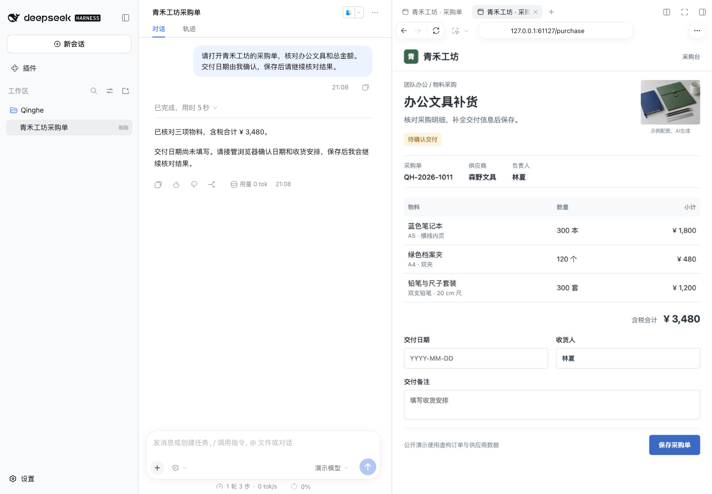
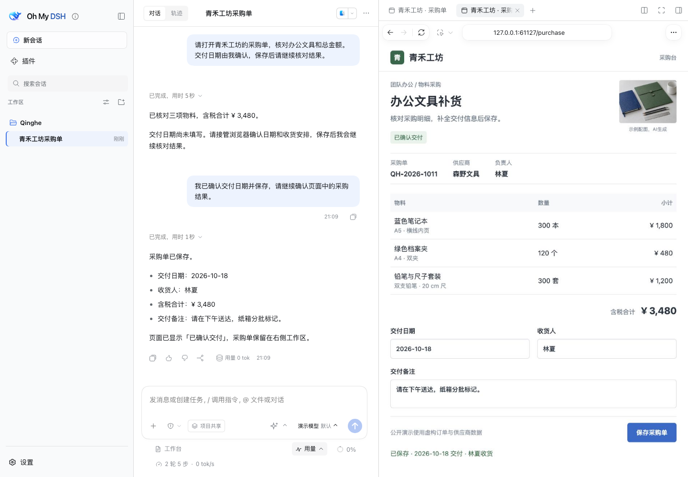
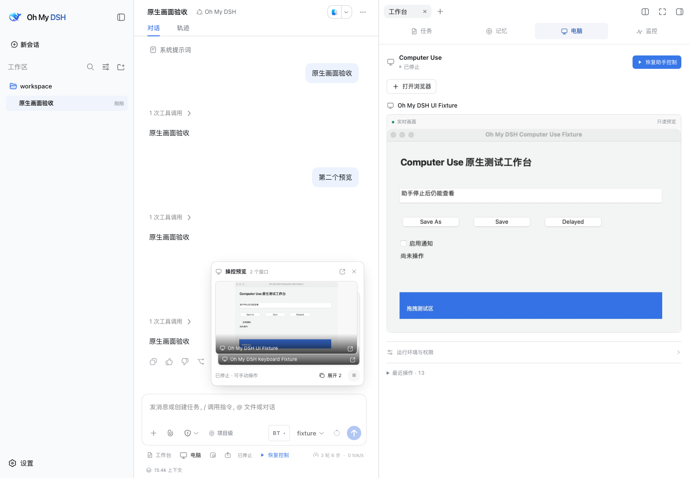

# OpenCU Showcase

[简体中文](showcase.md) · [English](showcase_EN.md) · [Home](../README_EN.md) · [Usage](usage_EN.md)

Three captures use a **controlled model and real Computer Use tools**, showing **new local OpenCU 1.6.1 work** in DSH `0.2.0-rc.2`. Both standalone and OMD configurations have one Browser entry; the third capture uses OMD `0.2.0-rc.2.omd.0.16.0`. They are not public 1.3.0's installation result. [Fixed downloads/differences](../README_EN.md#versions-and-platforms) are on the home page. The page/order are fictional, product thumbnails are AI-generated, and UI captures are real rather than redrawn.

This demo stops/resumes through the control interface's actual `stopped → idle` state transition, without clicking the visible stop/resume buttons. Daily button use is covered in [Usage](usage_EN.md#records-live-preview-and-takeover). It checks real handoff, not success rates for arbitrary models.

## Read a Stationery Restock Order

**Problem**: Qinghe Studio needs blue notebooks, green document folders, and pencil-and-ruler sets from Senye Stationery. The assistant should read products/form while its actual page remains visible.

**Action**: Open the isolated purchase demo page through the browser address bar and use real Computer Use to read controls. Inspect products/order/page in the unified **Browser** workspace, leaving delivery date and notes for manual takeover.

**Result**: Compare the tool read with the real form. The tax-inclusive total is **¥3480**. This checks browser/control reading/preview without placing an order with a real supplier.

Version 1.3.0 already supports control, preview, and delivery. Unified workspace, plugin browser, and new settings belong to local 1.6.1.

## Take Over for Delivery Date and Notes

**Problem**: The user must choose delivery date and instructions while the assistant waits and page state stays available.

**Action**: Set control state to stopped and confirm it. In the actual browser view, enter delivery date **2026-10-18**, contact **Lin Xia (林夏)**, and note **“请在下午送达，纸箱分批标记。”** (“Please deliver in the afternoon and label the cartons by batch”), then save the demo order. Viewing, switching, or closing preview does not stop control.

**Result**: The original tab/form remain available; edits and save occur in the actual page. Resolve failed/unconfirmed stop messages before manual action. Login, verification, and site challenges can use the same handoff; local 1.6.1 also has a dedicated login window.

## Resume and Read the Saved Result

**Problem**: After manual edits, the assistant needs to read saved date/notes rather than assume success from input actions.

**Action**: Restore control from `stopped` to `idle`, rebind the original tab, read actual controls/save state with real tools, and keep the result in the DSH conversation.

**Result**: The resumed tool read confirms **2026-10-18**, **Lin Xia (林夏)**, **“请在下午送达，纸箱分批标记。”**, and tax-inclusive **¥3480**, completing observation → user takeover → save → assistant review. This is a demo-page save, not a real purchase submission.

The third capture actually uses OMD `0.2.0-rc.2.omd.0.16.0`, demonstrating this configuration's browser/session flow rather than comprehensive compatibility across plugins, load orders, platforms, and lifecycle. Programs can reuse backend/UI through `opencu/integration` and `opencu/client-source`; OMD is one integration, not a standalone prerequisite. [Public interfaces and integration](integration_EN.md).

## Make a Change Request Precise

**Problem**: Position/text descriptions are ambiguous and need to identify a page element.

**Action**: **Annotate page**, select region/element, and add notes. Temporarily preview size/color/spacing and add images/explanation to the draft.

**Result**: Capture screen, identity, styles, and proposal. Ask for source edits and verification. Temporary CSS does not edit source. The historical image illustrates the workflow, not the new layout.

## Desktop Windows and Delivery

**Problem**: A macOS/Windows task needs control/input inspection or information sharing first.

**Action**: Select an app with `@` or **Share window** to add screenshot/accessibility text to the draft. Grant system permissions, act, then read actual state.

**Result**: Keep real windows, screenshots, and text; observation remains possible after stop. Linux has no native desktop. This round has no real Windows test of the new implementation; custom controls/rich text still depend on the app.

## Scope

The [asset manifest](images/showcase.json) records screenshot dimensions, versions, and checksums. The [illustrative photo](images/workspace-art.png) supplies the fictional order's product thumbnail; it is not interface or operation evidence.

Targets run on DSH's backend/control machine. Remote access does not authorize controlling the visitor's computer. Export is static MHTML/loaded assets, not a complete website/login backup. Protected credentials may not import, and permissions/business results follow actual state.

[Install](../README_EN.md#install) · [First task](usage_EN.md#get-started) · [Integration](integration_EN.md)
