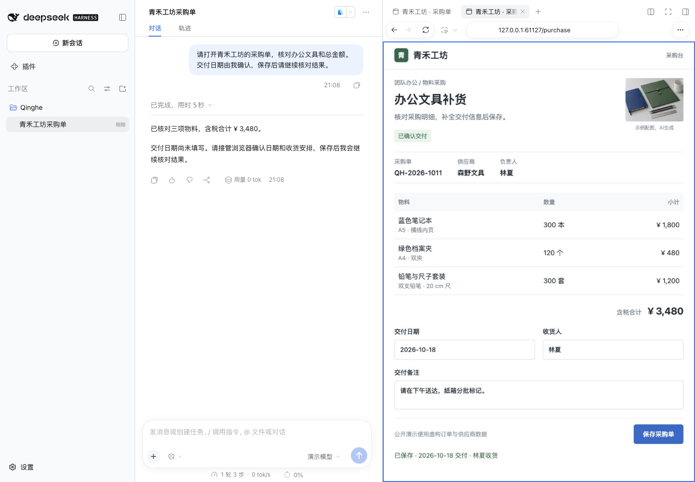
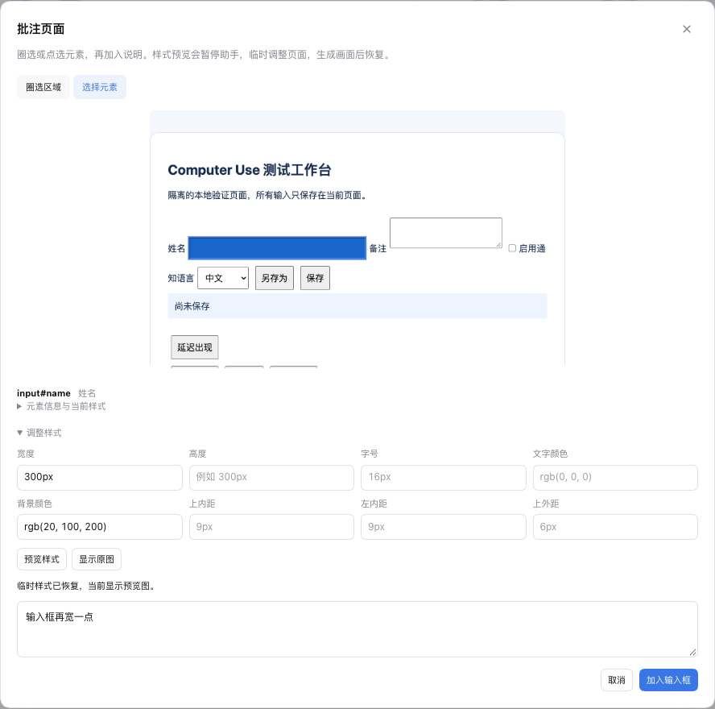

# OpenCU Usage

[简体中文](usage.md) · [English](usage_EN.md) · [Home](../README_EN.md) · [Install](../README_EN.md#install) · [Integration](integration_EN.md)

Installation and basic operation refer to public **1.3.0**, with separate DSH `0.2.1-alpha.1` / `0.2.0-rc.2` builds. New screenshots show **unpublished local 1.6.1**. Its additions are documented separately and are unavailable through the public install.

## Computer Use

In one session, the assistant selects a page or app, reads state, acts, and observes the result. Keep delivery pages and leave screenshots/exported files in the conversation. OpenCU uses DSH models, approvals, sessions, and attachments. Targets run on the backend/control machine; a remote web client is only an access point.

### Get Started

1. Install the package matched in the [version table](../README_EN.md#install), start your existing profile, and open the printed login link.
2. Select a tool-capable model; choose image input support for visual tasks.
3. Open **Computer → Runtime and permissions** to prepare browser or desktop. Version 1.3.0's native components require platform build tools initially.
4. Choose **Open browser** or use `@` to select a browser, existing tab, or app. State the task, input, and completion criteria.
5. Inspect progress in the conversation or right pane. Stop and take over for manual work, then resume assistant control.

Example requests:

> Select @Browser, open this form, and fill in my supplied details. Check required fields, stop before submission, and keep the page and a screenshot.

> Select the original signed-in @Chrome tab, read and export this page, and list assets that could not be saved.

> Share this app window, summarize its current information, then continue with the details I confirm.

### Execution Budget and Reset Recovery

Each `computer_use` call defaults to 30 seconds; `timeoutMs` accepts 1–300000 milliseconds. Individual actions have their own wait limits. A longer budget does not bypass stop state. Timeout reports returned, failed, and still-running actions.

Actions are not transactions. Input, submissions, and saves completed before an error/timeout are not rolled back. Observe before retrying to avoid duplicate sends or insertions. Timeout, reset, and user stop clear JavaScript bindings without closing the original tab; reselect using `cua.getTab(id, { browser })`. Ordinary errors and successive calls do not require new targets.

First selection returns initial state and API documentation, deduplicated by session/content version. Reread with `await cua.rewriteDocumentation(topic)` or `nodeRepl.write(await cua.documentation(topic))`. Follow the current tool API and real element IDs; observe again after navigation, reconnect, or screen changes.

### Login State and Original Tabs

Built-in `@Browser` has its own profile, separate from everyday Chrome and the browser viewing DSH. Connect the corresponding Chrome and select the **original tab** for an existing login.

Same-origin tabs in one profile share localStorage and scoped cookies; sessionStorage belongs to each tab. Reselect a surviving original tab after stopping to keep its storage. A new tab at the same URL cannot restore sessionStorage from a closed tab. Service restart, domain changes, logout, and expired credentials may also require login.

Remote pages may combine cookies, tab credentials, and pairing. A new tab requesting login does not prove cookie loss. Rebind the original tab first, then check the actual access route.

### Chrome Session Tab Groups

Connected Chrome with extension **0.1.4 or newer** groups tabs actually selected/created by the assistant under **OMD · session name**, using colors for sessions. Listing or observing tabs does not acquire grouping ownership; child tabs and renamed sessions update accordingly.

Each window has a group; grouping does not move windows. Stopped groups remain marked as stopped and are reused on resume. Pinned tabs are not unpinned automatically and remain operable without grouping. Reload **Oh My DSH Computer Use** at `chrome://extensions` after updates and confirm new permissions when prompted. This is Chrome's native tab strip, separate from the built-in browser strip.

### Platforms and Requirements

| Component | Public 1.3.0 requirements |
| --- | --- |
| Host | Matched DSH `0.2.1-alpha.1` / `0.2.0-rc.2`; Node.js ≥22.19, pnpm 11.23.0 |
| Browser | Local Chrome/Chromium on Windows/macOS/Linux with a separate profile |
| Chrome connection | Extension and native connection program; Windows initially needs .NET 10 SDK |
| macOS desktop | macOS 14+, Apple Command Line Tools, Accessibility and Screen Recording |
| Windows desktop | Windows 10 2004+, PowerShell 7, .NET 10 SDK initially, unlocked interactive desktop |
| Linux desktop | No native desktop control |
| Pop-out preview | Optional Document Picture-in-Picture; inline preview does not require it |

Earlier Windows validation includes single-display 125%, 150%, and 200%; mixed-DPI displays are outside scope. Local 1.6.1 has no real Windows-device validation in this round. Background behavior, rich text, and custom controls depend on the app. See [Windows](windows_EN.md).

## Records, Live Preview, and Takeover

Target selection shows tool records and live thumbnails. Expand results to inspect state, screenshots, errors, and files. The image viewer supports fit, actual size, zoom, download, and Esc, returning to the original entry.

Multiple previews stack at their own aspect ratios. A rear preview click changes viewing order; the front page can open its right-pane browser. Drag the top to move, double-click/reset to restore position, and enlarge to change display size only. Closing preview ends observation, not the app; stop has its own button. Supported browsers can use Document Picture-in-Picture for a pop-out.

Opening the same session's Computer pane hides the thumbnail and releases duplicate observation, restoring it afterward. Viewing other tabs, records, or zoom does not change the assistant target. Clicking a page, typing, navigating, changing viewport, or applying styles stops and takes over. **View assistant's current screen** returns to its target.

**Stop and take over** requests cancellation and waits for confirmation. Act after it succeeds; errors or unconfirmed stops retain messages and retry controls. Operate native apps in their real windows. Confirm the current target matches the task before **Resume assistant control**. Observation continues while stopped; failed resume is not reported as resumed.



*Unpublished local 1.6.1 capture. Public 1.3.0 also supports basic stop/takeover/resume with a different layout.*

### Navigation, Find, and Device Preview

The 1.3.0 pane has address bar, tabs, new/close, back/forward, reload, and find. Switching tabs only views; editing acquires manual control. Tabs owned by another session cannot be selected directly. Focus to edit the full URL, Esc to cancel. Navigating again to the same URL reloads and may discard unsaved input.

Device presets change viewport only. Touch, mobile layout, DPR, and User Agent are separately configured and applied; UA does not change the engine. Applying size/emulation stops and takes over, navigation keeps settings, and failed reset retains errors. Preview zoom changes display only. Read-only screenshots do not pause the assistant. Connected everyday Chrome keeps its window size.

### Downloads and History

Version 1.3.0 lists actual download tasks captured since connection and their completed/canceled states. Available built-in-browser files can be saved. Extension files remain in Chrome's download location: records sync but files cannot be returned directly to DSH. Disconnected unfinished tasks remain unconfirmed; missing temporary files cannot be saved. This is not a complete persistent browser history.

Local 1.6.1 adds persistent history/download settings from real navigation and downloads, surviving restart. Removing download history does not remove saved files. Resume depends on the browser, download information, site, and actual file.

## Window Sharing, Annotations, and Styles

**Share window** adds the selected macOS/Windows screenshot and accessibility text to the draft for your review and send. It neither acquires input nor replaces the draft. Invalid windows report failure.

**Annotate page** freezes a capture. Select a region or element, write a note, and **Add to input**. Full-size PNG and page/region/note TXT join the draft; elements also include identity, ancestors, and computed styles. Cross-origin nested frames work; capture changes require retry. Complex CSS clipping may affect hit testing, so check before sending.



*Historical public UI capture illustrating the workflow, not the new local layout.*

Adjust size, typography, color, or spacing and choose **Preview styles**. It pauses the assistant, applies temporary CSS, captures, and restores. Source is unchanged. Add the proposal to the draft, then ask for source edits and verification. Control does not continue without confirmed recovery.

## Page Export, Assets, and WebMCP

Ask to export the current page and report failed assets. MHTML is a static snapshot, not a running website or session backup. Ordinary readable input/check/selection state, frames, and open Shadow DOM can be preserved; passwords, file inputs, hidden fields, and password/OTP autofill fields are excluded.

Loaded images, fonts, styles, and video can be listed/saved. Inline SVG preserves observed markup without automatically inlining external resources/styles. Load lazy content first. Unreadable assets are reported separately. No Google Workspace-specific formats, YouTube subtitles, or complete streaming export is promised.

Files become persistent DSH attachments accessible from tool results, surviving refresh/turn end. The assistant should use `tab.markDeliverable()` for a temporary tab needed across turns; visible preview alone does not retain it.

Network diagnostics read observed requests, redirects, status, and completed responses without resending. They retain the latest 200 entries, with a 1 MiB returned-body limit. Expired, unfinished, and oversized content is disclosed; non-UTF-8/binary content uses Base64. This return limit is not a hard underlying read/decompression memory limit.

WebMCP is a **page tool capability** requiring protocol-capable Chromium 153+ in the public implementation. Refetch after navigation/tool changes. Stop requests cancellation and waits; failure retains state. Pages without tools remain normally controllable. This is not a general OpenCU MCP server. Local Electron 44.7.0 should not be claimed to support it when the 153+ requirement is unmet.

## Setup, Connection, Models, and Native Input

### Browser and Chrome Connection

Version 1.3.0 prefers local Chrome/Chromium with its own profile. If absent, run `pnpm exec playwright install chromium` from the installed plugin directory or set an executable path.

For everyday Chrome, **Runtime and permissions → Prepare Chrome connection** prepares programs and extension. Enable developer mode at `chrome://extensions`, load the displayed directory, then select the original tab. It is not a store/automatic update installation; reload after updates. Stopping/removing connection does not exit Chrome.

### macOS Desktop Permissions

Install desktop control from **Runtime and permissions**. Version 1.3.0 compiles/signs locally using Apple Command Line Tools. Grant **Oh My DSH Computer Use** Accessibility and Screen Recording; reopening may be needed. The web page/model cannot bypass authorization. Legacy bundle/extension/data identifiers preserve installations.

### Model and Input

Text-only models can read controls but do not receive screenshots. Choose an image-capable model when prompted. `typeText` sends typing: newline triggers Return and tab triggers Tab. Use `setValue` to replace values and `paste` to preserve newlines without key actions. Native plain text, Markdown, and HTML paste depend on the app. Inspect actual content after errors. Windows `super` is Win, not Command.

### macOS Keychain Prompts

Version 1.3.0 Chrome may request Safe Storage access on first start or version/signature changes. This is system authorization; the model does not need the keychain password. You may refuse when unsure, but old login information may not decrypt. Keep everyday Chrome's original profile and credential settings.

## Local 1.6.1 Browser Preview

These additions are **locally implemented and unpublished**; OpenCU's public 1.3.0 packages/main do not include the new UI. The local UI uses one **Browser** entry.

This fictional order demo uses a local DSH `0.2.0-rc.2` build. OMD main includes this round's 1.6.1 implementation; public installation packages remain defined by fixed releases, and a version number alone does not establish feature equivalence.

| Capability | Behavior and limits |
| --- | --- |
| Plugin browser | Official prebuilt Electron 44.7.0, separate browser/preview processes; no DSH or engine modification/build |
| Site information | Real connection, certificate, cookies, and permissions; HTTPS URL alone is not proof of safety |
| Site permissions | Actual requests trigger choices; persistent choices use a private store, temporary choices expire by lifecycle; system permissions still apply |
| History/downloads | Actual persistent records; unknown action origin is not assigned to user/assistant |
| Profile import | User chooses source and cookies/history/passwords; actual complete/partial/failed/stopped results |
| CSV passwords | Select official exported file, inspect records, confirm; same site/account can update existing passwords |
| Login window | User handles login/challenges; passwords are stored only with explicit save choice |

Passwords use the OS-protected plugin encrypted store; values do not enter ordinary tool results, model context, or logs. Source data may be bound to an app identity/system account. Administrator approval does not guarantee decryption. Failures are reported; use official CSV export or sign in again. Canceling import preserves committed data and actual counts.

Complete future packages are designed to carry native prebuilds, unlike 1.3.0's initial source build; development may still need tools. This round does not release the package, validate new Windows implementation on hardware, or provide Linux native desktop.

## Configuration

Use DSH's `opencu` settings, not another top-level plugin. Unset values use defaults/inheritance; explicit OpenCU values override OMD.

| Field | Purpose | Takes effect |
| --- | --- | --- |
| `computerUseEnabled` | Enable/disable | Runtime update |
| `computerUseBrowserExecutable` | 1.3.0 Chrome/Chromium path | DSH restart |
| `computerUseChromeUserDataDir` | Chrome data root, not Default/Profile subdirectory | DSH restart |
| `computerUseNativeBinary` | Native program; Windows binary for WSL | DSH restart |
| `computerUseNativeSocket` | Native service socket | DSH restart |
| `dataDir` | Base directory with internal `computer-use/` subdirectory | DSH restart |

Default is `DSH_HOME/trisoul-x/computer-use/`; unset `DSH_HOME` uses DSH's default user directory. Updates do not clear data. Browser profiles, logins, and runtime records are private and must not ship with source/packages. DSH manages exported attachment lifecycle.

## Update and Remove

1. Finish tasks and stop DSH using the profile.
2. Check fixed tag, host, and checksum, then repeat the [install command](../README_EN.md#install).
3. Restart the same profile and update runtime/reload extension as prompted.

Stop before removal too, for example alpha.1:

```sh
npx --yes @deepseek-ai/dsh@0.2.1-alpha.1 plugin --profile web remove opencu
```

Use the same-version CLI for rc.2 and your original profile name. Removal preserves sessions, private data, Chrome, app windows, and downloads. **Remove Chrome connection** deletes native registration but retains the extension directory; remove the extension in Chrome separately. **Remove desktop control** stops/removes the program; keep it if another owner needs it. Manage permissions in system settings and delete private data only when no longer needed.

## FAQ

**Why is my UI different?** New captures show unpublished local 1.6.1; the public install is 1.3.0. Tables/captions mark this.

**Is OMD required?** No. Standalone OpenCU uses DSH directly.

**Can any MCP client add it?** No general server release exists; integration needs DSH/Cordis services. See [Integration](integration_EN.md).

**Can it control remote visitors' computers?** Targets are on the backend/control machine. Web access does not bypass permissions.

**Why can I watch but not act?** Observation/control are separate. Check stop/resume, tool permissions, connections, and system authorization.

**How do I retain login?** Use the same profile and original tab. New tabs do not copy sessionStorage; protection/expiration may still require login.

**Should I redo a timed-out task?** Observe first. Completed actions do not roll back. Rebind the original tab and avoid replaying submission/saves.

**Why is WebMCP unavailable?** Browser/protocol mismatch or no page tools; ordinary control still works.

**How do I report a problem?** Use [Issues](https://github.com/gulagala001/opencu/issues) with versions, platform, entry, target, error, and minimal reproduction. Hide private details; do not provide credentials or personal profiles.
