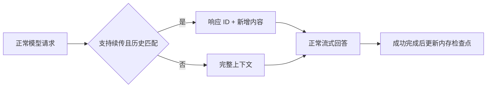

# DSH Response ID Reuse

[English](README_EN.md) · [更新日志](CHANGELOG.md) · [贡献与维护](CONTRIBUTING.md) · [文档结构](docs/documentation.md)

[](https://github.com/gulagala001/dsh-response-id-reuse/releases)

为 DeepSeek Harness 自动复用 Responses 响应 ID。安装加载后默认开启；在支持的渠道上只发送新增上下文，减少重复传输历史图片和消息。纯后端运行，无前端、弹窗或额外测试消息。

## 行为

- 使用正常聊天回执保存 ID，按渠道地址、认证信息、模型、会话和请求参数隔离。
- 历史精确延长时发送 `previous_response_id` 与新增内容；编辑、压缩、分支或参数变化时发送完整上下文。
- 图片和客户端工具结果都保留；不修改生成上限、停止条件、工具执行或宿主重试策略。
- 只在服务端明确拒绝 ID／存储、尚未返回生成内容时，回退一次完整请求；随后暂存不兼容状态。网络错误、限流和已开始输出的流交给宿主处理。
- ID 及历史指纹仅保存在进程内的有界缓存；禁用、卸载或退出后清理。不会修改渠道地址、密钥和默认模型。
- 重复加载共享一份运行实例，最后一个启用实例卸载后恢复原生请求处理。

## 兼容范围

精确宿主：**DSH 0.2.1-rc.3**；Node **22.19 或更新版本**。

所有 Responses 渠道都能经过同一处理入口；没有可靠能力依据的渠道保持原样，不发送探测请求、不自动切换协议。

| 服务端 | 默认自动续传范围 | 依据 |
| --- | --- | --- |
| 百炼官方北京 `cn-beijing.maas.qianwenaiapi.com`，以及官方工作区 `*.maas.aliyuncs.com` | `qwen3.8-flash`、`qwen3.7-flash`、`deepseek-v4-flash-0731`、`deepseek-v4.1-flash-1017` | 官方 Responses 文档；1017 另有多图续传验证 |
| Command Code `api.commandcode.ai` | `deepseek/deepseek-v4.1-flash` | 真实多图续传验证 |
| 其他端点／模型 | 原样转发 | 不把返回 ID 或 HTTP 200 当作能力证明 |

检测不会产生额外模型调用；正常聊天仍按渠道计费。启用续传会发送 `store:true`，服务端依其规则保存上下文。显式 ZDR 请求保持原样。卸载无法撤回已发送请求或删除服务端历史。首字收益依赖模型、网络和上下文，不保证每次更快。

能力依据：[百炼 Responses](https://help.aliyun.com/zh/model-studio/qwen-api-via-openai-responses) · [Command Code Provider API](https://commandcode.ai/docs/provider)。后者的通用接口说明不等于所有模型均支持 ID 续传。

## 安装与卸载

在 **插件 → 添加插件** 粘贴固定安装包：

```text
https://github.com/gulagala001/dsh-response-id-reuse/releases/download/v0.1.0-dsh.0.2.1-rc.3/gulagala001-dsh-response-id-reuse-0.1.0-dsh.0.2.1-rc.3.tgz
```

安装并启用后默认生效；若宿主提示重启，待当前任务结束后按宿主流程重启。无需添加开关页面或逐个配置响应 ID。

Web／CLI 用户在对应 profile 执行：

```sh
dsh plugin --profile web add https://github.com/gulagala001/dsh-response-id-reuse/releases/download/v0.1.0-dsh.0.2.1-rc.3/gulagala001-dsh-response-id-reuse-0.1.0-dsh.0.2.1-rc.3.tgz
```

通过宿主插件管理器禁用或卸载即可撤销接管。下一次模型请求使用其余插件与宿主原有逻辑，已有会话保留。安装包仅发布为 GitHub Release 工件；本版本未发布到 npm registry。

[SHA256SUMS](https://github.com/gulagala001/dsh-response-id-reuse/releases/download/v0.1.0-dsh.0.2.1-rc.3/SHA256SUMS) · [发行说明](CHANGELOG.md)

## 工作过程



## 开发

```sh
npm ci --ignore-scripts
npm test
npm pack
```

测试使用合成请求与受控响应，不调用在线模型。许可：[MIT](LICENSE)。
