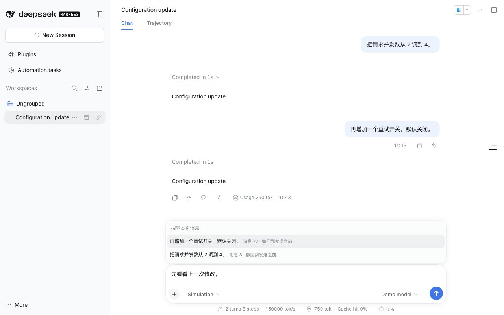

<a name="readme-top"></a>

<h1 align="center">DSH Rewind</h1>

<p align="center"><strong>把对话和 AI 改过的文件一起退回到某条消息之前，退错了还能撤销。</strong><br>DeepSeek Harness 插件</p>

<p align="center"><strong>简体中文</strong> · <a href="README_EN.md">English</a></p>

<p align="center">
  <a href="https://github.com/gulagala001/dsh-undo-plugin/releases/tag/v0.1.15-dsh.0.2.2-rc.3"></a>
  <a href="https://github.com/gulagala001/dsh-undo-plugin/releases"></a>
  <a href="#readme-install"></a>
  <a href="https://github.com/gulagala001/dsh-undo-plugin/stargazers"></a>
</p>

<p align="center"><a href="#readme-install"><strong>开始使用</strong></a> · <a href="docs/usage.zh.md">完整用法</a> · <a href="https://github.com/gulagala001/dsh-undo-plugin/issues">反馈</a></p>

<p align="center"><a href="docs/images/rewind.jpg"></a></p>

<a name="readme-install"></a>

## 快速开始

**需要：** DSH **0.2.2-rc.3**，Node.js **24.9.0+**。

### 1. 安装

在 DSH 里打开 **插件 → ＋ 添加插件**，粘贴：

```text
https://github.com/gulagala001/dsh-undo-plugin/releases/download/v0.1.15-dsh.0.2.2-rc.3/gulagala001-dsh-undo-plugin-0.1.15-dsh.0.2.2-rc.3.tgz
```

等手头的任务跑完，按提示启用或重启 DSH，原来的设置和会话都还在。命令行安装、升级和卸载见[安装指南](docs/install.md)，校验文件：[SHA256SUMS](https://github.com/gulagala001/dsh-undo-plugin/releases/download/v0.1.15-dsh.0.2.2-rc.3/SHA256SUMS)。

### 2. 先试一件事

找一个没在运行的会话，连按两次 **Esc**，或输入 `/rewind`。

输入框上方会列出可以退回的消息。选一条后会先弹出确认框，告诉你哪些文件会被恢复，确认后才动手。

## 怎么用

点你发过的某条消息旁边的撤回箭头（在复制按钮旁），看一眼确认框里列出的文件，确认。这条消息和之后的对话会被撤回，原来的文字和附件回到输入框里，方便你改完再发。

退多了，点 **撤销撤回** 或输入 `/undo`，对话和文件都会回到撤回之前。

- 不用手动存档：插件在 AI 每次调用工具前后自动记录文件变化。
- 恢复前会检查文件在这期间有没有被别人改过，有冲突就保留文件，对话仍能撤回。
- 正在生成回复时双击 Esc 还是 DSH 原来的"停止"，停下后再双击才打开回退列表。

## 能退回什么

| 情况 | 结果 |
| --- | --- |
| 安装插件之后的消息 | 对话和记录到的文件一起退回 |
| 安装之前的消息，或备份已过期 | 只退回对话，确认框会标"仅对话" |
| 文件在 DSH 之外被改过 | 保留文件，继续撤回对话 |
| 数据库、远程服务器、后台进程的改动 | 不在恢复范围内 |

备份保留多久、占多少空间，见[使用指南](docs/usage.zh.md#存储)。

## 常见问题

<details>
<summary>为什么有的消息只能退回对话？</summary>

那条消息早于插件安装，或者对应的文件备份已经过期清理。确认框会写明这次能恢复什么。

</details>

<details>
<summary>撤回之后还能回到刚才的状态吗？</summary>

能。点 **撤销撤回** 或输入 `/undo`，先看一眼确认框和冲突提示再确认。撤销针对的是最近一次撤回。如果撤回后又发了新消息，要先撤回这条新消息，再撤销之前那次。

</details>

## 开发和许可

安装包名是 `@gulagala001/dsh-undo-plugin`，只从本仓库的 Release 下载。开发命令和存储说明见[使用指南](docs/usage.zh.md)。代码用 [MIT](LICENSE) 许可，来源和署名见 [THIRD_PARTY_NOTICES.md](THIRD_PARTY_NOTICES.md)。

反馈问题请写明 DSH 和插件版本、操作步骤、期望和实际结果，日志和截图先去掉个人信息：[Issues](https://github.com/gulagala001/dsh-undo-plugin/issues)。
