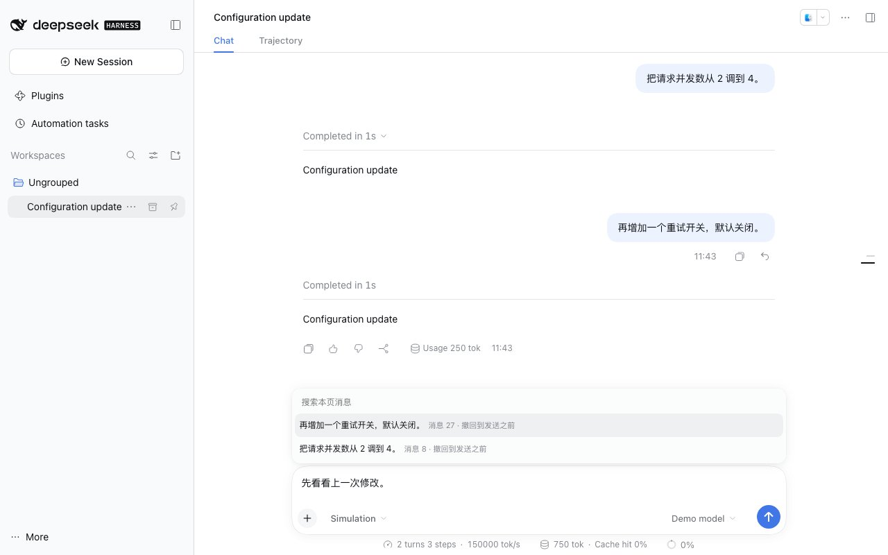

<a name="readme-top"></a>

<h1 align="center">DSH Rewind</h1>

<p align="center"><strong>Rewind conversations and recorded files, with undo.</strong><br>DeepSeek Harness plugin</p>

<p align="center"><a href="README.md">简体中文</a> · <strong>English</strong></p>

<p align="center">
  <a href="https://github.com/gulagala001/dsh-undo-plugin/releases/tag/v0.1.1-dsh.0.2.1-rc.2"></a>
  <a href="https://github.com/gulagala001/dsh-undo-plugin/releases"></a>
  <a href="#readme-install"></a>
  <a href="https://github.com/gulagala001/dsh-undo-plugin/stargazers"></a>
</p>

<p align="center"><a href="#readme-install"><strong>Get started</strong></a> · <a href="docs/usage.md">Docs</a> · <a href="https://github.com/gulagala001/dsh-undo-plugin/issues">Report an issue</a></p>

<p align="center"><a href="docs/images/rewind.jpg"></a></p>

<a name="readme-install"></a>

## Quick start

**Required environment：** DSH **0.2.1-rc.2**, Node.js **22.19+**.

File restoration only covers retained checkpoints. Older messages may support conversation-only rewind. External changes are checked before restoration; double Esc during generation retains the host Stop behavior.

### 1. Install

Open **Plugins → Add plugin** in the DSH instance you use, then paste:

```text
https://github.com/gulagala001/dsh-undo-plugin/releases/download/v0.1.1-dsh.0.2.1-rc.2/gulagala001-dsh-undo-plugin-0.1.1-dsh.0.2.1-rc.2.tgz
```

Wait for active tasks to finish, then follow the host’s activation/restart prompt. Keep your existing profile and data. See the [installation guide](docs/install_EN.md) · [SHA256SUMS](https://github.com/gulagala001/dsh-undo-plugin/releases/download/v0.1.1-dsh.0.2.1-rc.2/SHA256SUMS).

### 2. Try this first

In an idle test conversation, enter `/rewind` or press **Esc twice**.

**Success looks like：** A rewind list opens above the composer. Selecting an entry shows the affected scope and confirmation before any file restoration.

## Return to an earlier message

Click the rewind arrow beside a user message’s Copy button, inspect affected files and confirm. The conversation rewinds in place and restores text and attachments to the composer. Choose **Undo rewind** or enter `/undo` to restore the previous state.

- Checkpoints are recorded automatically; no manual save before every action is required.
- The confirmation shows actual file coverage and checks for external changes.
- Double Esc while idle or `/rewind` opens the native list; all restoration requires confirmation.

## Actual coverage

| Situation | Behavior |
| --- | --- |
| File checkpoints remain available | Restores recorded files and rewinds the conversation. |
| An older message has no file snapshot | Rewinds only the conversation, with the scope shown in confirmation. |
| Files changed externally | Checks conflicts before restoration rather than treating external edits as owned changes. |
| A response is running | Double Esc retains DSH’s native Stop behavior. |

See the [usage guide](docs/usage.md) for coverage, retention and automatic cleanup. This is not a complete snapshot of arbitrary system actions and cannot restore unrecorded external side effects.

## FAQ

<details>
<summary>Why can’t a message restore files?</summary>

It may predate installation or no longer have retained snapshots. Inspect the confirmation’s actual scope; without a snapshot, only the conversation rewinds.

</details>

<details>
<summary>Can I undo a rewind?</summary>

Use Undo rewind or `/undo` and review the confirmation and conflict notice. Undo applies to the last rewind record still retained by the plugin.

</details>

## Development and license

The package is `@gulagala001/dsh-undo-plugin`, distributed through fixed GitHub Releases. Development commands and storage behavior are in the [usage guide](docs/usage.md).

Licensed under [MIT](LICENSE). Sources and attribution are listed in [THIRD_PARTY_NOTICES.md](THIRD_PARTY_NOTICES.md).

## Documentation and support

| I want to | Where to go |
| --- | --- |
| Install, update or remove | [Installation guide](docs/install_EN.md) |
| Learn the features and limits | [Documentation](docs/usage.md) |
| Read release changes | [Releases](https://github.com/gulagala001/dsh-undo-plugin/releases) |
| Report a problem | [Issues](https://github.com/gulagala001/dsh-undo-plugin/issues) |

For a bug report, include the full DSH and plugin versions, the entry point, minimal reproduction steps, and expected versus actual behavior. Remove private data before sharing logs or screenshots.

<p align="center"><a href="#readme-top">Back to top</a> · <a href="https://github.com/gulagala001/dsh-undo-plugin/releases">Versions and downloads</a> · <a href="https://github.com/gulagala001/dsh-undo-plugin/issues">Feedback</a></p>

[Documentation structure and contributing](docs/documentation.md)
