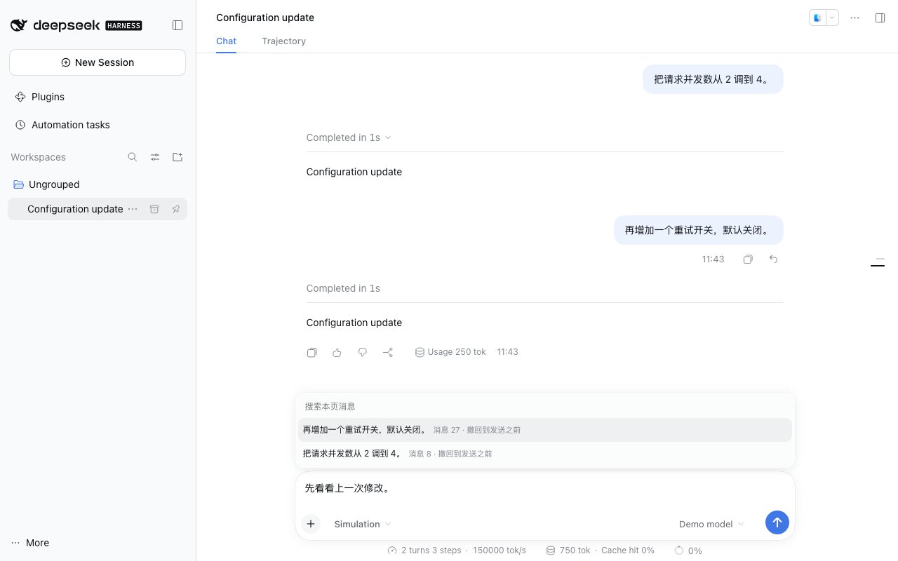

<a name="readme-top"></a>

<h1 align="center">DSH Rewind</h1>

<p align="center"><strong>Roll a conversation and the files the AI changed back to before any message, and undo the rollback if you change your mind.</strong><br>A DeepSeek Harness plugin</p>

<p align="center"><a href="README.md">简体中文</a> · <strong>English</strong></p>

<p align="center">
  <a href="https://github.com/gulagala001/dsh-undo-plugin/releases/tag/v0.1.12-dsh.0.2.2-rc.2"></a>
  <a href="https://github.com/gulagala001/dsh-undo-plugin/releases"></a>
  <a href="#readme-install"></a>
  <a href="https://github.com/gulagala001/dsh-undo-plugin/stargazers"></a>
</p>

<p align="center"><a href="#readme-install"><strong>Get started</strong></a> · <a href="docs/usage.md">Full usage</a> · <a href="https://github.com/gulagala001/dsh-undo-plugin/issues">Feedback</a></p>

<p align="center"><a href="docs/images/rewind.jpg"></a></p>

<a name="readme-install"></a>

## Quick start

**Requires:** DSH **0.2.2-rc.2** and Node.js **24.9.0+**.

### 1. Install

In DSH, open **Plugins → Add plugin** and paste:

```text
https://github.com/gulagala001/dsh-undo-plugin/releases/download/v0.1.12-dsh.0.2.2-rc.2/gulagala001-dsh-undo-plugin-0.1.12-dsh.0.2.2-rc.2.tgz
```

When your current task finishes, enable the plugin or restart DSH when prompted. Your settings and conversations stay as they were. For command-line installs, upgrades and removal, see the [installation guide](docs/install_EN.md). Checksums: [SHA256SUMS](https://github.com/gulagala001/dsh-undo-plugin/releases/download/v0.1.12-dsh.0.2.2-rc.2/SHA256SUMS).

### 2. Try it

In a conversation that is not running, press **Esc** twice or type `/rewind`.

A list of messages you can return to appears above the composer. Pick one and a confirmation dialog lists the files that will be restored. Nothing changes until you confirm.

## How to use it

Click the rewind arrow next to the copy button on one of your messages, check the files in the dialog, and confirm. That message and everything after it are removed, and its text and attachments go back into the composer so you can edit and resend.

Went too far? Click **Undo rewind** or type `/undo` to bring back the conversation and the files.

- No manual saves: the plugin records file changes before and after every AI tool call.
- Before restoring, it checks whether files changed in the meantime and stops to warn you about conflicts.
- While a reply is generating, double Esc still stops DSH as usual. Press it twice again afterwards to open the list.

## What it can restore

| Case | Result |
| --- | --- |
| Messages sent after the plugin was installed | The conversation and the recorded files roll back together |
| Older messages, or backups that have expired | Only the conversation rolls back; the dialog marks it "conversation only" |
| Files changed outside DSH | You get a conflict warning; nothing is overwritten |
| Databases, remote servers, background processes | Not covered |

For how long backups are kept and how much space they use, see the [usage guide](docs/usage.md#storage).

## FAQ

<details>
<summary>Why can some messages only roll back the conversation?</summary>

The message predates the plugin, or its file backup has expired. The dialog says what this rollback will restore.

</details>

<details>
<summary>Can I get back to where I was after a rewind?</summary>

Yes. Click **Undo rewind** or type `/undo`, check the dialog and any conflict warnings, then confirm. Undo applies to the most recent rewind. If you sent a new message after rewinding, rewind that message first, then undo the earlier one.

</details>

## Development and license

The package name is `@gulagala001/dsh-undo-plugin`. Download it only from this repository's releases. Development commands and storage details are in the [usage guide](docs/usage.md). Code is [MIT](LICENSE) licensed; sources and attributions are in [THIRD_PARTY_NOTICES.md](THIRD_PARTY_NOTICES.md).

When reporting a problem, include your DSH and plugin versions, the steps, and what you expected versus what happened. Remove personal data from logs and screenshots first: [Issues](https://github.com/gulagala001/dsh-undo-plugin/issues).
